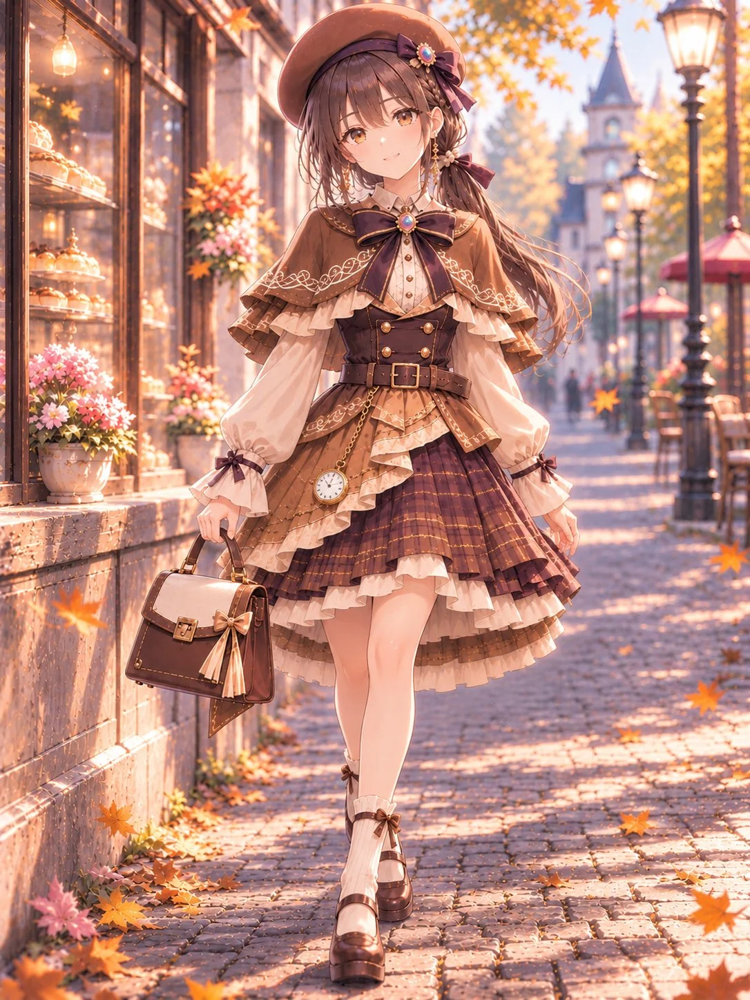

# Caramel Promenade Vintage Outfit for Your Character

**中文标题：** 「焦糖漫步」复古秋装角色换装  
**ID:** `gi25-x-1410` · **Mode:** `edit`  
**Categories:** `edit-change-preserve`, `character-consistency`  
**Tags:** `x-twitter`, `community`, `gpt-image-2.5`, `x-direct`, `en`



### Caramel Promenade Vintage Outfit for Your Character

```text
Dress the character in “Caramel Promenade,” an ornate vintage-inspired outfit in warm caramel, dark chocolate brown, cream, and brown plaid.

A short caramel capelet with delicate gold floral embroidery covers the shoulders, with layered brown plaid and cream ruffles beneath its scalloped edges. A large chocolate-brown chest bow, accented with caramel ribbons and an ornate oval gold brooch with a pale central gem, sits above a cream ruffled blouse with puffed sleeves and ribbon-trimmed cuffs.

The fitted dark brown double-breasted bodice features gold buttons and a brown belt with a rectangular gold buckle.

The above-knee skirt combines chocolate-and-caramel plaid pleats, asymmetrical caramel overskirt panels with embroidered edges, and multiple distinct layers of cream ruffles along the hem. Keep the skirt balanced and softly flared, without an elongated train.

At the back, a large caramel-and-chocolate waist bow has decorative ribbon tails that hang separately over the structured caramel overskirt panels. Plaid pleats and layered cream ruffles remain visible beneath these panels.

Complete the outfit with a caramel beret adorned with a layered ribbon and gold ornament, cream ribbed socks with ruffled cuffs, brown heeled Mary Jane shoes with small bows, a structured brown leather handbag, and a gold pocket watch with a decorative chain. Coordinated dangling gold earrings may be included if they do not replace the character’s signature earrings.

Preserve the distinct front and back structures, intricate fabric layering, coordinated ribbon details, and warm autumn palette. Avoid unrelated accessories or excessive additional decorations.

Adapt the clothing naturally to the character while preserving their original face, hairstyle, body proportions, and identity.
```

- **Recommended model:** `gpt-image-2.5-sunburst`
- **Settings:** _(defaults)_
- **Source:** [community](https://x.com/sayo_aym/status/2118092973565255895) — @sayo_aym
- **License note:** Original public X post; quoted with attribution — remix with attribution
- **Notes:** Collected directly from X; prompt posted as the author's own reply https://x.com/sayo_aym/status/2118092973565255895 to https://x.com/sayo_aym/status/2118092969442230568, which carries the images; GPT Image 2.5 is named in the reply; discovered via X search, prompt re-verified against the original X post via api.fxtwitter.com; verified=True; outfit prompt applied to an uploaded character image; author asks for credit via #小夜の衣装箱 and forbids redistributing the outfit design as one's own
- **Preview:** `previews/gi25-x-1410.webp`
