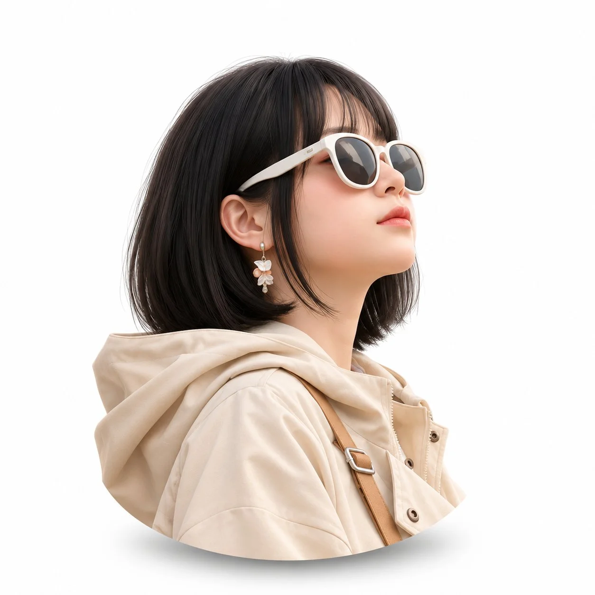

# Pixar-Style 3D Avatar from Your Photo

**中文标题：** 照片转皮克斯风3D头像  
**ID:** `gi25-x-1415` · **Mode:** `edit`  
**Categories:** `edit-change-preserve`, `character-consistency`  
**Tags:** `x-twitter`, `community`, `gpt-image-2.5`, `x-direct`, `en`



### Pixar-Style 3D Avatar from Your Photo

```text
Disney Pixar 3D avatar from reference photo. Preserve identity. Head & shoulders only. Small centered bust with generous white padding and a soft rounded lower edge and subtle soft shadow. White background, fair skin tones not warm or yellowish, soft studio lighting, perfect for WhatsApp profile, 1:1.
```

- **Recommended model:** `gpt-image-2.5-sunburst`
- **Settings:** _(defaults)_
- **Source:** [community](https://x.com/Ziha_ai/status/2118196482574868835) — @Ziha_ai
- **License note:** Original public X post; quoted with attribution — remix with attribution
- **Notes:** Collected directly from X; original post https://x.com/Ziha_ai/status/2118196482574868835; post text names GPT Image 2.5; discovered via X search, prompt re-verified against the original X post via api.fxtwitter.com; verified=True; needs an uploaded reference photo
- **Preview:** `previews/gi25-x-1415.webp`
