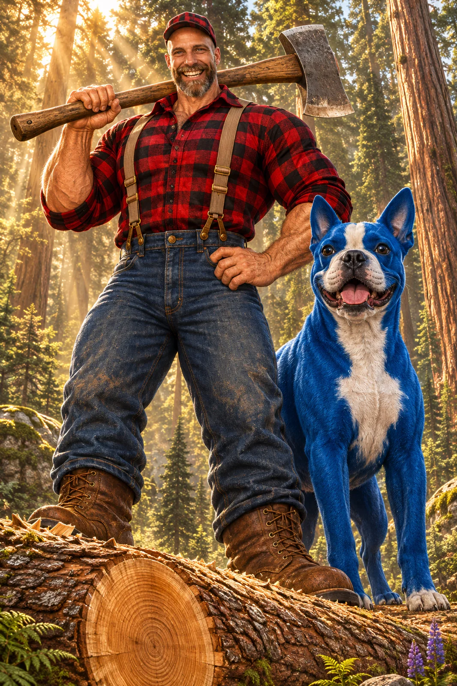

# Paul Bunyan Firewood-Day Pop-Culture Stand-In

**中文标题：** 伐木巨人保罗·班扬·劈柴日换脸  
**ID:** `gi25-x-1419` · **Mode:** `edit`  
**Categories:** `edit-change-preserve`, `character-consistency`  
**Tags:** `x-twitter`, `community`, `gpt-image-2.5`, `x-direct`, `en`



### Paul Bunyan Firewood-Day Pop-Culture Stand-In

```text
Using the uploaded reference image, transform the subject into a spectacular, larger-than-life, classic American folklore-inspired PAUL BUNYAN, the legendary giant lumberjack. Preserve the subject's recognizable facial features, identity, hairstyle, hair color, facial hair (if present), and distinctive characteristics. Adapt seamlessly to ANY person, character, avatar, or creature while maintaining their unmistakable identity.

CHARACTER: An enormous, legendary lumberjack with exaggerated heroic proportions, a massive muscular physique, broad shoulders, powerful arms, and an outrageously HUGE, gratifying, toothy grin radiating pride, accomplishment, and larger-than-life personality. Dress the subject in Paul Bunyan's iconic red-and-black buffalo plaid flannel shirt, rugged blue denim jeans with suspenders, oversized leather work boots, and a classic lumberjack cap. Include realistic fabric textures, weathered leather, authentic stitching, and rugged woodland details.

POSE & EXPRESSION: Standing triumphantly BEHIND an enormous freshly felled tree trunk, holding EXACTLY ONE gigantic, realistic lumberjack axe casually over ONE shoulder. The axe head and handle must be clearly visible and accurately proportioned. The subject faces directly toward the camera with a spectacularly enormous, gratifying grin, sparkling eyes, and an exaggerated expression of joyful accomplishment. Their stance is confident, heroic, playful, and unmistakably Paul Bunyan.

THE LEGENDARY BLUE COMPANION: Standing proudly beside the giant lumberjack is an equally gigantic [INSERT ANY ANIMAL OR PET HERE], reimagined as a whimsical, larger-than-life companion inspired by Babe the Blue Ox. Preserve the animal's natural anatomy, recognizable species characteristics, and distinctive features while transforming its ENTIRE BODY into a brilliant, rich, vibrant BLUE, including fur, feathers, scales, or skin as appropriate. The animal must remain unmistakably recognizable as the specified species, NOT automatically become an ox. Give it a charming, expressive personality, magnificent proportions, and a friendly, slightly comical expression. Both characters stand side by side, clearly visible, with matching legendary scale.

THE FELLED TREE: A colossal, freshly chopped tree lies horizontally across the foreground, directly IN FRONT of the lumberjack. Its enormous trunk features beautifully detailed bark, a massive freshly cut cross-section with realistic growth rings, scattered wood chips, and freshly exposed golden wood. The trunk emphasizes the impossible size and strength of the legendary lumberjack. The axe remains resting on the subject's shoulder, NOT embedded in the tree.

ENVIRONMENT: A breathtaking, lush American wilderness forest filled with towering ancient pine trees, majestic redwoods, vibrant green ferns, moss-covered boulders, wildflowers, and magnificent woodland scenery. Golden sunlight streams dramatically through the towering canopy, creating spectacular volumetric god rays, atmospheric mist, and beautiful cinematic depth. Tiny distant trees and natural environmental details emphasize the extraordinary gigantic scale of the characters.

#LaughingDawgS #ThursdayVibes

COMPOSITION: Epic, slightly low-angle, full-body cinematic portrait. The enormous lumberjack stands behind the felled tree, with the gigantic blue companion immediately beside them. Both characters face the camera. Keep their entire bodies, faces, feet, the complete axe, and the animal's distinctive anatomy clearly visible. The felled tree dominates the lower foreground without obscuring either character's face. Dramatic forced perspective creates a breathtaking sense of legendary scale.

STYLE: Hyperrealistic American folklore fantasy, whimsical exaggerated realism, spectacular Hollywood-blockbuster character design, charming storybook personality blended with extraordinary photorealistic detail. Rich natural colors, intricate textures, realistic anatomy, cinematic lighting, extraordinary visual clarity, and a playful, unforgettable larger-than-life atmosphere.

CRITICAL CONSTRAINTS: Preserve the uploaded subject's recognizable identity. EXACTLY ONE lumberjack, ONE axe, and ONE gigantic blue companion. The companion MUST remain the specified animal species and be completely blue. No extra limbs, duplicate characters, additional axes, distorted anatomy, or obstructed faces. No text, captions, logos, or watermarks.

TECHNICAL: 8K resolution, 2:3 vertical format, Octane render, ultra-detailed photorealistic materials, cinematic global illumination, volumetric lighting, razor-sharp subject focus, spectacular depth, premium color grading, masterpiece quality.
```

- **Recommended model:** `gpt-image-2.5-sunburst`
- **Settings:** _(defaults)_
- **Source:** [community](https://x.com/SethCritchley/status/2118325935489634559) — @SethCritchley
- **License note:** Original public X post; quoted with attribution — remix with attribution
- **Notes:** Collected directly from X; original post https://x.com/SethCritchley/status/2118325935489634559; post text names GPT Image 2.5; discovered via X search, prompt re-verified against the original X post via api.fxtwitter.com; verified=True; two-part prompt concatenated from the original post and the author's first reply; needs an uploaded reference image; fill-in [INSERT ANY ANIMAL OR PET HERE]; promo/referral footer after the prompt omitted
- **Preview:** `previews/gi25-x-1419.webp`
