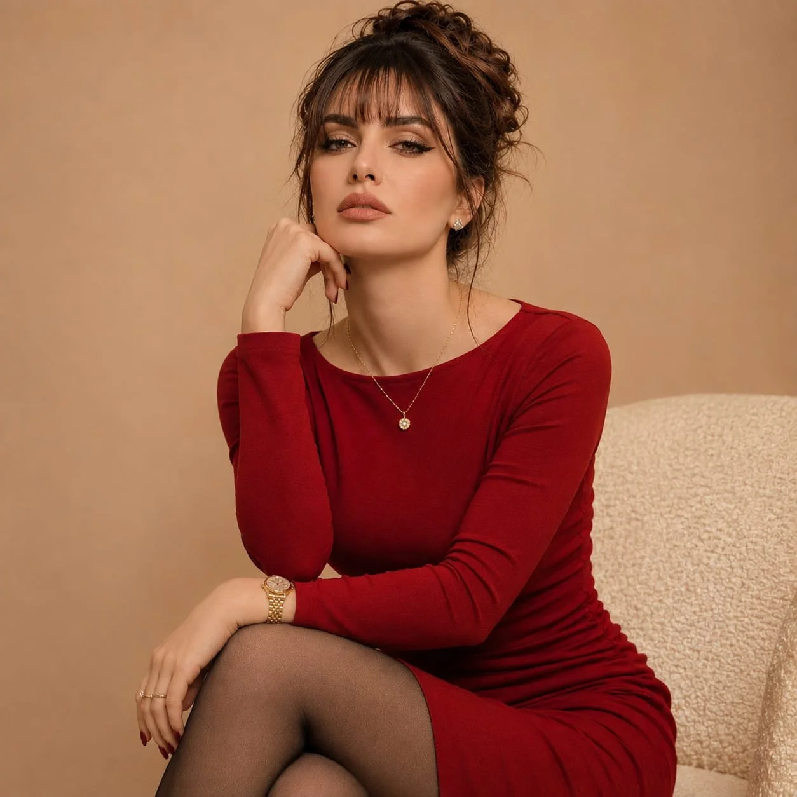

# Elegant Beige-Wall Editorial Portrait from Reference

**中文标题：** 米色墙面优雅编辑人像·参考脸  
**ID:** `gi25-x-1423` · **Mode:** `edit`  
**Categories:** `edit-change-preserve`, `character-consistency`  
**Tags:** `x-twitter`, `community`, `gpt-image-2.5`, `x-direct`, `en`



### Elegant Beige-Wall Editorial Portrait from Reference

```text
Use the uploaded reference photograph as the identity reference. Preserve the woman's original facial features, face shape, skin tone, eye color, and natural appearance accurately. Do not alter her identity.

Create an elegant, photorealistic indoor fashion portrait of the same woman, standing close to the camera in a relaxed, subtly leaning pose. Her hair is styled in a polished updo with straight, perfectly shaped fringe bangs framing her forehead.

She wears a sophisticated fitted scarlet-red mini dress featuring delicate spaghetti straps, a modest structured neckline, gentle gathering along the sides, and beautifully tailored fabric that follows her natural silhouette. The design should look refined and tasteful, with no visible cleavage. Complete the outfit with transparent black stockings and a fine gold pendant necklace.

Her makeup is understated yet glamorous, featuring elongated black winged eyeliner, softly defined lashes, naturally flushed cheeks, and muted rosy-nude lips.

Set the scene against a simple warm sand-beige interior wall. Capture her from approximately the waist up, with her shoulders slightly angled and her gaze directed confidently toward the camera.

Use soft, diffused warm lighting to create natural skin highlights and delicate shadows. Retain realistic skin pores, fine facial details, natural fabric textures, and authentic photographic depth.

Photography direction: Luxury fashion magazine editorial, sophisticated feminine styling, intimate portrait composition, warm neutral color grading, professional DSLR photography, 85mm portrait lens, shallow depth of field, ultra-realistic detail, naturally beautiful appearance.

Avoid artificial skin smoothing, exaggerated body proportions, excessive retouching, revealing styling, or any changes to the reference woman's identity.
```

- **Recommended model:** `gpt-image-2.5-sunburst`
- **Settings:** _(defaults)_
- **Source:** [community](https://x.com/mehvishs25/status/2118350715555090593) — @mehvishs25
- **License note:** Original public X post; quoted with attribution — remix with attribution
- **Notes:** Collected directly from X; original post https://x.com/mehvishs25/status/2118350715555090593; post text names GPT Image 2.5; discovered via X search, prompt re-verified against the original X post via api.fxtwitter.com; verified=True; needs an uploaded reference photograph
- **Preview:** `previews/gi25-x-1423.webp`
