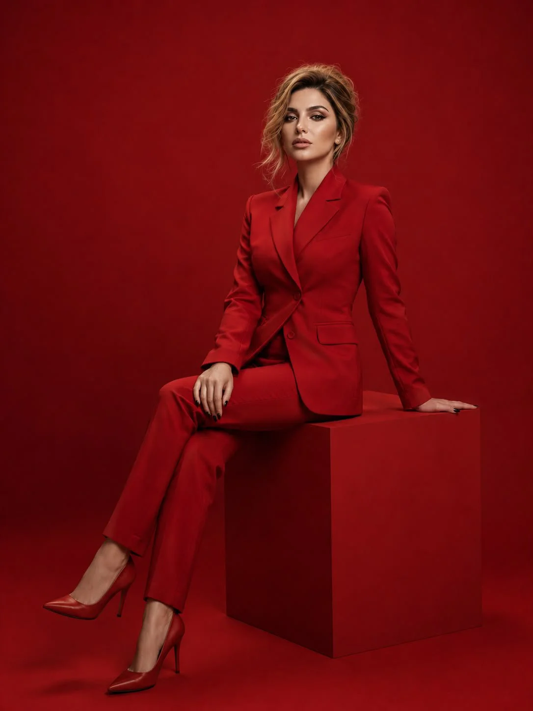

# Crimson Monochrome Luxury Fashion Campaign from Reference (3:4)

**中文标题：** 绯红单色奢华时尚大片·参考脸（3:4）  
**ID:** `gi25-x-1441` · **Mode:** `edit`  
**Categories:** `edit-change-preserve`, `character-consistency`  
**Tags:** `x-twitter`, `community`, `gpt-image-2.5`, `x-direct`, `en`



### Crimson Monochrome Luxury Fashion Campaign from Reference (3:4)

```text
Create a photorealistic luxury fashion campaign featuring the exact same woman from the uploaded reference image. Preserve her original facial identity, facial structure, skin tone, and recognizable features without alteration.

She has beautifully styled blonde hair in a polished, elegant updo with a few soft strands framing her face. She wears a striking crimson-red fitted blazer with a sculpted silhouette, matching high-waisted tailored trousers and elegant pointed-toe heels. Seated gracefully on a minimalist geometric red pedestal, she poses with one leg extended slightly forward and the other crossed, one hand resting casually on her thigh. Her expression is confident, composed, and effortlessly glamorous.

The setting is a monochromatic crimson studio with a seamless red backdrop and floor, subtle tonal variations, and dramatic softbox lighting that creates refined shadows. Luxury magazine editorial photography, sophisticated styling, rich color grading, realistic skin texture, intricate fabric details, sharp focus, full-body composition, vertical 3:4 portrait.

Negative Prompt: altered facial identity, different person, distorted anatomy, extra fingers, deformed hands, unnatural proportions, blurry face, artificial skin, text, logos, watermark, distracting background objects.
```

- **Recommended model:** `gpt-image-2.5-sunburst`
- **Settings:** _(defaults)_
- **Source:** [community](https://x.com/mehvishs25/status/2119445727273525375) — @mehvishs25
- **License note:** Original public X post; quoted with attribution — remix with attribution
- **Notes:** Collected directly from X; original post https://x.com/mehvishs25/status/2119445727273525375; post text names GPT Image 2.5; discovered via X search, prompt re-verified against the original X post via api.fxtwitter.com; verified=True; needs an uploaded reference image
- **Preview:** `previews/gi25-x-1441.webp`
