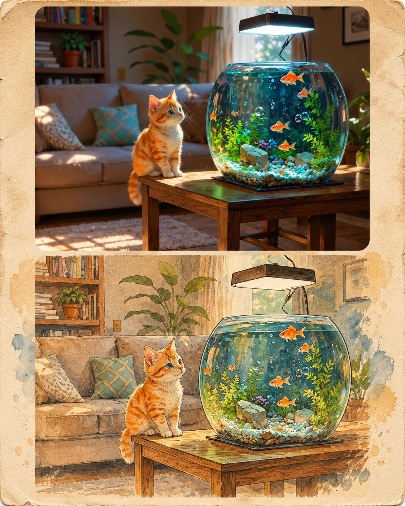

# Photo + Vintage Ink-Watercolor Illustration 2-Panel Collage (4:5)

**中文标题：** 原照+复古水墨淡彩插画上下双联（4:5）  
**ID:** `gi25-x-1452` · **Mode:** `edit`  
**Categories:** `edit-change-preserve`  
**Tags:** `x-twitter`, `community`, `gpt-image-2.5`, `x-direct`, `en`



### Photo + Vintage Ink-Watercolor Illustration 2-Panel Collage (4:5)

```text
Use the uploaded image as the sole visual reference. Automatically identify the subject, people, clothing, accessories, objects, environment, background, colors, composition, and overall visual details.

Create a premium 2-panel editorial collage with two vertically stacked sections:

TOP SECTION — ORIGINAL PHOTOGRAPH:
Reproduce the uploaded photograph in its original ultra-realistic photographic style. Preserve the subject's identity, facial features, expression, pose, clothing, hairstyle, accessories, objects, environment, lighting, camera angle, and composition. Do not introduce unrelated elements or change the original scene.

BOTTOM SECTION — HAND-DRAWN ILLUSTRATION:
Recreate the exact same photograph as a beautiful vintage hand-drawn editorial illustration. Preserve the same subject, facial appearance, pose, clothing, accessories, objects, background, perspective, and composition. Transform the visual style only, not the content.

ILLUSTRATION STYLE:
Traditional ink-and-watercolor aesthetics, delicate pencil outlines, expressive hand-drawn strokes, subtle watercolor washes, textured recycled paper, vintage print grain, muted earthy colors, and artistic imperfections. Add tasteful abstract painted brushstroke backgrounds that complement the original photograph's color palette.

COMPOSITION:
Arrange both versions in a clean, balanced editorial layout, with the original photograph on top and its illustrated counterpart directly underneath. Use refined panel separation, subtle rounded corners, and a sophisticated magazine-inspired aesthetic.

IMPORTANT:
Automatically adapt the prompt to ANY uploaded photograph, regardless of whether it contains a person, animal, vehicle, product, architecture, landscape, food, or any other subject. Never assume a specific subject or setting. Preserve every recognizable detail and maintain a clear one-to-one visual correspondence between the original photograph and its illustration.

The result should look like a premium vintage fashion and lifestyle magazine collage, combining photorealism with traditional hand-drawn artistry.

Aspect ratio: 4:5.
```

- **Recommended model:** `gpt-image-2.5-sunburst`
- **Settings:** _(defaults)_
- **Source:** [community](https://x.com/Goodmanprotocol/status/2119043014417141824) — @Goodmanprotocol
- **License note:** Original public X post; quoted with attribution — remix with attribution
- **Notes:** Collected directly from X; original post https://x.com/Goodmanprotocol/status/2119043014417141824; post text names GPT Image 2.5; discovered via X search, prompt re-verified against the original X post via api.fxtwitter.com; verified=True; universal template for any uploaded image
- **Preview:** `previews/gi25-x-1452.webp`
