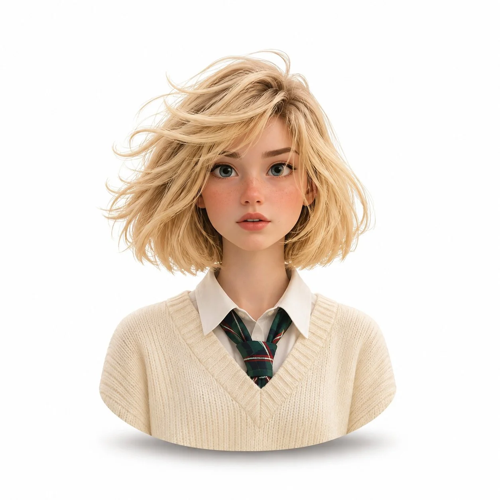

# Pixar-Style 3D Animated Bust Avatar — Animator's Brief (1:1)

**中文标题：** 皮克斯风3D动画半身头像·动画师简报（1:1）  
**ID:** `gi25-x-1455` · **Mode:** `edit`  
**Categories:** `edit-change-preserve`, `character-consistency`  
**Tags:** `x-twitter`, `community`, `gpt-image-2.5`, `x-direct`, `en`



### Pixar-Style 3D Animated Bust Avatar — Animator's Brief (1:1)

```text
Professional 3D Animated Character Portrait | Animator's Brief

Using the uploaded reference photo, create a premium-quality 3D animated character portrait of me, inspired by the expressive charm and polished visual storytelling of Pixar-style character design.

Character Design: Transform me into a beautifully stylized 3D animated version while preserving my distinctive facial features, face shape, hairstyle, skin tone, and recognizable identity. The character should look instantly recognizable to anyone familiar with the original photo. Maintain natural facial proportions while adding subtle animated charm, expressive eyes, and refined details.

Composition: Create a head-and-shoulders bust portrait only, positioned precisely in the center of the canvas. Keep the character relatively small, surrounded by generous, clean negative space on all sides. Use a pure, seamless white background with no additional objects or decorations.

Rendering & Lighting: Use high-quality 3D character rendering, smooth yet realistic skin shading, detailed hair, refined facial textures, and soft studio lighting. Keep the skin tone fair and neutral, with accurate natural undertones. Avoid excessive warmth, golden hues, orange casts, or yellowish skin tones.

Finishing Details: Give the bottom of the bust a smooth, softly rounded sculptural edge, with a subtle natural shadow directly beneath it to create a gentle floating effect. Maintain clean contours and beautifully polished 3D surfaces.

Overall Aesthetic: Premium animated movie character quality, playful yet sophisticated, friendly facial expression, appealing character proportions, cinematic 3D craftsmanship, and professional studio presentation.

Technical Requirements:

- Aspect ratio: 1:1 (square)
- Background: Pure white (#FFFFFF)
- Framing: Head and shoulders only
- Placement: Precisely centered
- Lighting: Soft, balanced studio lighting
- Output: High-resolution, crisp and polished
- Intended use: WhatsApp profile picture

Important: Identity preservation is the highest priority. Do not change my recognizable facial characteristics or invent a different person. The final result should feel like me reimagined as a high-end animated movie character.
```

- **Recommended model:** `gpt-image-2.5-sunburst`
- **Settings:** _(defaults)_
- **Source:** [community](https://x.com/harboriis/status/2118976038911000898) — @harboriis
- **License note:** Original public X post; quoted with attribution — remix with attribution
- **Notes:** Collected directly from X; original post https://x.com/harboriis/status/2118976038911000898; post text names GPT Image 2.5; discovered via X search, prompt re-verified against the original X post via api.fxtwitter.com; verified=True; needs an uploaded reference photo
- **Preview:** `previews/gi25-x-1455.webp`
