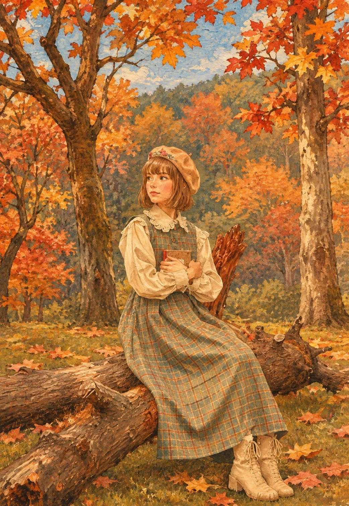

# Photo to Vintage Gouache Storybook Illustration

**中文标题：** 照片转复古水粉绘本插画  
**ID:** `gi25-x-1470` · **Mode:** `edit`  
**Categories:** `edit-change-preserve`  
**Tags:** `x-twitter`, `community`, `gpt-image-2.5`, `x-direct`, `en`



### Photo to Vintage Gouache Storybook Illustration

```text
Transform the uploaded photo into a beautiful hand-painted storybook illustration with a charming vintage children's book aesthetic.

Art Style: Traditional gouache and watercolor painting, visible paper grain, soft brushstrokes, subtle canvas texture, warm earthy colors, delicate hand-drawn outlines, and rich painterly details.

Character: Preserve the original subject's identity, facial features, hairstyle, clothing, pose, and distinctive details while translating everything into a charming illustrated form. Use expressive eyes, soft facial features, and naturally flowing shapes.

Environment: Recreate the original surroundings as a beautifully illustrated storybook setting, adding intricate environmental details, organic textures, and a dreamy atmosphere.

Color Palette: Warm autumn oranges, golden yellows, burnt reds, earthy browns, muted beige, and soft sky blues. Maintain rich but harmonious colors.

Lighting & Mood: Soft natural daylight, warm nostalgic atmosphere, whimsical storytelling feeling, cozy and magical visual appeal.

Final Look: A richly detailed, full-frame traditional children's storybook illustration, resembling a hand-painted vintage picture book. Absolutely no photorealism, 3D rendering, digital glossy effects, or artificial AI appearance.
```

- **Recommended model:** `gpt-image-2.5-sunburst`
- **Settings:** _(defaults)_
- **Source:** [community](https://x.com/Ziha_ai/status/2118667980594872355) — @Ziha_ai
- **License note:** Original public X post; quoted with attribution — remix with attribution
- **Notes:** Collected directly from X; original post https://x.com/Ziha_ai/status/2118667980594872355; post text names GPT Image 2.5; discovered via Bin0754/gpt-image-gallery index, prompt re-verified against the original X post via api.fxtwitter.com; verified=True; needs an uploaded photo
- **Preview:** `previews/gi25-x-1470.webp`
