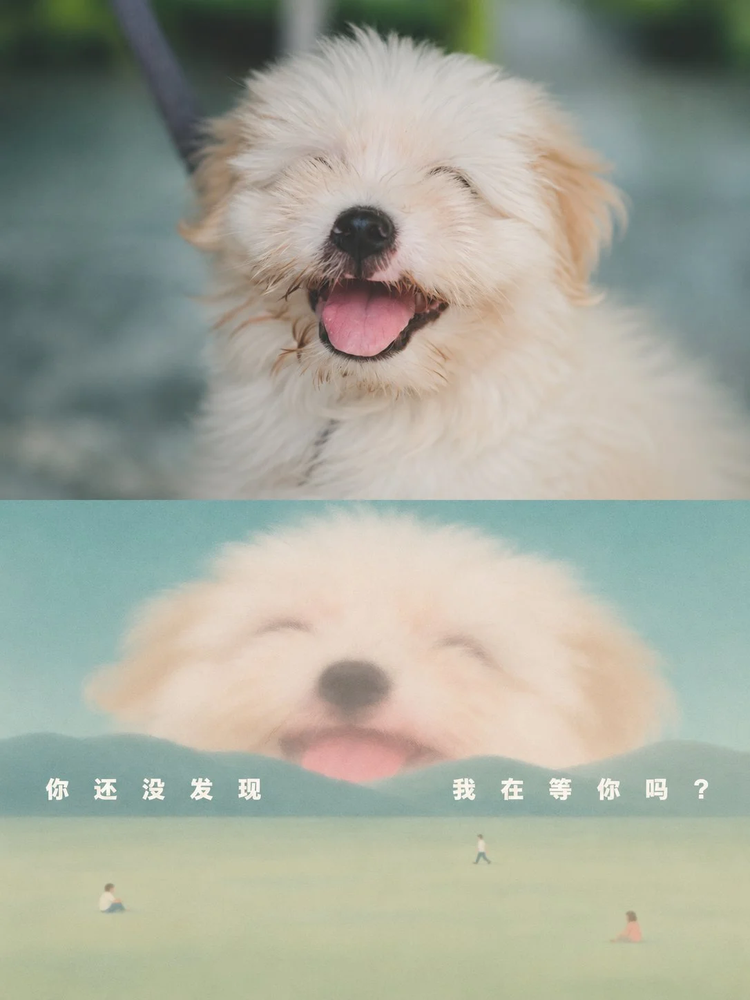

# Photo + 'Giant Peeking over the Horizon' Folded Poster (3:4)

**中文标题：** 原照+「地平线后的巨人」对折海报（3:4）  
**ID:** `gi25-x-1472` · **Mode:** `edit`  
**Categories:** `edit-change-preserve`, `poster-typography`  
**Tags:** `x-twitter`, `community`, `gpt-image-2.5`, `x-direct`, `en`



### Photo + 'Giant Peeking over the Horizon' Folded Poster (3:4)

```text
Turn each photo I upload into its own premium design poster: no multi-image collage, one output per photo. Use a 3:4 vertical format folded like a card into a top half and a bottom half of the same height, the fold falling exactly on the horizontal centre line of the frame; the fold itself is not drawn.

The top half keeps the original photo, preserving the subject's identity, structure, pose, real texture, natural light and original colour mood, with only a light refined grade so it reads like an art magazine, independent publication or exhibition image. To fit the frame, the surrounding background may be extended naturally, but the subject must never be stretched, distorted or altered; crop the photo as a full shot, leaving headroom above the subject so its top is never cut off. Add no text of any kind to the top half; all lettering belongs to the bottom half. Shop signs, brand marks and printed lettering already in the photo stay in the original photo above; the bottom half never copies them.

The bottom half extracts only the photo's most recognisable **subject, contour, structure, pose and narrative relationship**, rebuilt as a **Giant Peeking over the Horizon**. Do not copy the whole photo; enlarge the subject to an impossible size, hide it behind the distant horizon so only the top of its head and the upper half of its face show, and leave only a few tiny people in the foreground, so the link to the photo above is read at a glance. **The subject must be large enough to dwarf the far hills, rising from behind the horizon with its upper body or upper face showing and its body cut off by the horizon; scattered across the broad foreground plane are a few rice-grain-small people going about their business, unaware of the gaze behind them, with a broad empty plane between the two.**

The bottom half needs a fresh artistic judgement. Even if the original is badly composed, cluttered or has a tiny subject, rescue it through **enlarging the subject, removing surroundings and simplifying**; however detailed the subject, first gather it into a few rounded recognisable large shapes, its eyes only dark ovals inside white rings. When the photo is itself a scene, take only its single most representative element to enlarge into the giant and leave the rest undrawn.

The form centres on **flat masses with soft, hazy edges**: no form has an outline, colour melting slowly outward at the rims as if seen through a thin mist. People, animals, buildings and objects all gather into rounded large masses, their expression somewhere between curiosity and worry.

The material is **clean, flat soft-edged colour masses**: the melting happens only where forms meet, the inside of each mass even.

The composition uses **a huge subject + a full spread of horizontal colour bands**: a narrow strip of sky at the top, a silhouette of far hills below, and below that a plane filling most of the picture. The visible part of the subject sits upper-centre with a little headroom, and nothing touches the central fold. Better an emptier foreground than more things added to the plane.

Take the most emotional colours from the photo above and mix them into **one hue family filling the whole picture and one face of the opposite temperature**: the family stretches its values from the palest plane to the deepest hills, the subject's face takes one soft colour of the opposite temperature as the only contrast, and the sky takes a brighter colour on the face's side to answer it. Avoid several hues side by side.

Text is only a minimal editorial intervention, in any language, with no fixed preset title. Distil a short title from this photo's subject, action, mood or metaphor, written as **the giant's inner voice at this moment**, only this one line, with no numbering, rules or small labels; the type is small, much smaller than the subject, in **heavy white sans-serif** set over the far hills, justified wide so the words open into gaps of uneven size, its colour the palest light in the picture, its tone quiet with a hint of question; any Chinese is always in simplified characters. The line must add to the picture: say one thing the picture cannot show that belongs only to this photo; the title does not name the things in the picture and writes no clichés or musings.

The whole reads like a poetic poster by an independent illustrator: horizontal colour bands, a soft-edged giant, rice-grain people and a white phrase together make it quiet, soft and quietly unsettling.

Avoid a full scene copy and template-poster feel, avoid a subject the same size as the people or a giant standing whole in the picture, and avoid edges drawn as crisp outlines and a foreground crowded with people and things.
```

- **Recommended model:** `gpt-image-2.5-sunburst`
- **Settings:** _(defaults)_
- **Source:** [community](https://x.com/xiaoxiaodong/status/2118268096079376683) — @xiaoxiaodong
- **License note:** Original public X post; quoted with attribution — remix with attribution
- **Notes:** Collected directly from X; original post https://x.com/xiaoxiaodong/status/2118268096079376683; post text names GPT Image 2.5; discovered via Bin0754/gpt-image-gallery index, prompt re-verified against the original X post via api.fxtwitter.com; verified=True; one poster per uploaded photo; prompt drafted by the author with Opus 5.5 for GPT-image2.5
- **Preview:** `previews/gi25-x-1472.webp`
