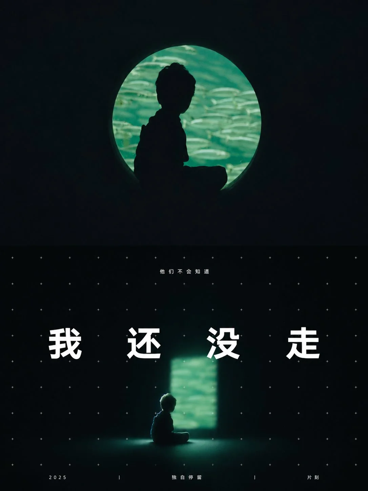

# Photo + 'The Only Light in a Dark Room' Folded Poster (3:4)

**中文标题：** 原照+「暗室里唯一的一块光」对折海报（3:4）  
**ID:** `gi25-x-1497` · **Mode:** `edit`  
**Categories:** `edit-change-preserve`, `poster-typography`  
**Tags:** `x-twitter`, `community`, `gpt-image-2.5`, `x-direct`, `zh`



### Photo + 'The Only Light in a Dark Room' Folded Poster (3:4)

```text
请将我上传的每一张照片分别制作成一张独立的高级设计海报，不多图拼接，每张照片单独输出。整体采用3:4竖版构图，上下两半像对折的卡片，折痕正好落在画面正中的水平中线上，两半一样高，折痕本身不画出来。

上半部分保留原始照片，保持主体身份、结构、姿态、真实质感、自然光影和原有色彩氛围，仅进行轻微高级调色，使其具有艺术杂志、独立出版物与展览图像质感。为适配画幅，可自然扩展环境背景，但不得拉伸、扭曲或改变主体；照片按全景裁，主体头上留天，不裁到顶部。上半部分不添加任何文字，所有文字只出现在下半部分。照片里原有的招牌、品牌标志和印刷文字只留在上方原照里，下半部分不照搬。

下半部分只提取照片中最具识别性的**主体、轮廓、结构、姿态与叙事关系**，重构为**暗室里唯一的一块光（The Only Light in a Dark Room）**。不要完整复制照片，使人一眼识别它与上方照片之间的对应关系。**必须让画面几乎全黑，只有一块边缘柔和、自己发光的长方形是光源；主体很小，低低地待在光的前方，朝光的一侧被照得发亮，背光一侧沉进黑里，轮廓微微分出一冷一暖的色边；一张等距排开的极小白色十字网格铺满整个画面。**

下半部分需重新做美术判断。哪怕原图构图差、背景乱、主体小，也要通过**压暗、缩小与删环境**把它救成一张成立的作品；主体保留照片里认得出的轮廓和姿态，只占画面中下部一小块，四周大片黑暗；照片里最亮的那一处光收成这块长方形。照片本身是场景时，只取最有代表性的一个单体留在光前，其余沉进黑里。

造型以**一个人独自面对一块光，却被冷静的网格和一个大词注视着**为核心：光和主体都略带柔焦，像一张没对准焦的快照，只有字和网格清楚锐利；地面上留一层被光扫到的冷色微光。人物、动物、建筑和器物都同样被这块光单侧照亮。

材质为**洁净的深黑、柔焦的光与锐利的白色细符号**。

构图采用**极小视觉岛 + 大面积纯净留白**：光和主体在中部偏一侧，其余全是黑。主体完整，头顶留一点空，任何部分都不碰到中间的折痕。宁可主体再小一点，也不要把画面照亮。

配色从上方照片中提取最冷、最寂静的那种饱和色，调制成**几乎全黑、一块饱和冷光和近白的受光边**：冷光只在那块长方形和它晕开的一圈里，字和网格是白色。避免第二处光源和暖色铺开。

文字只作极少量编辑性介入，不限制语种，不预设固定标题。从这张照片的主体、动作、情绪或隐喻里提炼一个简短标题，写成**主角此刻的一句心声**，只是一个短词，另配顶部一行极小的白色短句和底部一行三段小字（年份每张另起）；提炼一个说出照片隐喻、不念东西名字的最短的词，放大成画面主角，横跨画面中部，两侧留出空白、不碰到边，字距拉得很开，只遮住主体的一部分，不替掉任何一个整字或字母，整个词仍然认得出来；用**白色粗体无衬线字**，字色取画面里最亮的白，语气冷；中文一律用简体。这句话要给画面加分：说出画里看不见、只属于这张照片的一件事，标题不念画里东西的名字，不写套话和感悟。

整体像一张电子音乐或独立电影的概念海报：暗室、一块冷光和十字网格共同构成安静疏离、带着被凝视的不安。

避免完整场景复刻、模板化海报感，避免画面被照亮、主体画大或正对镜头。
```

- **Recommended model:** `gpt-image-2.5-sunburst`
- **Settings:** _(defaults)_
- **Source:** [community](https://x.com/xiaoxiaodong/status/2118329366430257591) — @xiaoxiaodong
- **License note:** Original public X post; quoted with attribution — remix with attribution
- **Notes:** Collected directly from X; original post https://x.com/xiaoxiaodong/status/2118329366430257591; post text names GPT Image 2.5; discovered via Bin0754/gpt-image-gallery index, prompt re-verified against the original X post via api.fxtwitter.com; verified=True; one poster per uploaded photo; the author credits Opus 5.5 + GPT-image2.5
- **Preview:** `previews/gi25-x-1497.webp`
