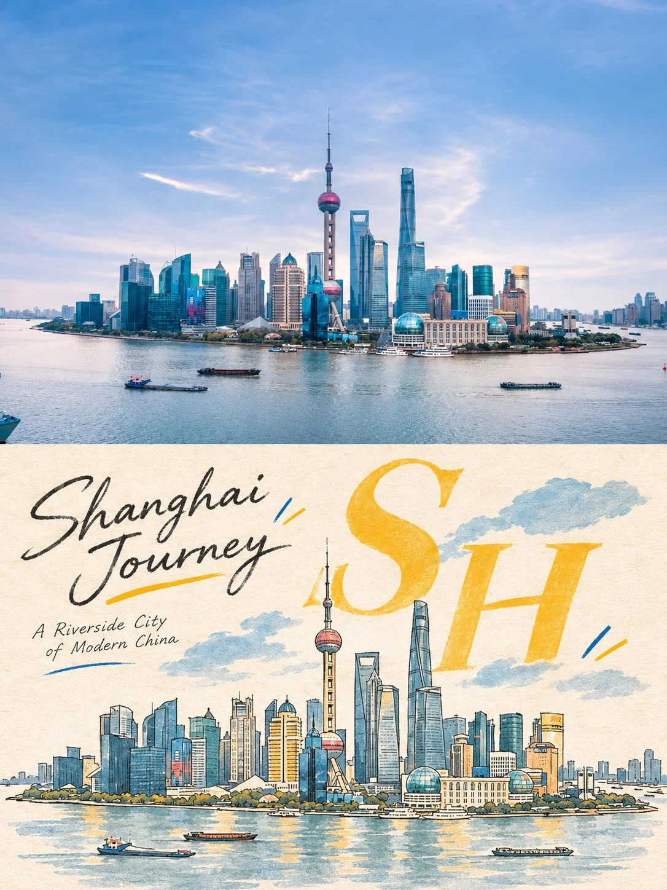

# Photo-to-Hand-Drawn Diptych Poster with Yellow Letters (3:4)

**中文标题：** 照片上下双联手绘海报：原照+日系复古插画（3:4）  
**ID:** `gi25-x-1549` · **Mode:** `edit`  
**Categories:** `edit-change-preserve`, `character-consistency`, `poster-typography`  
**Tags:** `x-twitter`, `community`, `gpt-image-2.5`, `x-direct`, `zh`



### Photo-to-Hand-Drawn Diptych Poster with Yellow Letters (3:4)

```text
将上传照片制作成3:4竖版上下双联艺术海报，上下严格各占50%。

上半部分完整保留原始照片，禁止重新绘制、修改人物、改变服装、改变动作或改变背景。

下半部分必须是上半部分同一场景的手绘插画版本。

【人物一致性】
严格保留原照片人物的面部轮廓、五官比例、发型、发色、表情、身体姿态和服装款式。允许将真实摄影转化为手绘线条和色块，但不得重新设计人物。

【插画风格】
日系复古极简手绘，粗细自然变化的炭黑色轮廓线，带有不完美的手绘笔触。局部使用淡彩水彩和复古平涂。

【色彩】
以原照片的主色调为基础，搭配芥末黄、复古蓝、炭黑色和奶油白。加入大型黄色英文字母，人物与字母自然穿插。

【背景】
奶油白粗纹纸质感，细腻印刷颗粒，大面积留白。

【排版】
根据原照片内容自动生成简短英文标题和副标题。文字采用自然手写字体，搭配少量蓝色、黄色装饰线条。每张图片独立设计，不要机械复制固定版式。

【最终要求】
上下两部分必须是同一人物、同一动作、同一场景。插画必须一眼能看出是原照片的艺术化重绘，而不是另一个相似的人。

禁止3D、动漫、光滑矢量、过度卡通化、人物变脸、服装改变、额外人物和无关装饰。
```

- **Recommended model:** `gpt-image-2.5-sunburst`
- **Settings:** _(defaults)_
- **Source:** [community](https://x.com/kuibenge/status/2122204768940806272) — @kuibenge
- **License note:** Original public X post; quoted with attribution — remix with attribution
- **Notes:** Collected directly from X; original post https://x.com/kuibenge/status/2122204768940806272; post text names GPT Image 2.5; discovered via X search, prompt re-verified against the original X post via api.fxtwitter.com; verified=True; needs an uploaded photo; post names GPT Image 2.5 without a variant
- **Preview:** `previews/gi25-x-1549.webp`
