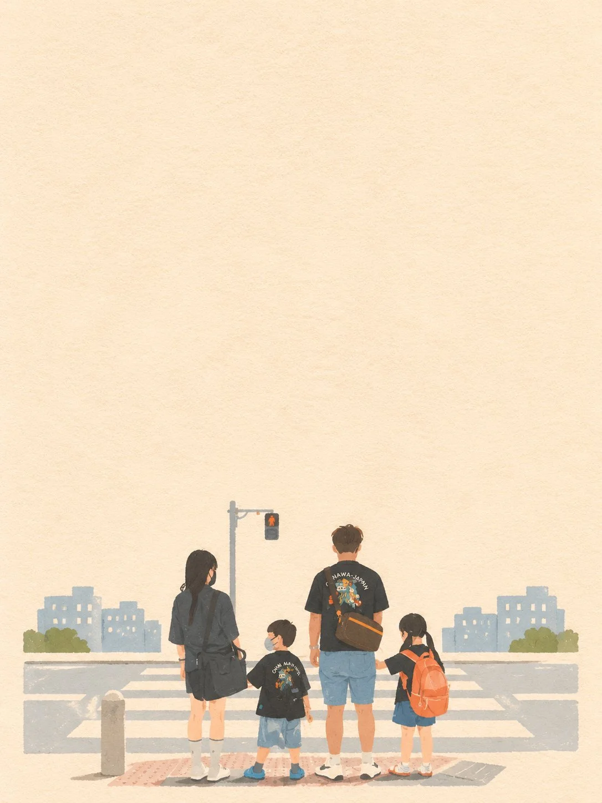

# Photo to Minimal Hand-Painted Paper-Texture Art Cover

**中文标题：** 照片转极简手绘纸质纹理艺术封面  
**ID:** `gi25-x-1550` · **Mode:** `edit`  
**Categories:** `edit-change-preserve`, `general`  
**Tags:** `x-twitter`, `community`, `gpt-image-2.5`, `x-direct`, `zh`



### Photo to Minimal Hand-Painted Paper-Texture Art Cover

```text
将上传的照片转化为极简、手绘、纸质纹理的艺术封面。

构图

- 主体仅占据画面的 10–20%。
- 将主体置于构图的底部中心附近。
- 在整幅图像中留出大量的留白空间。
- 仅用几条线条或小块颜色来暗示环境。

保留

- 原始主体最易辨识的特征。
- 基本的轮廓和比例。
- 原始姿势或主要动作。
- 重要物体和定义性细节。
- 核心故事、关系以及情感氛围。

配色方案

- 从原始照片中提取主导色调。
- 配色限制在不超过四种主要颜色。
- 使用大胆却克制的平面色块。
- 保持和谐、柔和的色彩组合。
- 添加细微的纸张纹理和手工笔触纹理。

简化
移除不必要的细节和视觉杂乱。只保留使主体瞬间可辨识的基本视觉信息。

排版

- 可选地融入少量简洁文本。
- 保持排版简短、细腻且美学精炼。
- 将文本自然融入构图中。
- 目标是艺术书籍封面、独立出版、现代编辑设计或沉思性绘本的视觉语言。
- 如果排版无法改善构图，则不要强行添加。

风格与材质

- 精致、略带瑕疵的手绘线条。
- 几块清晰定义的类似丙烯颜料的平面色块。
- 粗糙、触感强烈的纸质纹理。
- 可见的手工笔触痕迹。
- 有机、不规则、自然的轮廓。
- 细微的不完美之处，让作品感觉真正手工制作。

整体氛围
宁静、诗意、精致、极简、天真、放松、艺术化、沉思、独特且高端。

避免

- 彩铅渲染。
- 干笔效果。
- 水彩晕染或渗色。
- 纯线稿插图。
- 过于详细或写实的插图。
- 厚重 impasto 或浓稠油画纹理。
- 平滑、精致的数字插图。
- 3D 渲染、光泽表面或人工光照效果。
- 通用商业卡通风格。
- 电商广告美学。
- 通用海报模板。
- 过多装饰元素。
- 过于复杂的构图。
- 过多文本。

最终结果：一幅精炼的极简、手工纸质插图，带有大量的留白空间、克制的色彩、细微的触感纹理，以及独立艺术书籍封面的精致感。
```

- **Recommended model:** `gpt-image-2.5-sunburst`
- **Settings:** _(defaults)_
- **Source:** [community](https://x.com/kuibenge/status/2122194271617036297) — @kuibenge
- **License note:** Original public X post; quoted with attribution — remix with attribution
- **Notes:** Collected directly from X; original post https://x.com/kuibenge/status/2122194271617036297; post text names GPT Image 2.5; discovered via X search, prompt re-verified against the original X post via api.fxtwitter.com; verified=True; needs an uploaded photo; post names GPT Image 2.5 without a variant; preview is image 1 of 2
- **Preview:** `previews/gi25-x-1550.webp`
