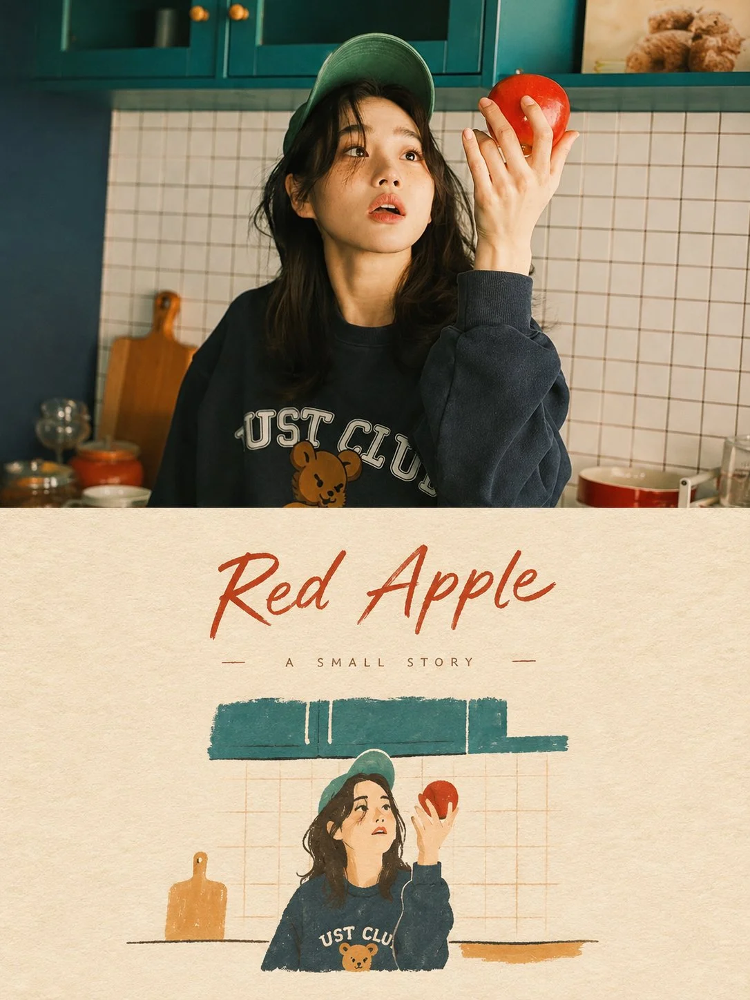

# Photo-to-Hand-Drawn Editorial Poster, Split 1:1 (3:4)

**中文标题：** 照片转手绘杂志海报：上下对半（3:4）  
**ID:** `gi25-x-1566` · **Mode:** `edit`  
**Categories:** `edit-change-preserve`, `poster-typography`, `character-consistency`  
**Tags:** `x-twitter`, `community`, `gpt-image-2.5`, `x-direct`, `en`



### Photo-to-Hand-Drawn Editorial Poster, Split 1:1 (3:4)

```text
Transform the uploaded photos into an individual, high-end design poster. Do not combine multiple images; output each photo as a separate, standalone piece. Use a vertical {argument name="aspect ratio" default="3:4"} format, with the upper and lower sections divided strictly 1:1, each occupying 50% of the total composition.

The upper section should retain the original photograph—preserving its core structure, authentic texture, natural lighting, and original color atmosphere—while applying subtle, high-end photographic color grading to evoke the aesthetic of magazine photography or art publications. To fit the frame, you may naturally extend the sky, ground, or environmental background, provided that the main subject remains undistorted and unaltered.

The lower section should distill the most recognizable elements of the subject—its silhouette, posture, and narrative context—into a minimalist, hand-drawn, paper-textured cover illustration. Strip away complex details, retaining only the most essential visual features. Use delicate, slightly unsteady hand-drawn lines combined with a few distinct, flat-applied acrylic color blocks to represent the subject, ensuring it remains instantly identifiable. The subject should be small and concentrated—occupying approximately {argument name="subject proportion" default="10%–20%"} of the lower section—surrounded by ample negative space. The background should resemble rough or light-colored paper, with only minimal lines or color planes to suggest the environment.

The color palette should be derived from the original photo and condensed into no more than four primary colors. These color blocks should be bold, solid, and restrained, incorporating textures like paper grain, visible brushstrokes, and slightly irregular edges. Lines should define the structure, while color blocks should establish the subject. Avoid styles such as colored pencil, crayon, watercolor washes, pure line art, complex realism, heavy oil-painting textures, slick digital illustrations, or 3D-rendered effects.

You may incorporate a small amount of concise text—such as titles, keywords, subject names, locations, years, serial numbers, or short phrases—tailored to the content of each photo (not limited to urban themes). The typography should be sparse and restrained, blending naturally with the negative space and illustration to evoke the aesthetic of an art book cover, an independent publication, or a children’s picture book.  The overall visual aesthetic features small subjects, ample negative space, a high degree of distillation, and strong recognizability. It conveys a sense of tranquility, childlike charm, and ease—evoking a poetic, sophisticated quality while steering clear of the look typical of commercial cartoons, e-commerce imagery, or generic templates.
```

- **Recommended model:** `gpt-image-2.5-flare`
- **Settings:** _(defaults)_
- **Source:** [community](https://x.com/harboriis/status/2122303434875609159) — @harboriis
- **License note:** Original public X post; quoted with attribution — remix with attribution
- **Notes:** Collected directly from X; original post https://x.com/harboriis/status/2122303434875609159; post text names GPT Image 2.5; discovered via X search, prompt re-verified against the original X post via api.fxtwitter.com; verified=True; needs uploaded photos; the original prompt contains replaceable {argument name=... default=...} placeholders for aspect ratio and subject proportion; post names GPT Image 2.5 without a variant; preview is image 1 of 3
- **Preview:** `previews/gi25-x-1566.webp`
