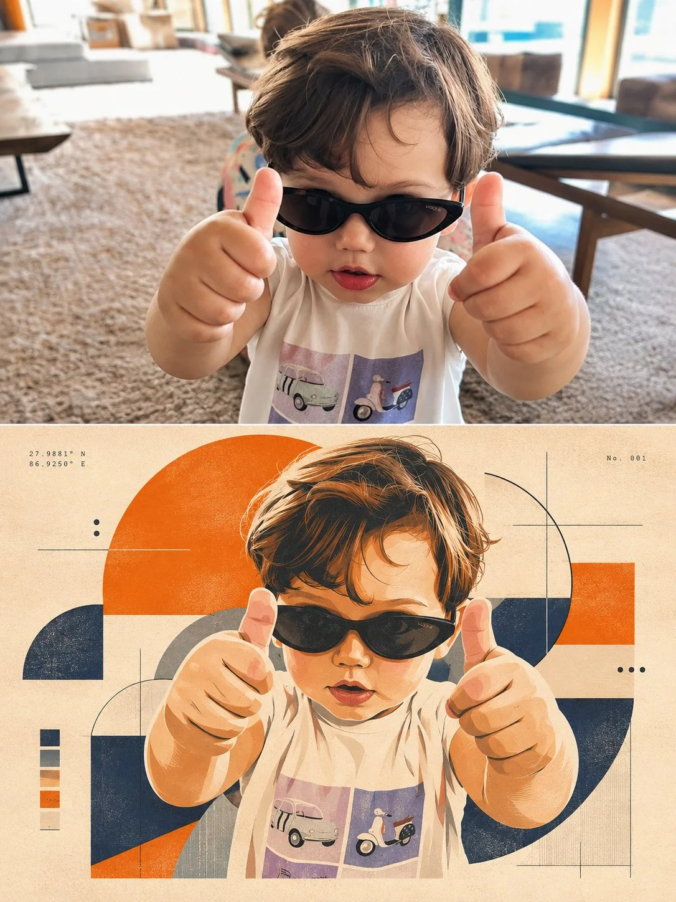

# Photo × Abstract Geometric Art Poster, Split 50/50 (3:4)

**中文标题：** 照片与抽象几何艺术对半海报（3:4）  
**ID:** `gi25-x-1567` · **Mode:** `edit`  
**Categories:** `edit-change-preserve`, `poster-typography`, `character-consistency`  
**Tags:** `x-twitter`, `community`, `gpt-image-2.5`, `x-direct`, `en`



### Photo × Abstract Geometric Art Poster, Split 50/50 (3:4)

```text
create a 3:4 vertical high-end art poster from the uploaded photo, with 50% of the image on each side strictly in the same position, presenting a dual-layer design of 'real photography × abstract geometric art'.

Top half|Real photography

The original image is preserved in its entirety, including the person, posture, composition, natural light, and color atmosphere, with only the color tone being refined, presenting a high-end art photography and independent publication quality. The background can be naturally extended, but the facial features, body shape, or original details of the person cannot be changed.

Bottom half|Abstract visual

The image is extracted from the photo to transform the person's posture, interaction, scene outline, and representative elements into minimalist geometric illustrations and abstract visual symbols. Color blocks, curves, lines, grids, and negative space are re-structured to maintain the original image's recognizability, but not directly copy the photo.

Design style

Combining Bauhaus, deconstructive Swiss flat design, Post-digital Graphic Design, and Japanese art publication aesthetics. The composition is restrained, the proportions are precise, and a large amount of blank space is left, combining rational order with artistic warmth.

Color and Material

Extract the main color from the original image, combined with warm white, low-saturation color tones, and a small amount of contrast color. Add Risograph embossed printing particles, vintage paper texture, subtle offset printing inaccuracies, and scanning noise to create a refined physical print quality.

Layout Details

Only use a very small number of tiny numbers, coordinates, fine line markings, and color tickets as design elements, without using large headlines. All elements must be coordinated with the main visual, avoiding excessive information.

Final Result

A collector's-level poster for high-end design studios, art institutions, or independent publications. The top half is realistic and natural, while the bottom half is abstract yet instantly recognizable as the original image concept. The overall design is refined, minimalist, and stylish, avoiding cheap commercial illustrations and excessive decoration
```

- **Recommended model:** `gpt-image-2.5-flare`
- **Settings:** _(defaults)_
- **Source:** [community](https://x.com/Ziha_ai/status/2122326157827686782) — @Ziha_ai
- **License note:** Original public X post; quoted with attribution — remix with attribution
- **Notes:** Collected directly from X; original post https://x.com/Ziha_ai/status/2122326157827686782; post text names GPT Image 2.5; discovered via X search, prompt re-verified against the original X post via api.fxtwitter.com; verified=True; needs an uploaded photo; post names GPT Image 2.5 without a variant; preview is image 1 of 4
- **Preview:** `previews/gi25-x-1567.webp`
