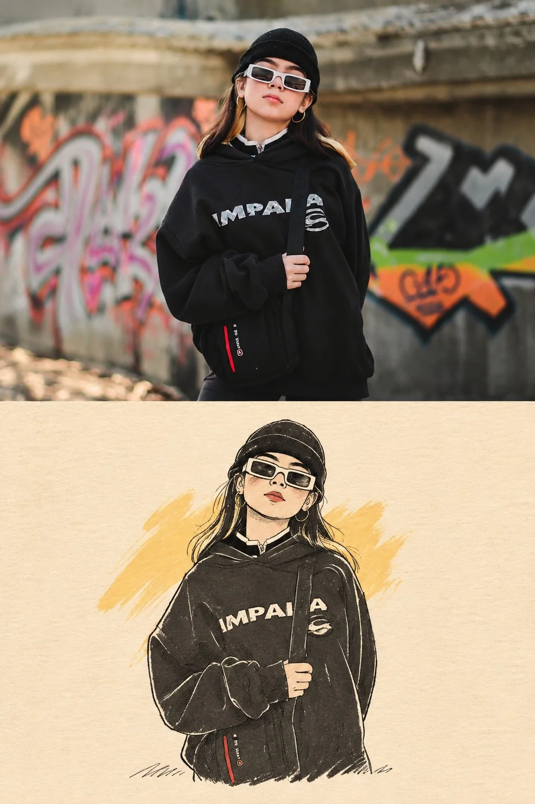

# Photo × Minimalist Hand-Drawn Art Split-Screen Poster (2:3)

**中文标题：** 照片与极简手绘对半海报（2:3）  
**ID:** `gi25-x-1576` · **Mode:** `edit`  
**Categories:** `edit-change-preserve`, `poster-typography`  
**Tags:** `x-twitter`, `community`, `gpt-image-2.5`, `x-direct`, `en`



### Photo × Minimalist Hand-Drawn Art Split-Screen Poster (2:3)

```text
Create a vertical 2:3 split-screen composition using the uploaded photo.

TOP HALF | Original Photography (50%)

Preserve the original uploaded photo exactly as it is. Keep the original subject, face, clothing, colors, pose, background, lighting, composition, and all visible details unchanged. Do not apply any artistic effects or modifications to this section.

BOTTOM HALF | Minimalist Hand-Drawn Illustration (50%)

Transform the same photo into a minimalist hand-drawn illustration.

Keep the subject's recognizable facial features, silhouette, hairstyle, clothing, accessories, pose, and overall story. Maintain the same composition and recognizable details from the original photograph.

Use fine, imperfect black ink lines, delicate sketch strokes, subtle hand-drawn details, and a few flat acrylic color blocks. Give the illustration a beautiful handmade appearance on warm, textured ivory paper.

Keep the subject relatively small and centered, with generous negative space surrounding the illustration. Simplify unnecessary background details while retaining the important visual elements that tell the original story.

Use a limited palette of no more than 4 colors for the illustration, with natural ivory paper as the background. Avoid gradients, photorealistic rendering, excessive shading, and unnecessary details.

COMPOSITION & LAYOUT

- Vertical 2:3 aspect ratio.
- Divide the canvas into two equal horizontal sections.
- Top 50%: Original photograph, completely unchanged.
- Bottom 50%: Minimalist hand-drawn illustration of the same photograph.
- Maintain consistent subject positioning and recognizable visual details.
- Clean, precise separation between both sections.
- Warm ivory paper texture in the illustrated section.
- Elegant editorial art direction with plenty of breathing room.

IMPORTANT

The top half must remain the original photograph, not an AI recreation. The bottom half must be an illustration of that exact same subject, not a different interpretation.

The final result should look like a premium art poster showcasing original photography × minimalist hand-drawn art.
```

- **Recommended model:** `gpt-image-2.5-flare`
- **Settings:** _(defaults)_
- **Source:** [community](https://x.com/Ziha_ai/status/2122657473903624237) — @Ziha_ai
- **License note:** Original public X post; quoted with attribution — remix with attribution
- **Notes:** Collected directly from X; original post https://x.com/Ziha_ai/status/2122657473903624237; post text names GPT Image 2.5; discovered via X search, prompt re-verified against the original X post via api.fxtwitter.com; verified=True; needs an uploaded photo; post names GPT Image 2.5 without a variant; preview is image 1 of 3
- **Preview:** `previews/gi25-x-1576.webp`
