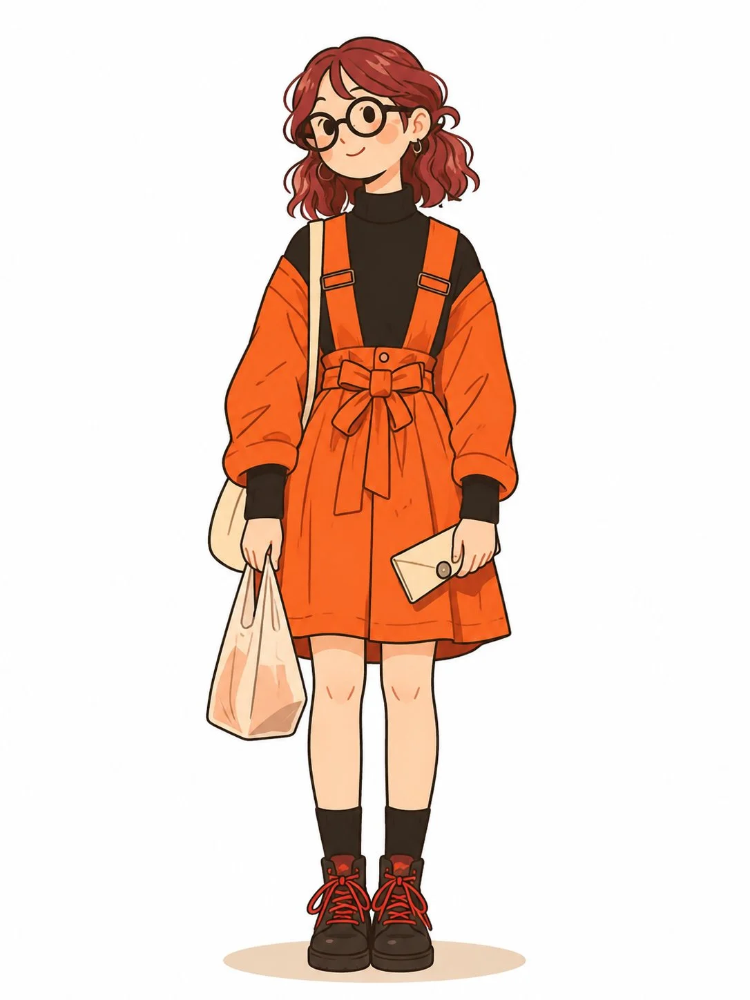

# Photo to Minimalist Full-Body Cartoon Illustration

**中文标题：** 照片转极简全身卡通插画  
**ID:** `gi25-x-1578` · **Mode:** `edit`  
**Categories:** `edit-change-preserve`, `character-consistency`  
**Tags:** `x-twitter`, `community`, `gpt-image-2.5`, `x-direct`, `en`



### Photo to Minimalist Full-Body Cartoon Illustration

```text
A minimalist full-body cartoon illustration of [subject] on a clean white background, wearing [outfit], [doing action], with [facial expression], cute rounded proportions, simple flat shapes, tiny oval black eyes, clean curved mouth, soft [colorl] and [color2] palette, subtle hand-drawn details, modern vector-style aesthetic
```

- **Recommended model:** `gpt-image-2.5-flare`
- **Settings:** _(defaults)_
- **Source:** [community](https://x.com/harboriis/status/2122664863902392635) — @harboriis
- **License note:** Original public X post; quoted with attribution — remix with attribution
- **Notes:** Collected directly from X; original post https://x.com/harboriis/status/2122664863902392635; post text names GPT Image 2.5; discovered via X search, prompt re-verified against the original X post via api.fxtwitter.com; verified=True; needs an uploaded photo; the published prompt uses replaceable [subject]/[outfit]/[doing action]/[facial expression]/[colorl]/[color2] placeholders (colorl as written); post names GPT Image 2.5 without a variant; preview is image 1 of 3
- **Preview:** `previews/gi25-x-1578.webp`
