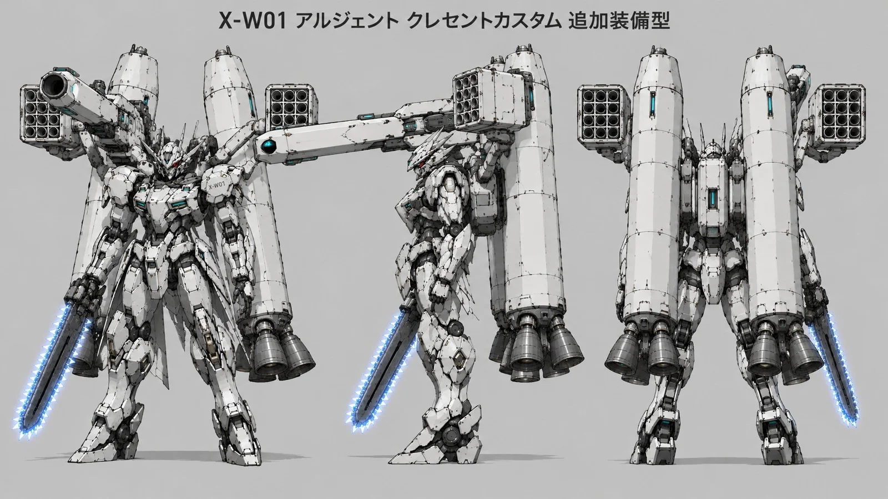

# Turn a Humanoid Mecha into a Full-Armor Three-View Sheet (16:9)

**中文标题：** 人型机体全装甲化三面设定图（16:9）  
**ID:** `gi25-x-1580` · **Mode:** `edit`  
**Categories:** `edit-change-preserve`, `character-consistency`  
**Tags:** `x-twitter`, `community`, `gpt-image-2.5`, `x-direct`, `ja`



### Turn a Humanoid Mecha into a Full-Armor Three-View Sheet (16:9)

```text
【全体・画風】
横位置16:9のメカ設定画。薄いグレーの無地背景に、巨大な追加装備を付けた「〔機体名〕」の正面・側面・背面の三面図を横に並べる。
手描きのインク線、くすんだ限られた色数、広い平坦な塗り影。写真ではない。CGIの艶や均一なベクター線は避ける。
機体本体の形・装甲の分割・塗装の配色・頭部は参照画像を正本とし、追加装備と強化した手持ち武器だけを足す。
最重要：追加装備を含めたシルエット全体の高さと幅を、機体本体の約2倍にする。機体本体は大きな装備の中心に組み込まれ、「人型の機体が巨大な装備を背負っている」ことが一目で分かるようにする。

【参照画像の役割】
参照画像は機体の全身画像1枚だけ。
機体本体の正本。体型、装甲の分割、装甲の基本色と関節の色、発光部の色と位置、刻印やマーキング、元の手持ち武器の種類と持ち方を維持する。
頭部もこの画像から取る。角やアンテナの本数・長さ・向き、顔の形、目の色と位置を変えない。
参照画像に見えていない側面や背面は、見えている部分の形と配色から自然につながるように描き、新しい意匠を足さない。
参照画像の汚れ、錆、傷、ぼろぼろの布は写さない。

【体比率・機体】
機体本体は全長〔全高〕mの人型。参照画像の頭身と手足の長さを変えず、装備に合わせて機体を大きくしたり太くしたりしない。大きくするのは装備と手持ち武器だけ。
脚・太もも・腰・腕には追加装備を何も付けず、参照画像の装甲のままにする。
正面・側面・背面で同じ機体・同じ装備の配置に統一する。左右は機体本人を基準にする。
腕と脚の関節は自然につなげ、装備が装甲や関節にめり込まない。手の指は親指1本とその他の指4本。

【追加装備】
追加装備の色は、参照画像の機体の配色に合わせる。機体の装甲でいちばん面積の大きい基本色を装備の装甲板の基本色にし、機体の副色を同じくらいの割合で配置して、機体と装備が同じ塗装規格に見えるようにする。
機体と同じように、装甲板を分割線で区切り、関節部・接続フレーム・ノズルの内側・発射口の奥だけを機体の関節と同じ暗い色にする。差し色は機体と同じ色の小さな発光部やマーキングを少しだけ使う。機体にない新しい色は足さない。
後付けの装備らしさは、色ではなくボルト留め、溶接の継ぎ目、小さな補修板で表す。汚れや錆は付けない。
追加装備の土台として、機体の背中の中央に、四角い箱型の「バックパック」を一つ付ける。バックパックは機体の胴体と同じくらいの幅で、太い接続部で背中に固定する。追加の推進装置と追加武器は、すべてこのバックパックに取り付ける。装備同士を直接つなげない。
① 推進装置：背中の左右に1基ずつ、合計2基。機体本体の全高とほぼ同じ大きさの、極太の推進剤タンクまたは大型ブースターとし、縦に背負う。上端は機体の頭より高く、下端は膝の高さまで届く。バックパックの左右の側面に、太い接続フレームで1基ずつ固定し、切り離せる接続金具を見せる。
ノズルは各推進装置の下端だけに付ける。下端に、大きさの違う下向きのノズルを3〜4基まとめて束ねて付け、それぞれの首振りで進む方向を調整できる作りにする。側面・背面・上端にはノズルを付けない。
② 追加武器：バックパックに取り付ける大型の追加武器を、2〜3種類選んで付ける。どの武器にするかは、この機体の外見と元の手持ち武器から連想して毎回自由に考える。射撃武器（大型砲、ビームランチャー、レールガンなど）、ミサイルやロケットの発射機、大型の近接武器を収めたラックなどから、この機体らしく、互いに役割の違う組み合わせにする。
・取り付け：すべての追加武器は、バックパックから伸びる太いアームや可動式の支えの腕の先に付ける。推進装置・肩の装甲・ほかの追加武器には直接つながない。どの武器も、バックパックから出ていることが三面図のどれかで読み取れるようにする。
・置き場所：肩の上、肩の上の斜め外側、背中の上方など、腕と脚の動きを邪魔しない位置に置く。左右で別の武器にしてよい。大きな砲身は前へ大きく突き出してよく、長さは機体本体の全高と同じくらいまでにする。
・構造：どの武器も、実際に撃つ・振る・発射できる作りに見えるようにする。ミサイルやロケットの発射機を付ける場合は、前後に貫通した発射筒を格子状に並べ、前面に発射口、背面に同じ数の後方排気口を開け、噴射炎が後ろへ抜ける作りにする。背面をふたや装甲板でふさがない。
・前後の見分け：どの追加武器も、前の端と後ろの端の形をはっきり変える。砲は、前の端に砲口と発光する砲口リング、後ろの端に平らな後端板・冷却フィン・太いケーブルの接続部を付ける。ミサイルやロケットの発射機は、前面の発射口に機体の差し色の弾頭の先端が見え、背面の後方排気口は中が暗い筒の口と耐熱リングだけにして、弾頭は見せない。
・太もも・脚の外側・腰には追加武器を一つも付けない。
③ マントや布（参照画像にある場合のみ）：バックパックの内側に折りたたんで格納されている状態にする。三面図では見えない。背面図でも布を出さない。
④ 手持ち武器の強化：参照画像で手に持っている武器を、同じ種類のまま強化した版に作り替える。元の武器の形の特徴・色・発光部は残し、全体を一回り大きくして、追加の装甲板、補助の発光部、大型化した刃や砲口、補助の推進器や冷却部など、その武器に合った強化部品を足す。持つ手と持ち方は参照画像と同じにする。参照画像で何も持っていない手には何も持たせず、新しい銃や盾を足さない。手持ち武器はバックパックにつながない。

【各図での見え方】
正面・側面・背面のすべてで、同じ追加武器・同じ手持ち武器が、機体本人から見て同じ位置にある。左右の取り違えをしない。
正面図：推進装置の下端に束ねたノズルが、機体の脚の左右に見える。追加武器の砲口や発射口など、前を向く部分が手前に見える。前へ突き出した砲身は短く見えてよい。重なりの順は手前から、機体本体と手持ち武器、追加武器とアーム、推進装置の順。
側面図：機体の右側面を見せる。すべての追加武器の砲口・発射口は、機体の顔とつま先と同じ方向を向く。砲身は機体の顔の前の方へ伸ばし、後端板・冷却フィン・ケーブルの接続部は機体の背中側に置く。武器を背中側へ向けない。前へ伸びる砲身や武器の長さと、アームや支えの腕がバックパックから武器へつながる様子をはっきり見せる。推進装置の下端に束ねた下向きのノズルを横から見せる。推進装置の側面と背面はノズルのない滑らかな装甲にする。
背面図：機体を真後ろから見た図で、正面図の機体と装備をそのまま180度回したものにする。正面図で手前を向いていた砲口・発射口・発光部は、背面図ではすべて奥を向いて見えない。左右は正面図と鏡に映したように入れ替わる。正面図で画面の左にあった追加武器は、背面図では画面の右に、正面図で画面の右にあった追加武器は、背面図では画面の左に描く。画面上の位置を正面図のまま写さない。
左右の目印は手持ち武器にする。手持ち武器と同じ側の肩にある追加武器は、正面図でも背面図でも手持ち武器と同じ画面の側に描く。
背面図の重なりの順は、手前から推進装置、バックパック、機体本体、追加武器の順にする。正面図ではいちばん奥だった推進装置が、背面図ではいちばん手前になる。推進装置は機体の背中より見る人の側にあり、バックパックの左右に密着して、機体の肩と腕の外側を少し隠す。追加武器は推進装置と機体の向こう側にあり、推進装置の上端の上や横から後ろの端だけがのぞく。追加武器を推進装置より手前に描かない。
中央のバックパックと、そこから出るアームの根元を見せる。追加武器は後ろの端だけが手前を向く。砲は後端板・冷却フィン・ケーブルの接続部がこちらを向き、砲身は奥へ向かって短く縮んで見え、砲口は見えない。砲の見えている部分は、正面図で見える砲の大きさとほぼ同じ短さにし、背面図で砲を長く横へ伸ばした形に描かない。手前の推進装置に隠れて見えない部分は無理に見せない。武器を背面図で後ろや横へ突き出さない。斜めに折れ曲がった形、二本に分かれた形、宙に浮いた形にしない。推進装置の背面はノズルのない滑らかな装甲で、下端に束ねたノズルだけが見える。ミサイルやロケットの発射機がある場合は、背面の後方排気口が格子状に開いてこちらを向いている。

【カメラ構図】
三面図は、同じ大きさ・同じ足元の高さで、左から正面・側面・背面の順に並べる。
装備が大きいので、各図は装備を含めた全体を画面に収める大きさにする。機体本体が小さく見えてよい。砲身の先、推進装置の上端とノズル、追加武器の外側、手持ち武器の先端を切らない。
各図の間は余白を十分にとり、装備同士が隣の図に重ならない。
詳細枠は描かない。

【画像内の文字】
上部中央の題名「〔機体名〕 追加装備型」だけを描く。
図の下のラベル、注記、ロゴ、寸法線は描かない。

【背景・光】
薄いグレーの無地。左上からの均一な光。影は平坦に一段だけ。噴射の炎は描かない。

【仕上】
機体と装備と強化した手持ち武器を同じ配色でまとめ、一体の重装備の機体として見えるように整える。機体本体と装備の境目は、暗い色の接続フレームと分割線で読み取れるようにする。装備はばらばらに浮かせず、背中の中央のバックパックで一体につながっているように描く。脚は参照画像のまますっきり見せる。
ノズルは推進装置の下端にだけ束ねて付け、推進装置の側面・背面・上端はすっきりした装甲に見えるようにする。
どの追加武器も、バックパックから支えられ、実際に使える構造だと見ただけで納得できるようにする。

no muzzles or glowing barrel tips facing the viewer in the rear view,
no warhead tips on the rear side of the missile pods,
rear view shows the back ends of all weapons.
In the rear view, the left and right shoulder weapons are mirrored from the front view:
the weapon on the screen-left in the front view appears on the screen-right in the rear view,
and stays on the same side as the handheld weapon.
In the side view, all weapon muzzles point the same way as the face and toes, never backward.
In the rear view, the cannon is foreshortened, showing only its short back end.
In the rear view, the propellant tanks are the closest objects to the viewer, in front of the body and the weapons;
the weapons sit behind the tanks and only peek out above them.
```

- **Recommended model:** `gpt-image-2.5-sunburst`
- **Settings:** _(defaults)_
- **Source:** [community](https://x.com/syouda_awajisim/status/2122698003010212239) — @syouda_awajisim
- **License note:** Original public X post; quoted with attribution — remix with attribution
- **Notes:** Collected directly from X; prompt posted as the author's own reply https://x.com/syouda_awajisim/status/2122698003010212239 to https://x.com/syouda_awajisim/status/2122697827881246742, which carries the images; GPT Image 2.5 is named in the parent post; discovered via X search, prompt re-verified against the original X post via api.fxtwitter.com; verified=True; needs an uploaded humanoid-mecha or character reference; made with GPT Image 2.5 Sunburst at 16:9; prompt posted in the author's reply; preview is image 2 of 2
- **Preview:** `previews/gi25-x-1580.webp`
