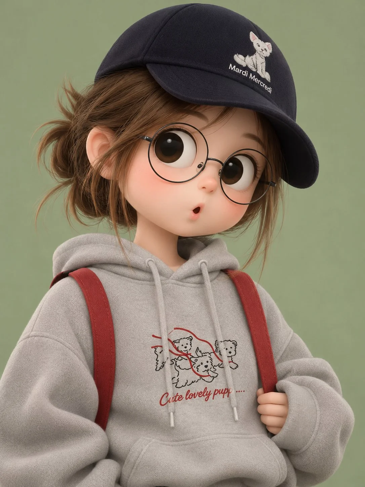

# Photo to Cute 3D Animated Portrait (3:4)

**中文标题：** 照片转可爱 3D 动画肖像（3:4）  
**ID:** `gi25-x-1589` · **Mode:** `edit`  
**Categories:** `edit-change-preserve`, `character-consistency`  
**Tags:** `x-twitter`, `community`, `gpt-image-2.5`, `x-direct`, `en`



### Photo to Cute 3D Animated Portrait (3:4)

```text
Turn my photo into a cute 3D animated portrait. Preserve recognizable features and hairstyle. Add a big round head, huge googly eyes, tiny pupils, round glasses, a button nose and tiny “o” mouth. Slightly surprised expression. Oversized black turtleneck, soft matte 3D, sage-green background, chest-up, 3:4.
```

- **Recommended model:** `gpt-image-2.5-flare`
- **Settings:** _(defaults)_
- **Source:** [community](https://x.com/Ziha_ai/status/2123005681200713762) — @Ziha_ai
- **License note:** Original public X post; quoted with attribution — remix with attribution
- **Notes:** Collected directly from X; original post https://x.com/Ziha_ai/status/2123005681200713762; post text names GPT Image 2.5; discovered via X search, prompt re-verified against the original X post via api.fxtwitter.com; verified=True; needs an uploaded photo; post names GPT Image 2.5 without a variant; preview is image 1 of 2
- **Preview:** `previews/gi25-x-1589.webp`
