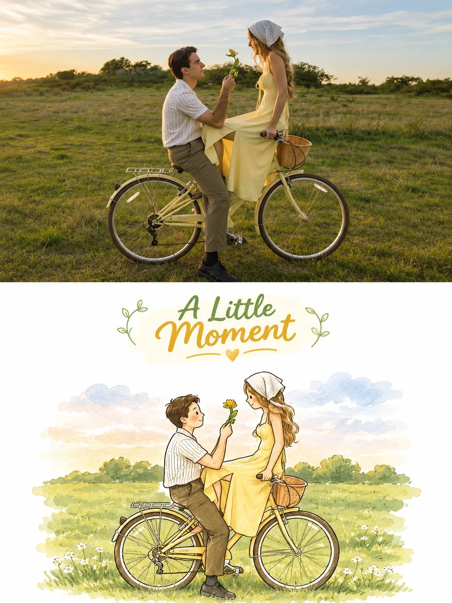

# Two-Part Photo Comparison Poster from a Reference (3:4)

**中文标题：** 参考照片双栏创意对比海报（3:4）  
**ID:** `gi25-x-1594` · **Mode:** `edit`  
**Categories:** `edit-change-preserve`, `poster-typography`  
**Tags:** `x-twitter`, `community`, `gpt-image-2.5`, `x-direct`, `en`



### Two-Part Photo Comparison Poster from a Reference (3:4)

```text
Transform the uploaded reference photo into a beautiful two-part creative comparison poster in a vertical 3:4 aspect ratio.

TOP SECTION: Original Photograph
Keep the original photograph realistic and photorealistic. Preserve the people, faces, clothing, poses, objects, background, lighting, camera angle, composition, and every small detail exactly as in the reference image.

BOTTOM SECTION: Hand-Drawn Illustration
Recreate the exact same scene as a charming, hand-drawn Japanese slice-of-life storybook illustration. Preserve the original subjects, facial expressions, hairstyles, outfits, accessories, poses, objects, and background arrangement. Use soft pastel colors, delicate pencil outlines, slightly imperfect ink strokes, subtle watercolor and colored-pencil textures, cute simplified facial features, warm tones, and a cozy whimsical atmosphere.

The illustrated version must closely match the original photograph, as if the same moment has been redrawn by a professional children's book illustrator. Do not change the characters, add new people, or alter the original scene.

POSTER DESIGN:

- Clean vertical layout with two equally balanced sections.
- Original photorealistic image on top.
- Illustrated recreation on the bottom.
- Bright white background around the illustrated section.
- Add a large, playful, handwritten title centered above the illustration, inspired by the main scene.
- Use colorful hand-lettered typography with a soft watercolor brushstroke behind the title.
- Add small decorative doodles relevant to the scene.
- Add subtle artist-style details and delicate textures.
- Minimal, clean editorial poster aesthetic.

IMPORTANT: Maintain strong visual consistency between the photograph and illustration. The illustration must be an accurate recreation of the photograph, not a loosely inspired interpretation. High-quality details, balanced composition, beautiful colors, professional creative poster design, 4K resolution.
```

- **Recommended model:** `gpt-image-2.5-flare`
- **Settings:** _(defaults)_
- **Source:** [community](https://x.com/harboriis/status/2123083712263078396) — @harboriis
- **License note:** Original public X post; quoted with attribution — remix with attribution
- **Notes:** Collected directly from X; original post https://x.com/harboriis/status/2123083712263078396; post text names GPT Image 2.5; discovered via X search, prompt re-verified against the original X post via api.fxtwitter.com; verified=True; needs an uploaded photo; post names GPT Image 2.5 without a variant; preview is image 1 of 4
- **Preview:** `previews/gi25-x-1594.webp`
