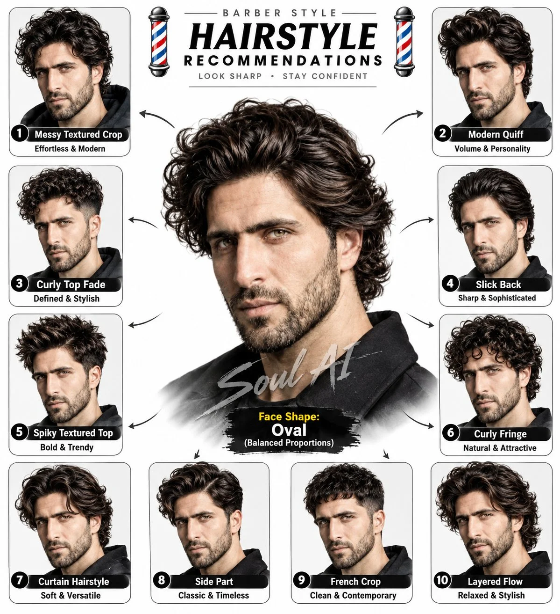

# Barber Hairstyle Recommendation Infographic from a Photo

**中文标题：** 理发店发型推荐信息图（基于上传照片）  
**ID:** `gi25-x-1597` · **Mode:** `edit`  
**Categories:** `edit-change-preserve`, `poster-typography`  
**Tags:** `x-twitter`, `community`, `gpt-image-2.5`, `x-direct`, `en`



### Barber Hairstyle Recommendation Infographic from a Photo

```text
Create a professional barber-style hairstyle recommendation infographic using the uploaded photo as the central reference. Preserve the person's exact facial identity, skin tone, beard, and natural features. Analyze the face shape and place a large portrait in the center with the face-shape label.

Around the central portrait, display 10 realistic hairstyle variations on the same person, each in a separate numbered card with hairstyle name and a short description. Include:

1. Messy Textured Crop — Effortless & Modern
2. Modern Quiff — Volume & Personality
3. Curly Top Fade — Defined & Stylish
4. Slick Back — Sharp & Sophisticated
5. Spiky Textured Top — Bold & Trendy
6. Curly Fringe — Natural & Attractive
7. Curtain Hairstyle — Soft & Versatile
8. Side Part — Classic & Timeless
9. French Crop — Clean & Contemporary
10. Layered Flow — Relaxed & Stylish

Clean white background, premium salon consultation infographic, realistic hairstyle rendering, consistent facial identity across every hairstyle, elegant numbered cards, thin arrows pointing toward the central portrait, crisp typography, balanced layout, high resolution, professional design, no watermark.
```

- **Recommended model:** `gpt-image-2.5-flare`
- **Settings:** _(defaults)_
- **Source:** [community](https://x.com/iamsoulAI/status/2123302001132110190) — @iamsoulAI
- **License note:** Original public X post; quoted with attribution — remix with attribution
- **Notes:** Collected directly from X; prompt posted as the author's own reply https://x.com/iamsoulAI/status/2123302001132110190 to https://x.com/iamsoulAI/status/2123301996094742676, which carries the images; GPT Image 2.5 is named in the reply; discovered via X search, prompt re-verified against the original X post via api.fxtwitter.com; verified=True; needs an uploaded photo; parent post names 'Image GPT 2.5'; prompt posted in the author's reply; preview is the parent image
- **Preview:** `previews/gi25-x-1597.webp`
