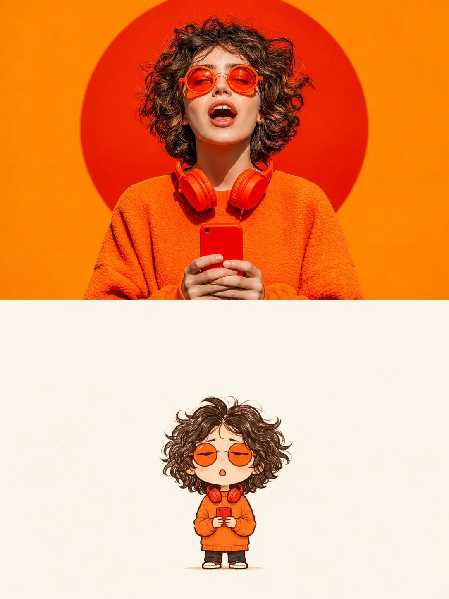

# Photo × Relaxed Hand-Drawn Chibi Comparison Poster (3:4)

**中文标题：** 原图 × 手绘 Q 版对比海报（3:4，需上传照片）  
**ID:** `gi25-x-1600` · **Mode:** `edit`  
**Categories:** `edit-change-preserve`, `character-consistency`  
**Tags:** `x-twitter`, `community`, `gpt-image-2.5`, `x-direct`, `en`



### Photo × Relaxed Hand-Drawn Chibi Comparison Poster (3:4)

```text
Transform each uploaded photo independently into a premium 3:4 vertical Original Photography × Relaxed Hand-Drawn Chibi Illustration comparison poster, split horizontally into two perfectly equal 50% sections. TOP: Faithfully preserve the original image, including subject identity, facial features, hairstyle, clothing, pose, composition, lighting, and authentic colors, allowing only minimal proportional cropping or natural background extension. BOTTOM: Automatically extract the primary subject, distinctive features, and 1–2 signature colors, then reinterpret the same subject as a tiny, relaxed, hand-drawn 2–3-head-tall chibi character with short limbs, slightly uneven organic outlines, subtle imperfections, soft flat colors, and recognizable details. Give the character deadpan fish eyes, half-closed eyes, or a blank expression, paired with a subtly awkward, amusing, slightly surreal pose. Avoid exaggerated emotions, broad smiles, or generic cartoon styling. Position the character alone near the lower center, occupying approximately 15–25% of the bottom section, without touching the bottom edge. Maintain at least 60–75% clean negative space with a solid near-white background subtly tinted toward the extracted primary color. Keep the composition exceptionally minimal, quiet, warm, gently humorous, and intentionally spacious. If text is explicitly provided, place it very small, horizontally centered above the character, with smaller secondary text directly beneath; otherwise omit all typography. No invented subjects, extra characters, unnecessary objects, decorative elements, borders, divider lines, labels, logos, or watermarks. Preserve strong visual consistency between both halves. The final artwork should feel small, lonely, effortlessly charming, and quietly funny.
```

- **Recommended model:** `gpt-image-2.5-flare`
- **Settings:** _(defaults)_
- **Source:** [community](https://x.com/harboriis/status/2123328421170438476) — @harboriis
- **License note:** Original public X post; quoted with attribution — remix with attribution
- **Notes:** Collected directly from X; original post https://x.com/harboriis/status/2123328421170438476; post text names GPT Image 2.5; discovered via X search, prompt re-verified against the original X post via api.fxtwitter.com; verified=True; needs an uploaded photo; post names GPT Image 2.5 without a Flare/Sunburst variant; preview is image 1 of 3
- **Preview:** `previews/gi25-x-1600.webp`
