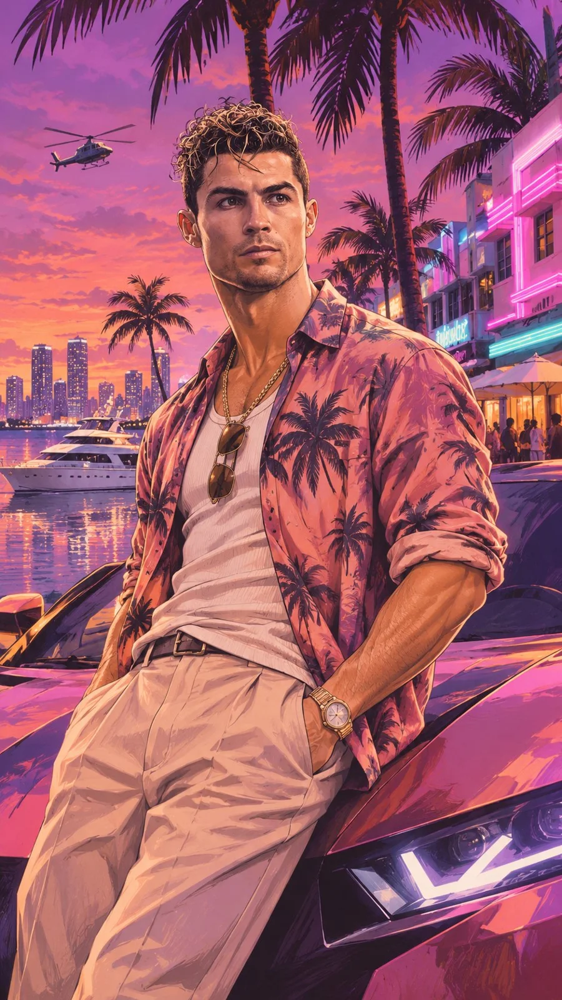

# GTA VI Vice City Cinematic Character Transformation Poster

**中文标题：** GTA VI Vice City 电影感角色海报（需上传参考照片）  
**ID:** `gi25-x-1604` · **Mode:** `edit`  
**Categories:** `edit-change-preserve`, `character-consistency`  
**Tags:** `x-twitter`, `community`, `gpt-image-2.5`, `x-direct`, `en`



### GTA VI Vice City Cinematic Character Transformation Poster

```text
GTA VI VICE CITY | CINEMATIC CHARACTER TRANSFORMATION

Transform the person in the uploaded reference photograph into an extraordinary, ultra-detailed Grand Theft Auto VI-inspired Vice City cinematic poster. The result should look like an exclusive official-style GTA VI promotional artwork or a stunning in-game loading screen.

1. PERSON & IDENTITY — CRITICAL

Use the uploaded photograph as the exact identity reference. Preserve the person's recognizable facial identity, facial structure, eyes, nose, hairstyle, skin tone, and distinctive features.

Transform the person naturally into a confident, charismatic GTA protagonist. Give them a stylish, effortlessly cool personality and realistic proportions. Do not replace their face with a generic character or make them look like someone else.

2. GTA CHARACTER STYLING

Dress the person in fashionable Vice City-inspired clothing that complements their appearance and personality. Depending on their look, create an outfit such as:

- Luxury tropical shirts, open collars and sunglasses.
- Premium leather jackets, fitted T-shirts and dark denim.
- Relaxed designer-inspired streetwear and accessories.
- Elegant summer suits, watches and gold chains.

Clothing must feel authentic to the GTA VI universe, with no real-world sports team logos, football club branding or recognizable brand marks.

3. VICE CITY ENVIRONMENT

Place the character inside a spectacular Miami-inspired Vice City setting. Automatically select a cinematic scenario that best suits the uploaded person's appearance.

Possible environments include:

- Driving a luxury convertible along Ocean Drive.
- Relaxing on a luxury yacht overlooking the Vice City skyline.
- Standing beside an exotic sports car outside a neon-lit hotel.
- Riding a powerful motorcycle through a vibrant nightlife district.
- Enjoying a sunset overlooking the ocean from a luxury waterfront villa.
- Sitting confidently inside an upscale nightclub or casino.
- Walking through a palm-lined boulevard after dark.

The character must be the undeniable focal point of the composition.

4. SIGNATURE GTA VI ART DIRECTION

Recreate the distinctive visual atmosphere of GTA VI promotional artwork:

- Spectacular pink, purple and orange sunset skies.
- Electric cyan and magenta neon illumination.
- Tropical palm trees and luxurious coastal architecture.
- Glowing city skylines, reflective streets and oceanfront scenery.
- Beautifully exaggerated yet believable cinematic lighting.
- Rich saturated colours with sophisticated contrast.
- Highly detailed illustrated textures and polished digital painting.
- Semi-realistic GTA promotional illustration rather than ordinary photography.

5. COMPOSITION & QUALITY

Create a premium vertical 9:16 smartphone poster. Use a cinematic medium or full-body composition depending on the chosen scenario. Ensure the face is clearly visible, beautifully detailed and naturally integrated into the environment.

The artwork should feature exceptional depth, dynamic composition, intricate environmental details, realistic anatomy, dramatic lighting and professional video-game promotional artwork quality.

6. FINAL PRESENTATION

Make the final image feel like a legendary GTA VI character introduction or exclusive Vice City loading-screen artwork.

IMPORTANT: No Juventus, no football clubs, no sports jerseys, no real-world team logos, no random text, no captions, no watermarks, no borders and no social media interface.

FINAL OBJECTIVE: One uploaded photograph goes in, and an incredible Vice City protagonist poster comes out. Preserve the person's identity while completely transforming their surroundings, outfit, atmosphere and lifestyle into the spectacular world of GTA VI.
```

- **Recommended model:** `gpt-image-2.5-flare`
- **Settings:** _(defaults)_
- **Source:** [community](https://x.com/Goodmanprotocol/status/2123411512312365447) — @Goodmanprotocol
- **License note:** Original public X post; quoted with attribution — remix with attribution
- **Notes:** Collected directly from X; original post https://x.com/Goodmanprotocol/status/2123411512312365447; post text names GPT Image 2.5; discovered via X search, prompt re-verified against the original X post via api.fxtwitter.com; verified=True; needs an uploaded photo; post names GPT Image 2.5 without a Flare/Sunburst variant; preview is image 1 of 4
- **Preview:** `previews/gi25-x-1604.webp`
