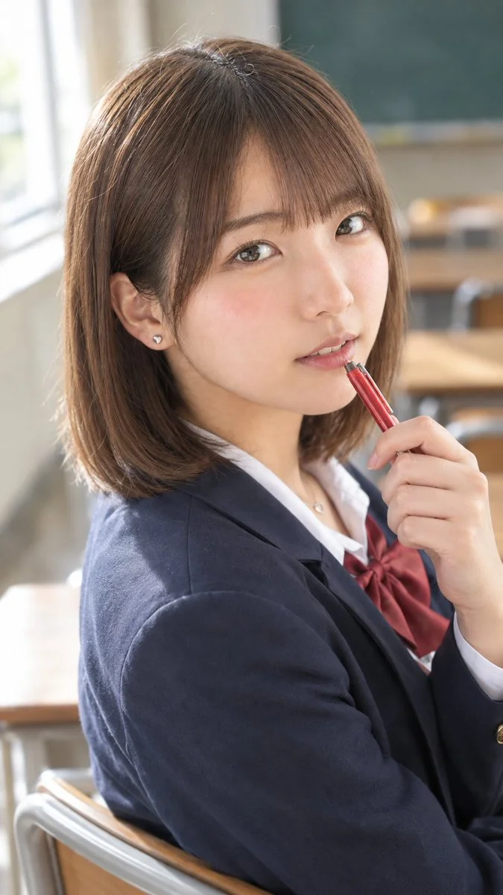

# Photoreal School Portrait: Blazer, Ribbon Tie, and a Red Pen (9:16)

**中文标题：** 写真风校园肖像：西装外套、领结与红笔（9:16，需上传脸部照片）  
**ID:** `gi25-x-1609` · **Mode:** `edit`  
**Categories:** `edit-change-preserve`, `character-consistency`  
**Tags:** `x-twitter`, `community`, `gpt-image-2.5`, `x-direct`, `ja`



### Photoreal School Portrait: Blazer, Ribbon Tie, and a Red Pen (9:16)

```text
目的: 実写の縦長ポートレート写真1枚。画像1の人物で、以下の場面・ポーズ・撮影条件を再現する
【参照画像】
顔・髪: 添付の顔写真（画像1）に準拠
【場面】
場所: 日中の学校の教室、背景に黒板と机が並ぶ、浅い奥行きと背景のボケ
光: 窓からの柔らかなサイドライト、中程度のコントラスト、自然な影の出方
【被写体】
髪の状態: 乾いた通常の状態
表情: 自然な目、肩越しにカメラ側を向く視線、わずかに開いた口（脱力による開き）、自然な眉
トップス: 白のブラウス、首元の赤のリボンタイ、紺色のブレザー
ボトムス: 紺のプリーツスカート
足元: 画角外
小物: 小さなハートモチーフのシルバーネックレス、小さなスタッドピアス、手に持つ赤いペン
ポーズ: 椅子に座る姿勢、脚は画角外、腰は奥向きで肩はカメラ側のねじれ、上体をわずかに後ろへ傾ける、肩越しにカメラ側を振り返る向き、左手を胸の高さで曲げペンを口元に添える
【カメラ・構図】
前後: 左肩と手元が最も近く画面の大半を占める、ピントが合う顔と手元、背景の遠方に向かって強めのボケ
構図: 胸から上のショットサイズ、頭頂が上から約1割の位置、人物が画面の右側に寄る、やや高い位置からのアングル
撮影: 学校の教室でのポートレート撮影、撮影者と被写体の近い距離、浅い被写界深度、自然な彩度
【仕上がり】
質感: 滑らかな肌の質感、自然なホワイトバランス、柔らかな光の回り方
画風: 実写・フォトリアル（アニメ・イラスト・CG・絵画は不可）、自然な写真的質感
比率: 縦9:16 / 1080x1920px（横長不可）
【制約】
維持: 画像1の顔立ち・髪型・髪色・肌の色をそのまま保つ
除外: 画像内に文字・ロゴ・透かしを入れない
```

- **Recommended model:** `either`
- **Settings:** _(defaults)_
- **Source:** [community](https://x.com/kawagoe_ai/status/2123526226979488067) — @kawagoe_ai
- **License note:** Original public X post; quoted with attribution — remix with attribution
- **Notes:** Collected directly from X; original post https://x.com/kawagoe_ai/status/2123526226979488067; post text names GPT Image 2.5; discovered via X search, prompt re-verified against the original X post via api.fxtwitter.com; verified=True; needs an uploaded face photo; images 3 and 4 are gpt-image-2.5-flare and gpt-image-2.5-sunburst; preview is image 3 (Flare)
- **Preview:** `previews/gi25-x-1609.webp`
