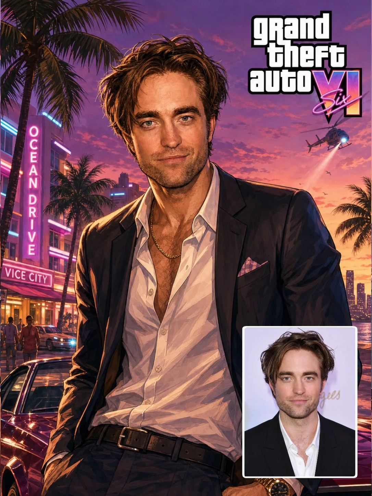

# GTA VI Loading-Screen Character Transformation Poster

**中文标题：** GTA VI 载入画面风角色海报（需上传参考照片）  
**ID:** `gi25-x-1613` · **Mode:** `edit`  
**Categories:** `edit-change-preserve`, `character-consistency`  
**Tags:** `x-twitter`, `community`, `gpt-image-2.5`, `x-direct`, `en`



### GTA VI Loading-Screen Character Transformation Poster

```text
"task": "Image-to-image character transformation",
  "reference_image": "Uploaded original photograph",
  "output_type": "Cinematic video game character poster",

  "creative_direction": {
    "concept": "Recreate the individual in the reference photograph as a compelling protagonist from the Grand Theft Auto VI universe, using the distinctive visual language of premium Rockstar Games promotional illustrations.",
    "visual_style": "High-end semi-realistic digital illustration, bold graphic contours, sophisticated cel shading, painterly textures, realistic anatomy, expressive facial rendering, and vivid cinematic color grading.",
    "artistic_quality": "AAA video game key art, professional promotional illustration, intricate environmental details, sharp character rendering, and polished poster composition.",
    "mood": "Confident, stylish, cinematic, adventurous, and infused with the vibrant energy of Vice City."
  },

  "character_design": {
    "identity_reference": "Use the person in the uploaded photograph as the exclusive character identity reference.",
    "identity_preservation": {
      "face_structure": "Preserve the original facial proportions, jawline, cheekbones, nose, lips, eyes, and distinctive facial characteristics.",
      "hair": "Maintain the original hairstyle, hair length, texture, and natural color.",
      "skin": "Retain the person's authentic skin tone and recognizable complexion.",
      "expression": "Preserve the reference expression while translating it naturally into an illustrated character.",
      "likeness_priority": "Maximum facial resemblance with no unnecessary changes to identity.",
      "restrictions": [
        "Do not replace the original face.",
        "Do not alter the person's ethnicity or defining features.",
        "Avoid exaggerated cartoon proportions.",
        "Do not introduce facial distortions.",
        "Maintain realistic human anatomy."
      ]
    },
    "wardrobe": {
      "direction": "Contemporary Vice City street fashion with stylish, character-appropriate details.",
      "flexibility": "Retain recognizable clothing elements where possible, while allowing tasteful adjustments to enhance the game's visual atmosphere.",
      "accessories": "Add subtle accessories only when they complement the subject's appearance."
    },
    "rendering": {
      "outlines": "Clean, confident graphic outlines with controlled line-weight variation.",
      "shading": "Layered cel shading combined with smooth cinematic gradients.",
      "textures": "Detailed illustrated skin, realistic fabric folds, reflective accessories, and painterly highlights.",
      "appearance": "A believable open-world game protagonist rather than a generic cartoon avatar."
    }
  },

  "environment": {
    "location": "Vice City-inspired tropical coastal metropolis",
    "setting": "A lively Miami-inspired cityscape featuring palm-lined streets, elegant Art Deco buildings, glowing storefronts, luxury vehicles, and distant waterfront scenery.",
    "sky": "Spectacular tropical sunset with luminous orange, coral pink, violet, and deep purple clouds.",
    "lighting": {
      "primary": "Warm golden-hour sunlight illuminating the character.",
      "secondary": "Soft magenta and violet neon reflections.",
      "rim_light": "Subtle cinematic edge lighting separating the character from the background.",
      "contrast": "Dramatic but balanced highlights and shadows."
    },
    "atmosphere": "Energetic coastal nightlife, tropical warmth, stylish urban luxury, and cinematic open-world adventure.",
    "depth": "Detailed foreground, layered midground architecture, and softly atmospheric distant skyline."
  },

  "composition": {
    "layout": "Premium cinematic character-reveal poster",
    "character_position": "Prominent central or slightly left-of-center placement.",
    "camera_angle": "Eye-level cinematic portrait with a confident hero composition.",
    "framing": "Medium portrait or three-quarter character framing based on the original photograph.",
    "visual_hierarchy": [
      "Recognizable illustrated character",
      "Grand Theft Auto VI branding",
      "Vibrant Vice City environment",
      "Original photograph inset",
      "Loading-screen interface"
    ],
    "balance": "Maintain clear visual separation between the main character, title graphics, loading bar, and photographic inset."
  },

  "branding": {
    "logo": {
      "text": "Grand Theft Auto VI",
      "placement": "Upper-right corner",
      "design": "Prominent stacked Grand Theft Auto lettering paired with a large stylized Roman numeral VI.",
      "appearance": "Authentic-looking video game promotional branding with bold typography and a vibrant pink-purple tropical gradient.",
      "visibility": "Sharp, legible, correctly spelled, and unobstructed."
    },
    "interface_style": "Elegant cinematic video game loading-screen graphics."
  },
```

- **Recommended model:** `gpt-image-2.5-flare`
- **Settings:** _(defaults)_
- **Source:** [community](https://x.com/HitPawofficial/status/2123664602437480642) — @HitPawofficial
- **License note:** Original public X post; quoted with attribution — remix with attribution
- **Notes:** Collected directly from X; prompt posted as the author's own reply https://x.com/HitPawofficial/status/2123664602437480642 to https://x.com/HitPawofficial/status/2123663985627328553, which carries the images; GPT Image 2.5 is named in the parent post; discovered via X search, prompt re-verified against the original X post via api.fxtwitter.com; verified=True; needs an uploaded photo; prompt posted as the author's self-reply; parent post names GPT Image 2.5 without a Flare/Sunburst variant; preview is image 1 of 3
- **Preview:** `previews/gi25-x-1613.webp`
