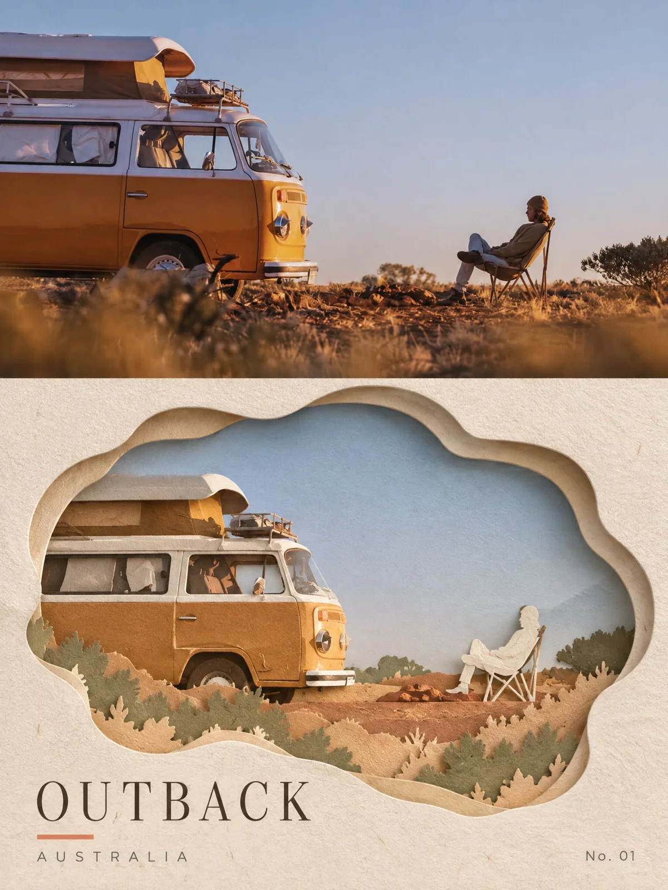

# Split Poster: Photo on Top, Paper-Cut Diorama Below (3:4)

**中文标题：** 上下分屏海报：上半实拍、下半层纸立体场景（3:4，需上传照片）  
**ID:** `gi25-x-1632` · **Mode:** `edit`  
**Categories:** `edit-change-preserve`, `character-consistency`  
**Tags:** `x-twitter`, `community`, `gpt-image-2.5`, `x-direct`, `en`



### Split Poster: Photo on Top, Paper-Cut Diorama Below (3:4)

```text
3:4 vertical image, top 48% / bottom 52%, seamless join, no white line, border or gap.
TOP: the uploaded photo, realistic, unchanged, full-bleed.
BOTTOM: the same scene and composition as a layered 3D paper-cut diorama, seen through an irregular cloud-shaped window cut into textured cream paper, with stepped paper layers and soft shadows around the edge. Visible paper fiber, simplified shapes, soft pastel palette from the photo, people as small ivory paper figures.
TEXT: bottom-left, large thin serif English place name, short coral line, small spaced sans-serif subtitle; bottom-right "No. 01".
AVOID: white divider, gap, frame between halves, flat vector look, garbled text, watermark.
```

- **Recommended model:** `gpt-image-2.5-flare`
- **Settings:** _(defaults)_
- **Source:** [community](https://x.com/Ziha_ai/status/2124395105855635723) — @Ziha_ai
- **License note:** Original public X post; quoted with attribution — remix with attribution
- **Notes:** Collected directly from X; original post https://x.com/Ziha_ai/status/2124395105855635723; post text names GPT Image 2.5; discovered via X search, prompt re-verified against the original X post via api.fxtwitter.com; verified=True; needs an uploaded photo; post names GPT Image 2.5 without a Flare/Sunburst variant; preview is image 1 of 2
- **Preview:** `previews/gi25-x-1632.webp`
