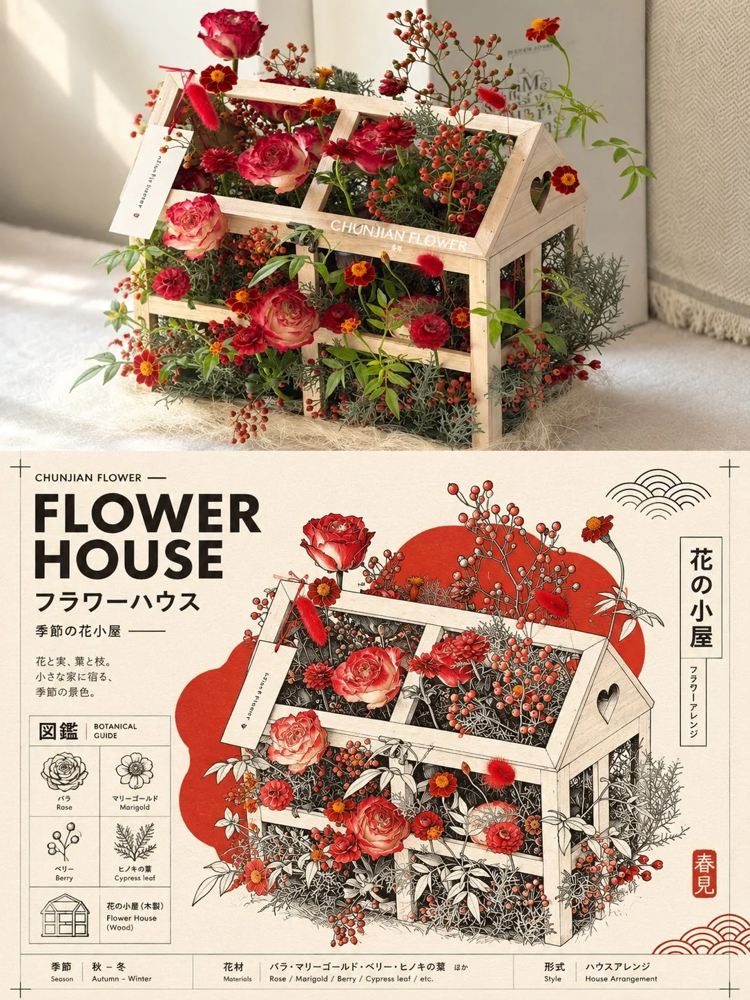

# Photo to Botanical Line-Art Split Poster (3:4)

**中文标题：** 照片转植物学线描上下双联海报（3:4，需上传照片）  
**ID:** `gi25-x-1634` · **Mode:** `edit`  
**Categories:** `edit-change-preserve`, `poster-typography`  
**Tags:** `x-twitter`, `community`, `gpt-image-2.5`, `x-direct`, `zh`



### Photo to Botanical Line-Art Split Poster (3:4)

```text
将照片创作成3:4竖版上下双联海报：上半保持真实摄影风貌，下半以暖白纸底呈现日式极简图鉴海报。提炼照片中的核心主体、自然物件与标志性轮廓，将具象元素转译为大面积不规则纯色色块与精细黑色线描，以局部写实、整体抽象的虚实对比构建视觉焦点。采用现代日本版画语言、植物学线描、硬边平涂与细腻纸张肌理；依据原图色彩关系选取单一主色作为视觉锚点，辅以黑白中性色，通过高纯度色块与无彩线条形成克制对比。主体偏置放大，四周保留宽阔负空间，搭配粗体英文标题、日文标签、纤细网格线与角落传统纹样，形成理性秩序与东方侘寂相融合的瑞士网格编辑设计。
```

- **Recommended model:** `gpt-image-2.5-flare`
- **Settings:** _(defaults)_
- **Source:** [community](https://x.com/xiaoxiaodong/status/2124431187116716443) — @xiaoxiaodong
- **License note:** Original public X post; quoted with attribution — remix with attribution
- **Notes:** Collected directly from X; original post https://x.com/xiaoxiaodong/status/2124431187116716443; post text names GPT Image 2.5; discovered via X search, prompt re-verified against the original X post via api.fxtwitter.com; verified=True; needs an uploaded photo; prompt was posted inside a fenced code block; post names GPT Image 2.5 without a Flare/Sunburst variant
- **Preview:** `previews/gi25-x-1634.webp`
