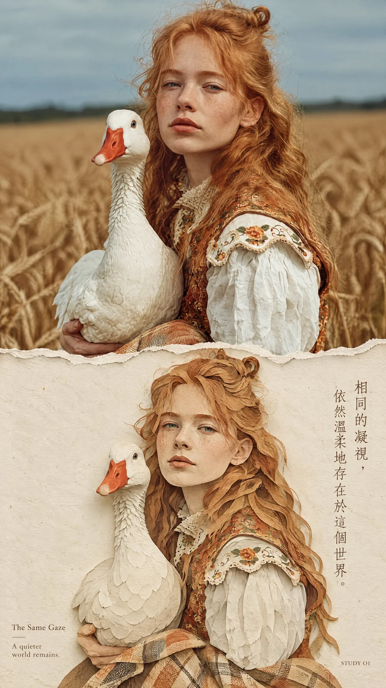

# Photo × Layered Paper Sculpture Poster (3:4)

**中文标题：** 实拍 × 多层纸雕艺术海报（3:4，需上传照片）  
**ID:** `gi25-x-1641` · **Mode:** `edit`  
**Categories:** `edit-change-preserve`, `character-consistency`  
**Tags:** `x-twitter`, `community`, `gpt-image-2.5`, `x-direct`, `en`



### Photo × Layered Paper Sculpture Poster (3:4)

```text
Create a 3:4 vertical "real photography × layered paper sculpture" art poster by uploading photos. Please create multiple photos, not combined.

The layout is 50% each, connected at natural horizontal boundaries. The original photo serves as the sole content source, preserving the subject, composition, perspective, transparency, and object's position, quantity, and spatial relationships, without adding or removing elements.

The top half preserves the real photography texture, natural light and shadow, and original colors, with only slight color correction, full-page presentation, and no text added.

The bottom half transforms the same scene into a detailed multi-layer paper sculpture, placed on a warm ivory handmade paper base. It presents thin paper layers, clear knife-cut edges, paper sides, perforated details, and soft contact shadows. The colors are derived from the original photo and reduced saturation, preserving the delicate paper texture and moderate negative space, creating a quiet and transparent museum paper texture.

The lower left corner adds a small font with the English title "[TITLE]", with a fine line and short subtitle "[SUBTITLE]"; the right side leaves a blank space with a straight calligraphy "[Traditional Chinese sentence]", and a corner note "STUDY O1". The text is clear and restrained, not obstructing the

subject.

Avoid hard seams, body deformation, irrelevant elements, plastic or CG feel, oil painting brush strokes, blurred edges, heavy black shadows, fluorescent colors, messy fonts, logos, watermarks, and frames
```

- **Recommended model:** `gpt-image-2.5-flare`
- **Settings:** _(defaults)_
- **Source:** [community](https://x.com/Ziha_ai/status/2124728480168640921) — @Ziha_ai
- **License note:** Original public X post; quoted with attribution — remix with attribution
- **Notes:** Collected directly from X; original post https://x.com/Ziha_ai/status/2124728480168640921; post text names GPT Image 2.5; discovered via X search, prompt re-verified against the original X post via api.fxtwitter.com; verified=True; needs uploaded photos; post names GPT Image 2.5 without a Flare/Sunburst variant; preview is image 1 of 3
- **Preview:** `previews/gi25-x-1641.webp`
