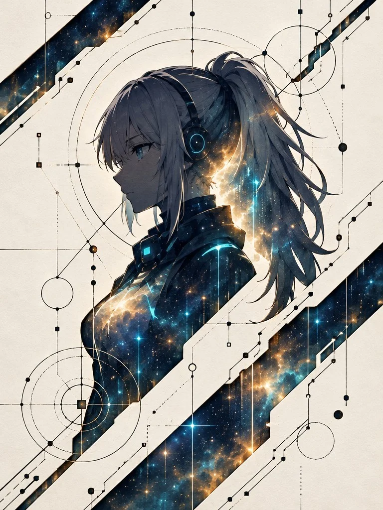

# Paper-Cut Profile: A Character Silhouette Opening onto a Circuit Void

**中文标题：** 剪纸侧影：纸上挖出的角色轮廓通向电路虚空（需上传角色图）  
**ID:** `gi25-x-1647` · **Mode:** `edit`  
**Categories:** `edit-change-preserve`, `character-consistency`  
**Tags:** `x-twitter`, `community`, `gpt-image-2.5`, `x-direct`, `en`



### Paper-Cut Profile: A Character Silhouette Opening onto a Circuit Void

```text
A flat graphic illustration built from four stacked layers, vertical frame.
Deepest layer: a dreamlike void that reads both as deep space and as a digital realm — dark indigo depths with drifting amber and cyan light, soft nebula haze and faint grids of light.
Paper layer: a sheet of white paper covers almost the whole canvas. Light seeping up from the deepest layer gives the paper a faint warm tint, warmest near its openings.
Middle layer, the openings in the paper: the paper is split by straight, clean-edged tears. Along these tears, circuit-like cracks run through the paper on 45-degree diagonals from upper right to lower left: thin trace lines with branching nodes and small square pads, slicing the white sheet. Through every opening, the deepest layer shows.
The referenced character lives in this same paper layer. The face, hair, clothes, and body of the referenced character stay as in the reference; do not change them. Hair, a mantle, cables, or any other forms present in the reference also stay as they are. The character's strict left-facing profile silhouette, from the waist up, is cut out of the white paper as an opening in the central vertical third of the frame. Through this silhouette the deepest layer is visible — the dark void with its amber and cyan light, brightest where the light of the void gathers behind the torso and behind the base of any hair, mantle, cables, or other trailing forms present in the reference. The outline is the crisp cut edge of the paper. Circuit cracks run from the edges of the silhouette out across the paper.
Foreground layer: the circuit schematic advances toward the viewer and floats in front of the paper — ultra-fine black lines and slightly distorted, imperfect rings and circles, gently warped, overlapping the character's silhouette and the paper.
Palette: white paper with a warm tint, indigo, black, amber, cyan.
The canvas holds only drawn shapes and lines.
```

- **Recommended model:** `gpt-image-2.5-sunburst`
- **Settings:** _(defaults)_
- **Source:** [community](https://x.com/syouda_awajisim/status/2124897200769769502) — @syouda_awajisim
- **License note:** Original public X post; quoted with attribution — remix with attribution
- **Notes:** Collected directly from X; prompt posted as the author's own reply https://x.com/syouda_awajisim/status/2124897200769769502 to https://x.com/syouda_awajisim/status/2124897147594461265, which carries the images; GPT Image 2.5 is named in the reply; discovered via X search, prompt re-verified against the original X post via api.fxtwitter.com; verified=True; needs an uploaded character reference; prompt posted as the author's self-reply; the parent hook does not name the model, but a follow-up reply (2124898278739472413) names GPT Image 2.5 Sunburst; the author asks to keep the English prompt (a Japanese translation changed the result); preview is parent image 1
- **Preview:** `previews/gi25-x-1647.webp`
