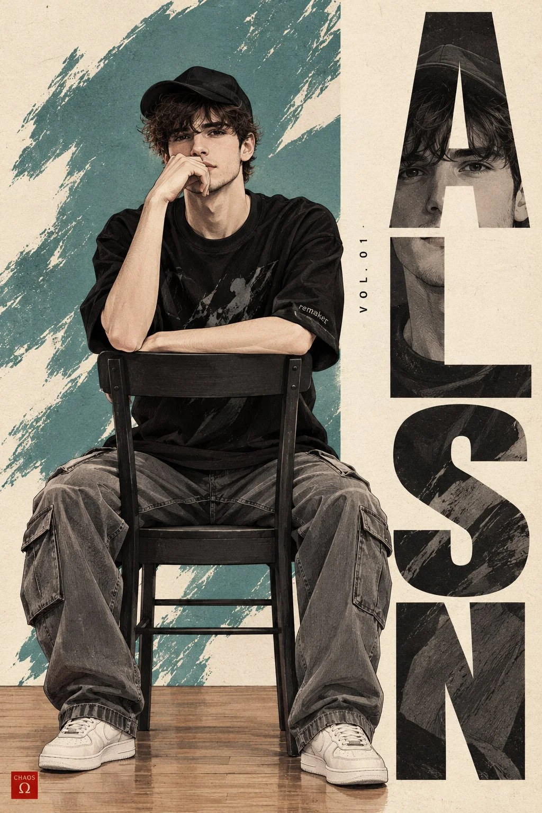

# Split Typographic Portrait Poster: ALSN Letter Windows (2:3, English)

**中文标题：** 左右分栏字体肖像海报：ALSN 字母窗（2:3 英文提示词，需上传照片）  
**ID:** `gi25-x-1648` · **Mode:** `edit`  
**Categories:** `edit-change-preserve`, `poster-typography`  
**Tags:** `x-twitter`, `community`, `gpt-image-2.5`, `x-direct`, `en`



### Split Typographic Portrait Poster: ALSN Letter Windows (2:3, English)

```text
Create one image of an young man in her twenties with long flowing dark hair, slender poised build, wearing an oversized black graphic tee with no readable text, grey baggy cargo jeans, white sneakers and a plain black cap. 

FACE REFERENCE: match the facial structure, skin tone, and hairline from the uploaded reference photo, rendered authentically in the chosen artistic style. 

POSE (highest priority, keep exactly): sitting backwards astride a plain chair with the chest against the backrest, forearms folded on top of the backrest, one hand raised to the mouth, head tilted. 

FRAMING: full body, feet near the bottom edge, figure centered. 

CAMERA: eye level, front view. MEDIA: a typographic portrait poster: the person and large display lettering are designed together as one bold graphic layout with strong contrast and clean shapes, the person sharp and readable designed as a split typographic portrait: the frame is divided vertically through the middle of the face, the image of the person fills one side and the other side is a tall column on a plain off-white or solid-color ground; the word "ALSN" in huge ultra-condensed bold sans-serif capitals stacked vertically one letter per row (or rotated ninety degrees), filling the full height of that column, the letterforms cut out like windows so the same image of the person shows through them; small "VOL. 01" in fine widely spaced capitals rotated along the inner edge. 

STYLE: Render an adult Indonesian woman in her twenties with long flowing dark hair, slender poised build as a flat graphic street illustration: clean simplified shapes with thin dark linework, flat color fills with at most one hard shadow tone, a slightly stylized face with minimal features, true to the subject’s age, and a muted, sun-faded palette of cream, dusty teal and warm grey cut by one loud accent color. The background is a plain painted wall marked by big rough brush-stroke shapes in the accent color, abstract and without readable letters. Subtle paper grain, calm poster-like composition, generous negative space. 

SETTING: a bright old European apartment of tall white double windows, sheer curtains, a warm wooden plank floor, a beige sofa, a glass coffee table and a black floor lamp; keep the style’s rendering, but use this setting in place of any background or place the style describes. Subtle signature detail: the tiny mark "remaker" appears naturally subtly embroidered on a garment cuff. Aspect ratio 2:3. In the bottom-left corner, one small solid bright red square seal with the white letters "CHAOS" and a small white Omega symbol (Ω) beneath them, small and crisp like an artist’s chop; it is the only text in the image. No other text, logos or watermarks. Keep anatomy, hands and joints physically plausible; exactly one person. If the style and the pose conflict, keep the pose, props, framing and camera exactly and adapt the style.

Avoid: photorealism, painterly rendering, soft gradients, 3D shading, readable lettering, graffiti words, logos, busy detail, glossy highlights, text, watermark, logo, watermark, extra people, distorted hands, extra fingers.
```

- **Recommended model:** `gpt-image-2.5-flare`
- **Settings:** _(defaults)_
- **Source:** [community](https://x.com/harboriis/status/2124901405257568556) — @harboriis
- **License note:** Original public X post; quoted with attribution — remix with attribution
- **Notes:** Collected directly from X; original post https://x.com/harboriis/status/2124901405257568556; post text names GPT Image 2.5; discovered via X search, prompt re-verified against the original X post via api.fxtwitter.com; verified=True; needs an uploaded face photo; post names GPT Image 2.5 without a Flare/Sunburst variant; exact on-image text is 'ALSN', 'VOL. 01', 'CHAOS', a small Omega symbol, and the cuff mark 'remaker'
- **Preview:** `previews/gi25-x-1648.webp`
