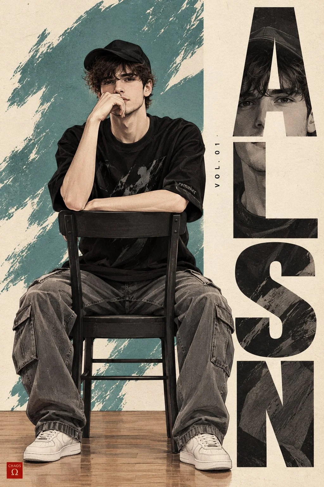

# Split Typographic Portrait Poster: ALSN Letter Windows (2:3, Chinese)

**中文标题：** 左右分栏字体肖像海报：ALSN 字母窗（2:3 中文提示词，需上传照片）  
**ID:** `gi25-x-1649` · **Mode:** `edit`  
**Categories:** `edit-change-preserve`, `poster-typography`  
**Tags:** `x-twitter`, `community`, `gpt-image-2.5`, `x-direct`, `zh`



### Split Typographic Portrait Poster: ALSN Letter Windows (2:3, Chinese)

```text
生成一张图：一位二十多岁的年轻人，留着飘逸的深色长发，身材修长挺拔，穿着一件宽松的黑色图案 T 恤（无可读文字）、灰色宽松工装牛仔裤、白色运动鞋和一顶纯黑色帽子。

脸部参考：按上传的参考照片匹配面部结构、肤色和发际线，以所选艺术风格真实呈现。

姿势（最高优先级，严格保持）：反坐在一条普通椅子上，胸口贴着椅背，前臂交叠放在椅背顶部，一只手抬到嘴边，头微微倾斜。

构图：全身，脚靠近画面下边缘，人物居中。

镜头：平视，正面。媒介：排版肖像海报——人物与大字排版共同构成一个大胆的图形版式，对比强烈、形状干净；人物清晰可读，做成左右分栏的排版肖像：画面从脸部中间垂直分成两半，一半由人物图像填满，另一半是纯米白或纯色底的高竖栏；"ALSN"四个字母用超粗的无衬线大写字母竖排，一行一个字母（或旋转九十度），填满竖栏全高，字母像窗户一样镂空，同一人物图像从字母里透出来；竖栏内侧边缘沿竖向排一行小字 "VOL. 01"，细体、字距拉开。

风格：把一位二十多岁的印度尼西亚成年女性（长发飘逸、身材修长）画成平面图形街头插画：干净简化的形状、细的深色线条、平面色块填充（最多一档硬阴影）、略带风格化的脸、五官极简、年龄感真实；配色是褪色的米色、灰青色和暖灰色，再加一个醒目的强调色。背景是一面涂了色的普通墙，上面有强调色的大块粗笔触形状，抽象、无可读字母。带一点纸纹，沉稳的海报式构图，大量留白。

场景：明亮的欧式老公寓，高高的白色双开窗、薄纱窗帘、温暖的木地板、米色沙发、玻璃茶几和一盏黑色落地灯；保留风格的画法，但用这个场景替换风格里描述的任何背景或地点。小签名细节："remaker" 这个小字自然地绣在某件衣服的袖口上。宽高比 2:3。左下角有一块小而实的亮红色方印，上面有白色字母 "CHAOS"，下面有一个小的白色 Omega 符号（Ω），小巧利落，像艺术家的印章；这是图里唯一的文字。不要其他文字、标志或水印。解剖、手和关节要符合物理逻辑；只有一个人。如果风格与姿势冲突，严格保持姿势、道具、构图和镜头，风格让步。

避免：写实摄影、绘画式渲染、柔和渐变、3D 阴影、可读字母、涂鸦文字、标志、繁忙细节、光泽高光、文字、水印、多余的人、变形的手、多余的手指。
```

- **Recommended model:** `gpt-image-2.5-flare`
- **Settings:** _(defaults)_
- **Source:** [community](https://x.com/octopusaia/status/2124928391946375453) — @octopusaia
- **License note:** Original public X post; quoted with attribution — remix with attribution
- **Notes:** Collected directly from X; original post https://x.com/octopusaia/status/2124928391946375453; post text names GPT Image 2.5; discovered via X search, prompt re-verified against the original X post via api.fxtwitter.com; verified=True; needs an uploaded face photo; Chinese counterpart of the English typographic-portrait template also posted by @harboriis in this harvest; post names GPT Image 2.5 without a Flare/Sunburst variant; exact on-image text is 'ALSN', 'VOL. 01', 'CHAOS', a small Omega symbol, and the cuff mark 'remaker'
- **Preview:** `previews/gi25-x-1649.webp`
