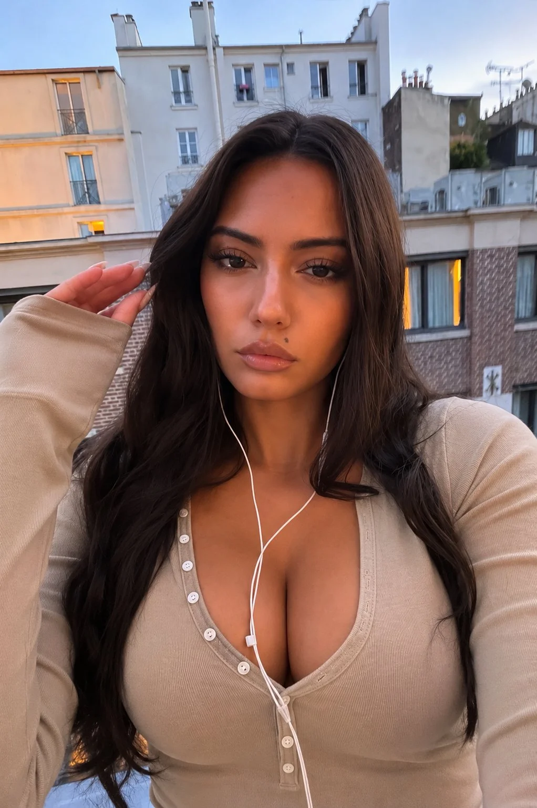

# Edit a Smartphone Selfie: Change the Top to Warm Beige (JSON)

**中文标题：** 编辑手机自拍：上衣改成暖米色（JSON）  
**ID:** `gi25-x-1662` · **Mode:** `edit`  
**Categories:** `edit-change-preserve`  
**Tags:** `x-twitter`, `community`, `gpt-image-2.5`, `x-direct`, `en`



### Edit a Smartphone Selfie: Change the Top to Warm Beige (JSON)

```text
{
  "prompt_type": "photorealistic_reference_reconstruction_with_targeted_color_modification",
  "objective": "Recreate the supplied reference photograph as closely as possible while preserving the same woman, facial features, hairstyle, expression, pose, camera angle, framing, wired earphones, European apartment buildings, evening lighting, and authentic smartphone-photo aesthetic. Apply one specific modification: change the original muted gray-green fitted long-sleeve top to a warm beige version while preserving its exact neckline, buttons, material, texture, and fit. Ignore and remove all text, buttons, captions, logos, watermarks, social-media interface elements, and screen overlays.",
  "reference_fidelity": {
    "target": "extremely high visual similarity to the supplied reference, except for the requested clothing color change",
    "priority_order": [
      "same facial identity and proportions",
      "same vertical selfie composition",
      "same direct gaze and neutral expression",
      "same long dark-brown wavy hairstyle",
      "same raised hand touching hair",
      "same wired white earphones",
      "same fitted button-front top silhouette",
      "green top changed to beige",
      "same European residential architecture",
      "same natural evening lighting",
      "same warm skin tones",
      "same realistic smartphone image quality"
    ],
    "preserve_exactly": [
      "camera perspective",
      "subject positioning",
      "facial structure",
      "body proportions",
      "hair volume",
      "hair placement",
      "pose",
      "hand positioning",
      "earphone positioning",
      "background architecture",
      "lighting direction",
      "overall color grading"
    ],
    "change_only": [
      "top color from muted gray-green to warm beige"
    ]
  },
  "canvas": {
    "orientation": "portrait",
    "aspect_ratio": "approximately 2:3",
    "output_resolution": "high resolution",
    "framing": "tight vertical smartphone selfie",
    "crop": "from slightly above the woman's head to approximately her lower torso",
    "subject_scale": "large, occupying the majority of the image",
    "subject_alignment": "centered horizontally",
    "headroom": "moderate space above the subject showing buildings and evening sky",
    "bottom_crop": "lower torso partially cropped by the bottom edge",
    "camera_distance": "approximately arm's length",
    "visual_character": "authentic casual social-media photograph"
  },
  "scene": {
    "location": "outdoor balcony, rooftop terrace, or elevated residential space overlooking European apartment buildings",
    "architectural_style": "traditional European urban residential architecture with subtle Parisian influences",
    "time_of_day": "early evening, shortly before sunset or during soft blue hour",
    "weather": "clear and calm",
    "atmosphere": "quiet, intimate, warm, relaxed, slightly cinematic without appearing professionally staged",
    "background_complexity": "moderate, with recognizable apartment facades and window details"
  },
  "subject": {
    "description": "adult woman taking a casual outdoor selfie",
    "age_appearance": "early-to-mid 20s",
    "position": "center foreground",
    "body_visibility": "head, neck, shoulders, chest, arms, and upper torso",
    "physique": "naturally proportioned adult feminine build",
    "pose": {
      "head": "upright with a subtle natural tilt",
      "face_orientation": "almost directly facing the camera",
      "gaze": "looking directly into the camera lens",
      "expression": "calm, composed, slightly serious, with a soft neutral pout",
      "mouth": "closed",
      "shoulders": "relaxed",
      "torso": "front-facing with a slight natural rotation",
      "viewer_left_arm": "raised, with the hand gently touching or adjusting hair beside the head",
      "viewer_right_arm": "extended forward and partly cropped, suggesting the phone is being held for the selfie",
      "posture": "natural and relaxed"
    },
    "skin": {
      "tone": "warm light-to-medium tan",
      "undertone": "golden-neutral",
      "finish": "natural satin with subtle luminosity",
      "texture": "realistic fine pores, tiny imperfections, and natural tonal variation",
      "cheeks": "soft peach-pink warmth",
      "highlights": "subtle natural highlights along forehead, nose, cheeks, collarbones, and upper chest",
      "retouching": "light and believable",
      "important": "Preserve the original skin tone and natural lighting without excessive smoothing or artificial beauty filtering."
    }
  },
  "face": {
    "identity_instruction": "Preserve the facial appearance from the reference photograph as closely as possible. Do not intentionally redesign facial features.",
    "shape": "soft oval with naturally defined cheekbones",
    "forehead": "medium height",
    "jawline": "softly tapered",
    "chin": "small and gently rounded",
    "eyes": {
      "shape": "almond-shaped",
      "color": "warm dark brown",
      "size": "medium-large",
      "orientation": "directly toward the camera",
      "lashes": "long, dark, curled, and defined",
      "eyeliner": "subtle dark lash-line definition",
      "eyeshadow": "soft neutral brown",
      "catchlights": "small natural reflections from the evening sky"
    },
    "eyebrows": {
      "shape": "full, gently arched",
      "color": "dark brown",
      "density": "medium-full",
      "finish": "groomed but natural"
    },
    "nose": {
      "shape": "straight and softly refined",
      "bridge": "medium-narrow",
      "tip": "softly rounded"
    },
    "lips": {
      "shape": "full with a softly defined cupid's bow",
      "upper_lip": "naturally sculpted",
      "lower_lip": "slightly fuller",
      "color": "muted rosy nude",
      "finish": "soft satin with subtle natural gloss",
      "expression": "closed and relaxed"
    },
    "makeup": {
      "style": "natural soft glam",
      "complexion": "smooth but realistic",
      "eyeshadow": "soft brown-neutral tones",
      "lashes": "defined and slightly elongated",
      "blush": "subtle warm peach",
      "contour": "soft natural definition",
      "lips": "nude-pink satin finish"
    }
  },
  "hair": {
    "color": "deep chocolate brown, almost black in shaded areas",
    "length": "very long, extending below the chest",
    "style": "loose voluminous waves",
    "part": "clean center part",
    "roots": "smooth and relatively flat near the scalp",
    "mid_lengths": "soft natural S-shaped waves",
    "ends": "loose flowing waves",
    "volume": "moderately full with noticeable body around the shoulders",
    "texture": "smooth and glossy with individual strands visible",
    "placement": {
      "viewer_left": "hair falls across the left shoulder and chest, with the raised hand gently touching the upper section",
      "viewer_right": "long wavy sections cascade over the right shoulder and down the front"
    },
    "shine": "soft reflected evening light",
    "flyaways": "a few realistic fine strands",
    "important": "Preserve the same hair color, length, part, wave pattern, volume, and placement as the reference."
  },
  "wardrobe": {
    "top": {
      "change_instruction": "Replace the original gray-green top with an identical warm beige version. Only recolor the fabric; do not change its shape, fit, construction, or neckline.",
      "type": "fitted long-sleeve henley-style knit top",
      "original_color": "muted sage gray-green",
      "new_color": "soft warm beige / light oatmeal beige",
      "recommended_color_hex": "#C7B5A2",
      "color_variation": "subtle natural light and shadow variations across the fabric",
      "neckline": "deep rounded scoop neckline with an open partial button placket",
      "button_placket": {
        "type": "vertical curved henley-style front opening",
        "placement": "center chest",
        "buttons": "several small round buttons",
        "button_color": "pale ivory or matching beige",
        "button_spacing": "evenly spaced along the opening",
        "opening": "upper buttons left open, creating the same neckline shape as the reference"
      },
      "sleeves": {
        "length": "long",
        "fit": "close-fitting",
        "wrinkles": "subtle natural folds around elbows and shoulders"
      },
      "material": {
        "type": "soft stretchy fine-knit jersey",
        "texture": "subtle natural knit texture",
        "surface": "matte with slight natural fabric reflections",
        "weight": "light-to-medium weight"
      },
      "fit": {
        "torso": "fitted and body-contouring",
        "shoulders": "natural close-fitting shoulder seams",
        "waist": "gently tapered",
        "overall": "same silhouette and proportions as the original"
      },
      "important": [
        "Keep the original neckline depth unchanged.",
        "Keep the original button placement and opening unchanged.",
        "Keep the original sleeve shape unchanged.",
        "Do not introduce decorative patterns.",
        "Use a natural beige shade rather than yellow, pink, gray, or cream-white.",
        "Preserve all realistic fabric folds and tension lines."
      ]
    }
  },
  "accessories": {
    "earphones": {
      "type": "wired in-ear headphones",
      "color": "clean white",
      "earbuds": "small white earbuds worn in both ears",
      "cable": {
        "material": "thin flexible white wire",
        "placement": "one cable descends from each ear and converges around the center of the chest",
        "movement": "natural hanging curves",
        "visibility": "clearly visible against the beige top"
      },
      "important": "Preserve the original cable routing and natural positioning."
    },
    "jewelry": {
      "necklace": "no prominent necklace",
      "earrings": "no large visible earrings",
      "rings": "no major additional jewelry",
      "instruction": "Do not add new accessories that were not present in the original reference."
    }
  },
  "hands": {
    "raised_hand": {
      "position": "viewer-left, beside the head",
      "gesture": "fingers lightly touching the hair",
      "anatomy": "natural adult hand proportions",
      "visibility": "partially cropped by the left frame edge"
    },
    "camera_arm": {
      "position": "viewer-right, extending toward the camera",
      "visibility": "forearm and sleeve partially visible",
      "perspective": "mild wide-angle enlargement due to proximity to camera"
    },
    "nails": {
      "appearance": "natural or understated neutral manicure"
    }
  },
  "background": {
    "overall": "authentic European residential cityscape at early evening",
    "upper_background": {
      "sky": {
        "color": "soft desaturated pale blue",
        "lighting": "cool natural evening ambient light",
        "clouds": "minimal"
      },
      "buildings": {
        "style": "traditional mid-rise European apartment buildings",
        "colors": [
          "warm cream",
          "light beige",
          "pale gray",
          "muted brick brown"
        ],
        "details": [
          "rectangular windows",
          "white window trim",
          "subtle decorative facade molding",
          "small balconies with dark metal railings",
          "rooftop chimney structures",
          "slightly irregular historic architecture"
        ]
      }
    },
    "viewer_left": {
      "architecture": "cream-colored multi-story building with symmetrical windows",
      "lighting": "soft cool evening light with subtle warm reflected highlights"
    },
    "center_background": {
      "architecture": "pale cream and white apartment facades",
      "windows": "several rectangular windows, some reflecting the sky",
      "depth": "buildings appear slightly farther away than the subject"
    },
    "viewer_right": {
      "architecture": "brown brick or textured apartment facade",
      "windows": "horizontal rectangular windows",
      "illumination": "small warm-yellow interior light visible through select windows"
    },
    "important": "Preserve the original buildings, perspective, architectural shapes, colors, and lighting. Do not replace the background with a different city or introduce new structures."
  },
  "lighting": {
    "instruction": "Preserve the original photograph's lighting, color grading, contrast, and white balance. The clothing recolor must integrate naturally into the existing illumination.",
    "time": "early evening",
    "primary_light": "soft natural ambient daylight",
    "secondary_light": "subtle warm reflected city light",
    "direction": "mostly frontal with a slight viewer-left bias",
    "quality": "soft and diffused",
    "contrast": "low-to-moderate",
    "skin_effect": "warm natural highlights with soft shadow transitions",
    "hair_effect": "gentle reflected highlights along the waves",
    "clothing_effect": "beige fabric should show natural shadow gradients without appearing artificially bright",
    "background_effect": "slightly dimmer than subject, with a mix of cool evening sky and warm building tones",
    "color_temperature": "neutral-warm foreground balanced against cool evening background",
    "avoid": [
      "dramatic cinematic relighting",
      "golden-hour orange color cast",
      "overexposure",
      "heavy shadow contrast",
      "cold blue tint on skin",
      "artificial studio lighting"
    ]
  },
  "camera": {
    "device": "modern smartphone front-facing camera",
    "orientation": "vertical portrait",
    "lens": "standard wide-angle selfie lens",
    "focal_length_equivalent": "approximately 24-28mm",
    "distance": "approximately 45-75 cm",
    "camera_height": "roughly eye level",
    "perspective": "natural smartphone selfie perspective",
    "focus": "sharpest on eyes and face",
    "depth_of_field": "moderately deep, with background architecture still recognizable",
    "sharpness": "realistic smartphone digital sharpness",
    "dynamic_range": "subtle HDR",
    "noise": "slight natural low-light phone-camera texture",
    "compression": "subtle social-media compression",
    "motion_blur": "minimal"
  },
  "composition_geometry": {
    "head_top": "approximately 13% from the top",
    "face_center": "approximately x=51%, y=34%",
    "eye_line": "approximately y=33%",
    "mouth": "approximately y=44%",
    "shoulder_line": "approximately y=56%",
    "neckline": "approximately y=71%",
    "torso": "center and lower half of the frame",
    "raised_hand": "viewer-left near head",
    "earphone_cables": "visible from both ears toward the center of the torso",
    "background_buildings": "occupy upper and side regions behind the subject",
    "visual_balance": "centered woman framed by slightly asymmetric European architecture"
  },
  "color_palette": {
    "dominant_colors": [
      "warm beige",
      "deep chocolate brown",
      "warm tan",
      "soft nude pink",
      "pale blue",
      "cream",
      "muted brick brown",
      "white"
    ],
    "new_top_color": "warm oatmeal beige",
    "skin": "golden-neutral tan",
    "hair": "dark chocolate brown",
    "sky": "cool muted pale blue",
    "architecture": "warm neutral cream and brown",
    "overall_saturation": "moderate-low",
    "contrast": "soft and natural",
    "white_balance": "neutral with gentle warmth"
  },
  "photographic_style": {
    "genre": "casual outdoor lifestyle selfie",
    "aesthetic": "authentic social-media portrait in a European residential setting",
    "realism": "extreme photorealism",
    "retouching": "minimal and believable",
    "production_value": "natural personal smartphone photograph rather than professional studio photography",
    "desired_result": "looks like the exact same photograph captured at the same moment, with only the top naturally recolored to beige"
  },
  "negative_prompt": [
    "green top",
    "sage green clothing",
    "olive green top",
    "dark gray top",
    "white top",
    "bright yellow top",
    "pink top",
    "different neckline",
    "different buttons",
    "different sleeve length",
    "loose oversized clothing",
    "jacket",
    "hoodie",
    "dress",
    "different woman",
    "different facial identity",
    "short hair",
    "blonde hair",
    "curly hair",
    "ponytail",
    "hair tied back",
    "different hand pose",
    "missing earphones",
    "wireless earbuds",
    "different background",
    "modern glass skyscrapers",
    "nighttime city lights",
    "studio background",
    "indoor bedroom",
    "dramatic lighting",
    "strong orange color grading",
    "cold blue skin",
    "plastic skin",
    "excessive beauty filtering",
    "uncanny facial features",
    "CGI",
    "3D render",
    "illustration",
    "anime",
    "cartoon",
    "extra people",
    "extra fingers",
    "warped hands",
    "distorted architecture",
    "text",
    "captions",
    "watermarks",
    "logos",
    "buttons",
    "UI overlays",
    "screen graphics"
  ],
  "final_generation_instruction": "Create one extremely photorealistic vertical smartphone selfie matching the supplied reference image as closely as possible. Show the same adult woman with very long dark-chocolate-brown hair parted in the middle and falling in soft waves over both shoulders. Preserve her warm tan skin, brown almond-shaped eyes, defined brows, soft natural-glam makeup, full nude-pink lips, direct neutral expression, and relaxed pose. Keep her viewer-left hand raised beside her hair, with the other arm extended toward the camera. Preserve the thin white wired earphones hanging from both ears down the center of her chest. Dress her in the exact same fitted long-sleeve henley-style knit top with the same low rounded neckline and small button-front opening, but change its color from muted gray-green to a natural warm oatmeal beige. Preserve the original fabric texture, fit, folds, neckline, and button placement. Keep the European residential cityscape behind her unchanged: cream apartment buildings, rectangular windows, warm illuminated interiors, textured brick facade, pale blue evening sky, and slightly distant architectural details. Preserve the exact lighting direction, soft evening shadows, original skin tones, image contrast, and natural smartphone color grading. Do not change anything else. Completely omit all text, buttons, captions, watermarks, logos, and interface elements."
}
```

- **Recommended model:** `gpt-image-2.5-flare`
- **Settings:** _(defaults)_
- **Source:** [community](https://x.com/jasonugc/status/2125553890754183668) — @jasonugc
- **License note:** Original public X post; quoted with attribution — remix with attribution
- **Notes:** Collected directly from X; original post https://x.com/jasonugc/status/2125553890754183668; post text names GPT Image 2.5; discovered via X search, prompt re-verified against the original X post via api.fxtwitter.com; verified=True; JSON edit prompt as posted; post names GPT-Image 2.5 without a Flare/Sunburst variant; requires a supplied reference photograph
- **Preview:** `previews/gi25-x-1662.webp`
