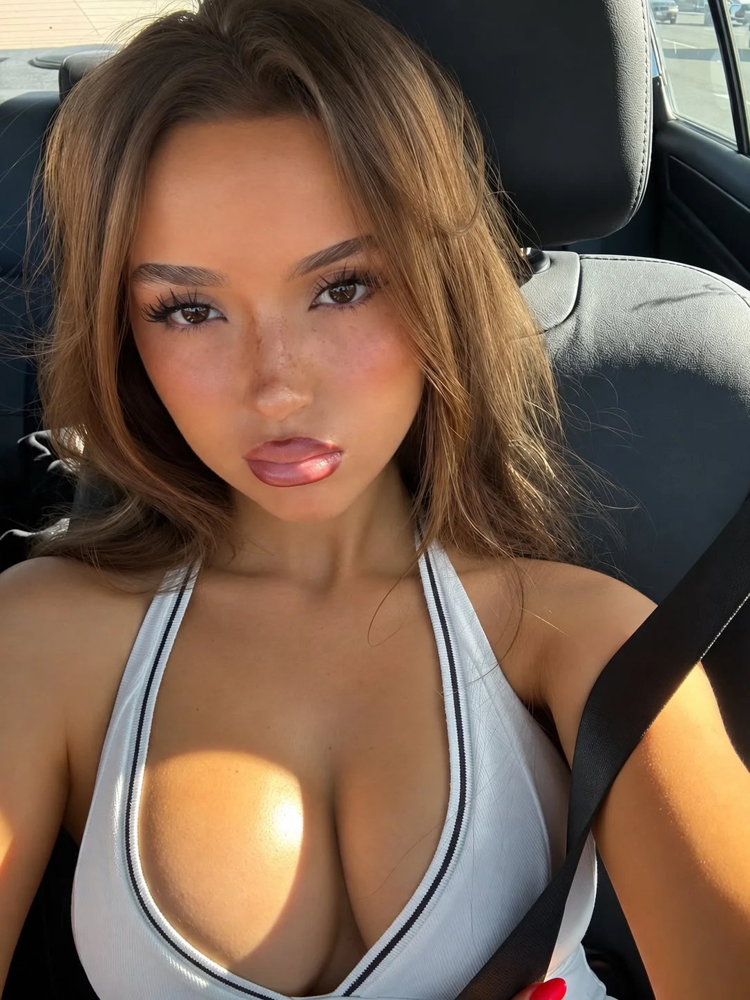

# Edit a Car Selfie: Remove the Necklace (JSON)

**中文标题：** 编辑车内自拍：去掉项链（JSON）  
**ID:** `gi25-x-1668` · **Mode:** `edit`  
**Categories:** `edit-change-preserve`  
**Tags:** `x-twitter`, `community`, `gpt-image-2.5`, `x-direct`, `en`



### Edit a Car Selfie: Remove the Necklace (JSON)

```text
{
  "task": "Recreate the attached car selfie as closely as possible. Remove all neck jewelry and omit any onscreen text, buttons, or interface elements.",
  "reference": {
    "source": "Use the attached photo as the primary visual reference for the adult woman's likeness, expression, hair, makeup, clothing, framing, light, and car interior.",
    "method": "When image editing is available, use the original photograph as the base and localize the edit to the necklace and any interface overlays. Match the original photograph's color, sharpness, and texture around the edited areas."
  },
  "necklace_removal": {
    "remove": "Erase the entire gold necklace, including the thin chain, the dangling letter charms, the small connecting rings, and any jewelry reflections or shadows.",
    "retouch": "Reconstruct the skin beneath the chain and charms from the surrounding neck, collarbone, and upper chest. Continue the existing skin texture, warm color gradients, and light falloff through the edited area.",
    "fine_details": "Preserve the loose brown hairs crossing the collarbone, especially the long curved strand at image right. Match the adjacent skin grain and natural shadow so the collarbone area looks continuous."
  },
  "canvas_and_composition": {
    "orientation": "Portrait",
    "aspect_ratio": "3:4",
    "framing": "Tight front-facing selfie from the crown of her head to the upper torso. The highest strands meet the top edge. Both arms are cropped by the sides, and the white halter continues beyond the bottom edge.",
    "subject_position": "Her face sits slightly left of center in the upper half. The dark headrest fills much of the upper-right background. The seat belt creates a strong diagonal from the middle-right edge toward the lower center.",
    "camera_position": "Close smartphone camera at roughly eye level, with a slight downward view over the shoulders and torso. Preserve the close perspective and the original off-center framing.",
    "pose": "She sits against the car seat with her shoulders angled slightly and her face turned almost square to the camera. Match the subtle head tilt, the angle of the chin, and the way the arm at image right extends toward the lower-right edge.",
    "expression": "Direct eye contact with slightly lowered eyelids and softly parted glossy lips. Preserve the reference's slight pout and relaxed brow."
  },
  "subject": {
    "likeness": "Match the visible facial geometry and proportions in the reference, including cheek contour, jawline, lip shape, eye spacing, nose shape, and natural asymmetry.",
    "hair": "Voluminous medium chestnut-brown hair with warm caramel-toned strands and deeper brown roots. Keep the loose near-center part, lifted crown, and long face-framing layers. At image left, a thick layer curves past the cheek and fans across the shoulder. At image right, straighter layers sweep beside the face and over the shoulder, with fine flyaways catching the sun.",
    "eyes": "Deep brown eyes looking directly into the lens. Match the existing catchlights, long separated upper lashes, dark definition at the upper lash line, and soft neutral eyeshadow.",
    "brows": "Full dark brown brows with clean lower edges, individual hairs visible, and a soft arch toward the outer ends.",
    "skin": "Warm tan complexion with visible natural skin texture. Preserve the fine freckles scattered across the bridge and sides of the nose and the upper cheeks, the warm flush on the cheeks, and the subtle highlight on the nose tip.",
    "lips": "Full muted rose-brown lips with a deeper lip outline, glossy pink highlights, and a small natural gap between the lips. Match the brighter reflection on the lower lip toward image right."
  },
  "clothing_and_seat_belt": {
    "top": "Fitted white ribbed halter top with a deep rounded neckline and narrow dark piping tracing both straps and the neckline. Preserve the strap placement, fabric ribbing, stitching, slight folds, and cool white appearance in the shaded areas.",
    "seat_belt": "Wide black woven seat belt crossing diagonally in front of the shoulder and torso at image right. Keep the same angle, width, edge texture, and overlap with the white top.",
    "bottom_edge_detail": "Preserve the small sliver of bright red nail visible near the bottom edge beside the seat belt."
  },
  "car_interior": {
    "headrest": "Large rounded black headrest directly behind the upper-right side of her hair, with a softly lit edge and subtle upholstery grain.",
    "seat": "Dark charcoal seatback on image right, with a bright graze of sunlight bringing out the pebbled upholstery texture near the top. Retain the original seams and contours.",
    "windows": "Keep the narrow, bright view through the upper-right window, with pavement and indistinct parked vehicles outside. Preserve the pale daylight visible through the glass in the upper-left corner.",
    "background_depth": "Most of the cabin sits in deep charcoal and black shadow. Keep enough detail to recognize the interior while preserving the stronger contrast between the cabin and the sunlit foreground."
  },
  "lighting_and_finish": {
    "light_direction": "Match the reference's warm direct sunlight entering from image right. Keep the brighter strands along the right side of the hair and the strongly lit outer edge of the right arm.",
    "sun_patch": "Preserve the distinct rounded golden patch of direct sunlight on the upper torso at image left, including its defined curved edge and brighter center. Let the adjacent shadows remain soft where they were soft in the original.",
    "face_exposure": "The face reads more evenly than the arm and torso. Keep the warm detail across the cheeks, nose, and lips, with gentle shadows beneath the hair and jaw.",
    "color_and_texture": "Photorealistic smartphone rendering with warm skin highlights, neutral dark upholstery, fine hair detail, visible freckles, and restrained sharpening. Retain the natural difference in brightness between the shaded cabin and the areas hit by direct sunlight."
  },
  "screen_cleanup": {
    "instruction": "Omit text, captions, buttons, interface bars, icons, timestamps, logos, watermarks, and other onscreen overlays."
  },
  "negative_prompt": [
    "Necklace, pendant, letter charms, chain fragments, metallic reflections, or residual jewelry shadows",
    "Smudged retouching, blurred collarbone texture, or erased loose hair strands",
    "Altered face, lighter eyes, missing freckles, changed expression, or different hair color",
    "Changed neckline, missing dark piping, missing seat belt, or repositioned seat belt",
    "Mirrored image, centered portrait crop, wider framing, or different camera angle",
    "Even studio lighting, missing sunlight patch, plastic skin, or heavy beauty filtering",
    "Text, captions, buttons, logos, watermarks, or app interface elements"
  ]
}
```

- **Recommended model:** `gpt-image-2.5-flare`
- **Settings:** _(defaults)_
- **Source:** [community](https://x.com/jasonugc/status/2125768151409549323) — @jasonugc
- **License note:** Original public X post; quoted with attribution — remix with attribution
- **Notes:** Collected directly from X; original post https://x.com/jasonugc/status/2125768151409549323; post text names GPT Image 2.5; discovered via X search, prompt re-verified against the original X post via api.fxtwitter.com; verified=True; JSON edit prompt as posted; post names GPT-Image 2.5 without a Flare/Sunburst variant; requires a supplied reference photograph
- **Preview:** `previews/gi25-x-1668.webp`
