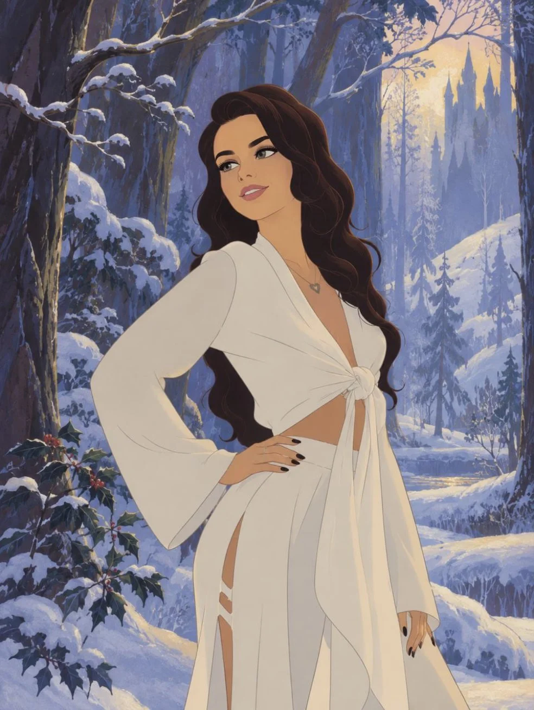

# Source Photo → Atmospheric Hand-Drawn Illustration

**中文标题：** 源照片→氛围手绘插画  
**ID:** `gi25-x-801` · **Mode:** `edit`  
**Categories:** `edit-change-preserve`, `poster-typography`  
**Tags:** `x-twitter`, `community`, `gpt-image-2.5`, `x-direct`, `en`



### Source Photo → Atmospheric Hand-Drawn Illustration

```text
Transform the source photograph into an atmospheric hand-drawn illustration in the aesthetic of Disney's classic 1959 animated film Sleeping Beauty. SOURCE PHOTO PRESERVATION: Preserve the composition of the original photograph, the exact positioning of the people, their poses, gestures, camera angle, body proportions, direction of gaze, and overall scene structure. Preserve each person's individual facial features, face shape, hairstyle, and recognizability. Do not replace the people or create a new composition; transform the original photograph into a hand-drawn animation frame. ARTISTIC STYLE: Redraw the scene as a genuine hand-drawn frame from a classic mid-20th-century animated film: elegant, crisp outlines, expressive fine linework, stylized organic shapes, flat painterly color fills, delicate rendering of faces and clothing, and decorative fairytale vegetation. The visual language should evoke traditional hand-drawn animation: lines drawn by hand, painterly backgrounds, graphic silhouettes, the slightly irregular natural quality of traditional drawing, and multilayered use of color and shadows. The image must look like an original animation frame created manually by artists, not a modern digital illustration. SEASON AND ENVIRONMENT: Completely replace the original background with an enchanted forest in [INSERT SEASON: SPRING / SUMMER / AUTUMN / WINTER]. The season must be visually obvious through the vegetation, condition of the trees, foliage, ground, atmosphere, lighting, and color palette. Regardless of the selected season, maintain the consistent fairytale visual language of the classic Sleeping Beauty. SPRING: Fresh young greenery, blooming plants, delicate flowers, soft light colors, slender branches, and a sunlit golden haze. SUMMER: Dense, lush green foliage, deep vegetation, sunbeams filtering through the leaves, warm golden light, and rich forest depth. AUTUMN: Terracotta, brown, olive, bottle-green, golden, amber, and warm orange tones, fallen leaves, and a soft golden haze. WINTER: Deep conifer-green and cool blue tones, snow, frost-covered branches, a snow-covered forest, soft diffused lighting, and silver-gold light accents. The seasonal palette must be rich, refined, and painterly, without neon colors or modern digital oversaturation. FOREST AND BACKGROUND: The background is a decorative enchanted forest inspired by medieval book illustration and the art direction of classic animation. Use elongated graceful branches, graphic leaves, decorative plants, expressive tree silhouettes, and layered forest perspective. Vegetation should look hand-drawn and stylized, not photorealistic. Add soft atmospheric perspective, a light haze in the background, and a sense of depth within the illustrated forest space. LIGHTING: Create soft fairytale lighting that naturally matches the chosen season. Light should filter through branches and foliage, creating delicate golden or season-appropriate highlights on the characters, soft translucent transitions, and deep velvety shadows. The lighting should feel cinematic while clearly looking like painted light in classic animation. CHARACTERS: Preserve the natural beauty and recognizability of the faces. Do not enlarge the eyes excessively, make the faces doll-like, or turn the people into caricatures. Add a hairstyle in the aesthetic of Princess Aurora from the classic animation: elegant, softly flowing wavy locks and carefully rendered decorative curls. The hair must look like hand-drawn animation artwork, with crisp lines, painterly color fills, and natural highlights. Individual curls and strands should be clearly rendered and organically integrated into the style of traditional 2D animation, rather than looking like voluminous 3D hair or a digital render. CLOTHING: Preserve the original style, silhouette, main shapes, and character of the people's clothing, but stylize the clothing in the aesthetic of characters from classic Disney animation.
```

- **Recommended model:** `gpt-image-2.5-sunburst`
- **Settings:** _(defaults)_
- **Source:** [community](https://x.com/rhaenvox/status/2108982113529741613) — @rhaenvox
- **License note:** Original public X post; quoted with attribution — remix with attribution
- **Notes:** Collected directly from X; original post https://x.com/rhaenvox/status/2108982113529741613; post text names GPT Image 2.5; discovered via Bin0754/gpt-image-gallery index, prompt re-verified against the original X post via api.fxtwitter.com; verified=True
- **Preview:** `previews/gi25-x-801.webp`
