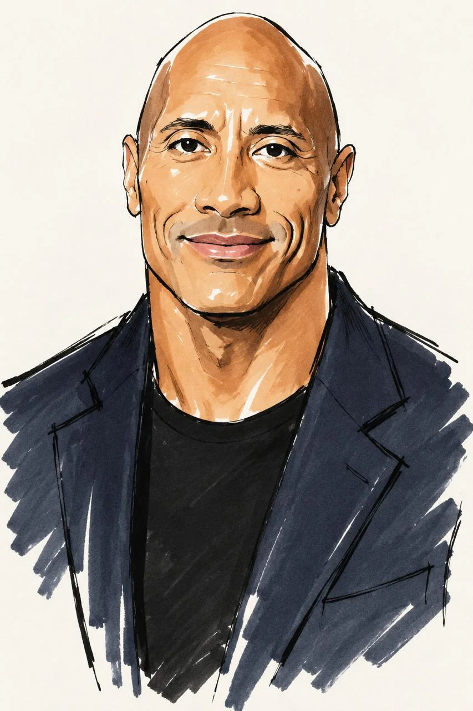

# Loose Minimalist Fashion Sketch from Photo

**中文标题：** 照片→松散极简时装速写  
**ID:** `gi25-x-832` · **Mode:** `edit`  
**Categories:** `edit-change-preserve`, `character-consistency`  
**Tags:** `x-twitter`, `community`, `gpt-image-2.5`, `x-direct`, `en`



### Loose Minimalist Fashion Sketch from Photo

```text
Redraw the person from the original photo as a very loose minimalist fashion sketch, preserving the exact original pose, camera angle, body position, gestures, direction of gaze, and composition. Do not change the pose and do not create a new scene - only transform the photograph into a quick artistic sketch. Style: loose fashion illustration, expressive marker sketch, fashion designer notebook drawing, beautiful exaggerated fashion caricature. The drawing should look as if a fashion illustrator made it in a few minutes: minimum lines, maximum expressiveness. Do not render details - convey the person only through the silhouette, a few confident contours, and large blocks of color. Use a black liner or black gel pen for very simple expressive lines: a few strokes instead of fully rendered drawing. The contours should be lively, slightly rough, uneven, and hand-drawn. Apply color with colored markers in large broad strokes. Maximum 4 colors. Do not create complex shades, shadows, or gradients. Only big color shapes and bold patches. The face should be rendered as a beautiful fashion caricature, but very minimalistically: heavily distorted fashion face proportions; huge expressive eyes extending beyond the natural boundaries of the face; the eyes indicated by only a few lines, without rendering the iris or details; eyelashes with one expressive black stroke; a small simple nose in one line; small lips with one light contour; a sharp chin; an elongated elegant face shape; a thin long neck. Do not draw the face realistically. 3:4

The best AI prompts don't just make something look different.

They make it look like a service someone could actually charge for.
```

- **Recommended model:** `gpt-image-2.5-sunburst`
- **Settings:** _(defaults)_
- **Source:** [community](https://x.com/rhaenvox/status/2110323414367961499) — @rhaenvox
- **License note:** Original public X post; quoted with attribution — remix with attribution
- **Notes:** Collected directly from X; original post https://x.com/rhaenvox/status/2110323414367961499; post text names GPT Image 2.5; discovered via Bin0754/gpt-image-gallery index, prompt re-verified against the original X post via api.fxtwitter.com; verified=True
- **Preview:** `previews/gi25-x-832.webp`
