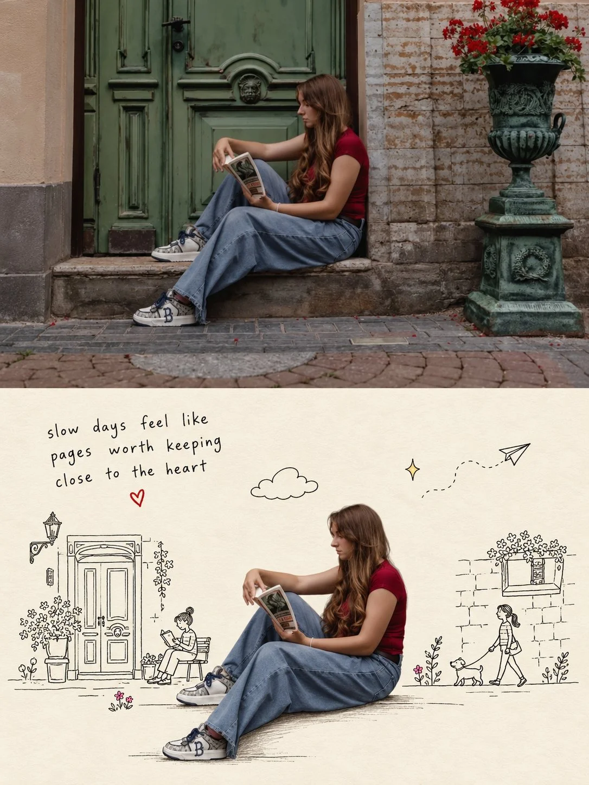

# Before/After Cut-Out Doodle Photo Panel

**中文标题：** 前后对比抠图涂鸦照片双格  
**ID:** `gi25-x-874` · **Mode:** `edit`  
**Categories:** `edit-change-preserve`, `poster-typography`  
**Tags:** `x-twitter`, `community`, `gpt-image-2.5`, `x-direct`, `en`



### Before/After Cut-Out Doodle Photo Panel

```text
Create a vertical 3:4 before-and-after image split into two stacked panels of equal height.

TOP PANEL (before): the original photograph exactly as provided, completely unedited — same subject, pose, background, colors and lighting. Full bleed to the panel edges.

BOTTOM PANEL (after): the same person or people, still fully photographic and realistic, cut out from the original photo and placed centered on a warm cream off-white paper background. Keep their face, identity, expression, pose, clothing and proportions exactly as in the photo — never illustrate, stylize, smooth or redraw the subject. Clean cutout edges including hair.

Replace the entire background with charming hand-drawn doodles in thin black pen line art — monoline, no fill, light and loose like a sketchbook, with a little character and personality in the linework.

Use about eight doodle elements, balanced across the panel. Draw one or two simplified landmarks or buildings from the original background, one on each side of the subject at small scale. Add two or three small cartoon figures doing light actions that suit the scene — riding a bicycle, walking a dog, taking a photo, waving from a shop, holding a balloon. Add three or four small accents scattered in the open areas: a cloud, a sparkle or two, a paper plane with a dotted trail, a musical note, a few flowers or small plants near the ground.

Compose it with breathing room. Keep every doodle at roughly a third of the subject's height or less, and rest the buildings and figures along a shared ground line so the panel has a clear horizon. Let the accents float higher in the empty upper corners to fill the space lightly. Leave a clear margin of untouched cream around the subject on all sides — doodles never overlap or touch them — and keep visible cream gaps between neighbouring elements so nothing clusters.

Ground the subject with a thin sketchy horizontal line under the feet with a few short hatch marks and a soft natural shadow. Keep it light, not a dense scribble.

Place a short handwritten caption in the open upper-left area: three lines, three to five words each, casual lowercase handwriting in thin black ink, warm and reflective in tone. Add one small red hand-drawn heart just below it with space around it.

Everything in the lower panel is black line on cream, except three or four tiny color accents — a red heart, pink flowers, a yellow sparkle. The subject alone stays in full photographic color.

Avoid: a cluttered or busy background, doodles filling every corner, doodles overlapping or touching the subject, large doodles rivaling the subject's size, three or more buildings, dense scribbled shadows, heavy thick linework, shading or crosshatching, long caption text, more than three lines of text, an illustrated or cartoon subject, changed face or identity, beautified skin, altered clothing or pose, colored or filled doodles, 3D rendering, side-by-side panels, watermark.
```

- **Recommended model:** `gpt-image-2.5-sunburst`
- **Settings:** _(defaults)_
- **Source:** [community](https://x.com/Ziha_ai/status/2111374785079103515) — @Ziha_ai
- **License note:** Original public X post; quoted with attribution — remix with attribution
- **Notes:** Collected directly from X; original post https://x.com/Ziha_ai/status/2111374785079103515; post text names GPT Image 2.5; discovered via Bin0754/gpt-image-gallery index, prompt re-verified against the original X post via api.fxtwitter.com; verified=True
- **Preview:** `previews/gi25-x-874.webp`
