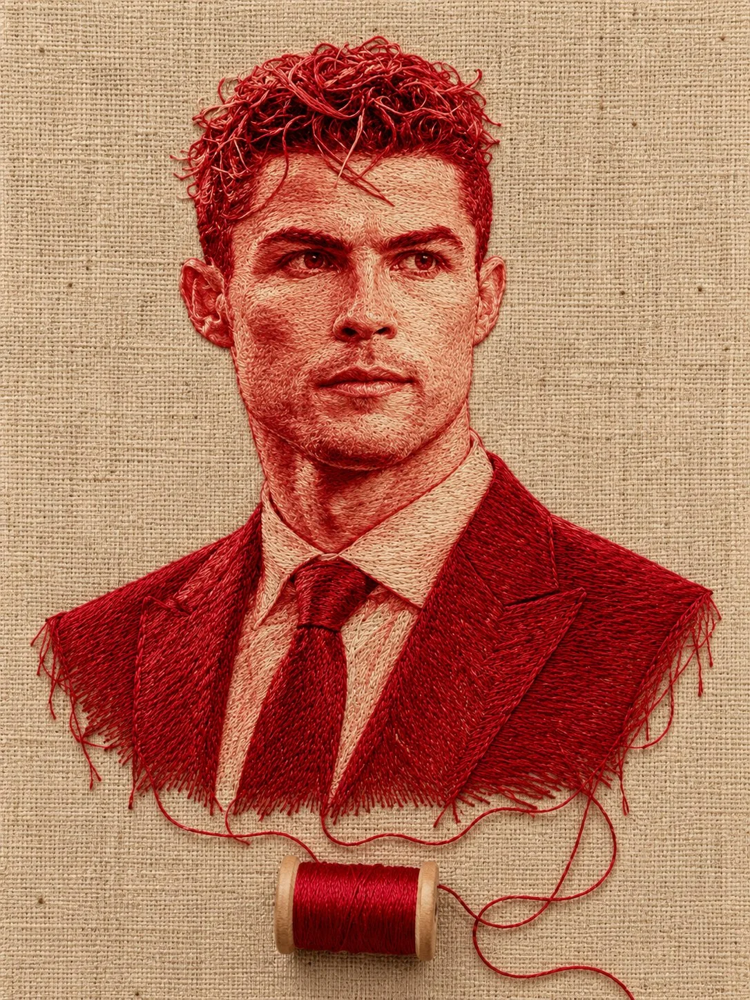

# Crimson-Thread Embroidery Portrait on Linen

**中文标题：** 亚麻布红线刺绣肖像  
**ID:** `gi25-x-878` · **Mode:** `edit`  
**Categories:** `edit-change-preserve`, `character-consistency`  
**Tags:** `x-twitter`, `community`, `gpt-image-2.5`, `x-direct`, `en`



### Crimson-Thread Embroidery Portrait on Linen

```text
Transform the uploaded photograph into an extraordinary, photorealistic textile artwork in which the entire portrait is intricately constructed from fine crimson-red sewing threads embroidered onto natural beige linen fabric.

SUBJECT & IDENTITY:
Preserve the subject’s exact facial identity, recognizable features, facial proportions, natural expression, eye shape, nose, lips, jawline, and distinctive characteristics. Recreate the subject as an intricate thread portrait, maintaining strong likeness to the original photograph. Do not beautify, cartoonize, or alter the face.

THREAD ARTWORK:
Every detail of the portrait must appear handcrafted from individual strands of deep scarlet-red, ruby-red, and crimson embroidery thread. Construct the facial contours using delicate directional stitches, fine parallel thread lines, and exceptionally precise needlework. Recreate the eyes, eyebrows, eyelashes, nostrils, lips, cheekbones, and facial shadows using carefully layered red threads of varying thickness and density.

Render the hair as spectacular, voluminous arrangements of individually visible red thread strands, with natural waves, curls, flyaway fibers, overlapping loops, and realistic three-dimensional depth. For bearded subjects, create every mustache and beard hair from thousands of fine, individually defined red fibers. Every strand must follow the natural direction and flow of the hair.

FABRIC & MATERIAL REALISM:
The artwork is stitched directly onto coarse, natural beige linen or burlap fabric. Clearly visible woven fibers, tiny irregularities, fabric grain, thread tension, individual stitches, subtle raised embroidery, and delicate contact shadows create an authentic handcrafted appearance. The red thread must physically interact with the fabric, producing realistic highlights, fine shadows, and tactile dimensionality.

SIGNATURE COMPOSITION:
Create a centered, elegant portrait with the head and hair occupying most of the frame. Let a few loose red threads naturally trail downward from the bottom of the portrait, connecting to a small, realistic wooden-sided spool of deep-red sewing thread positioned directly beneath the neck. Include a loose strand gently curling across the fabric. The spool must look physically real, with visible wound thread, wooden end caps, and soft contact shadows.

LIGHTING & PHOTOGRAPHY:
Soft, warm studio lighting from the upper left, gentle directional shadows, subtle highlights on individual thread fibers, natural beige color grading, macro textile photography, extraordinary material definition, crisp facial stitching, realistic depth of field, and premium handcrafted editorial-art quality.

VISUAL STYLE:
Photorealistic mixed-media textile portrait, hyper-detailed thread embroidery, tactile fiber art, museum-quality needlework, intricate red-on-natural-linen craftsmanship, realistic three-dimensional thread relief, sophisticated minimalist composition, professional macro photography, physically believable materials.

OUTPUT REQUIREMENTS:
Vertical 3:4 aspect ratio. Entire portrait and thread spool visible. Natural beige fabric background. Red thread only for the portrait. No ink, paint, pencil, printed outlines, digital illustration, or ordinary photographic facial skin. No typography, lettering, watermark, border, or additional decorative objects. Maximum detail, exceptional realism, clean composition.
```

- **Recommended model:** `gpt-image-2.5-sunburst`
- **Settings:** _(defaults)_
- **Source:** [community](https://x.com/Goodmanprotocol/status/2111687248118993227) — @Goodmanprotocol
- **License note:** Original public X post; quoted with attribution — remix with attribution
- **Notes:** Collected directly from X; original post https://x.com/Goodmanprotocol/status/2111687248118993227; post text names GPT Image 2.5; discovered via Bin0754/gpt-image-gallery index, prompt re-verified against the original X post via api.fxtwitter.com; verified=True
- **Preview:** `previews/gi25-x-878.webp`
