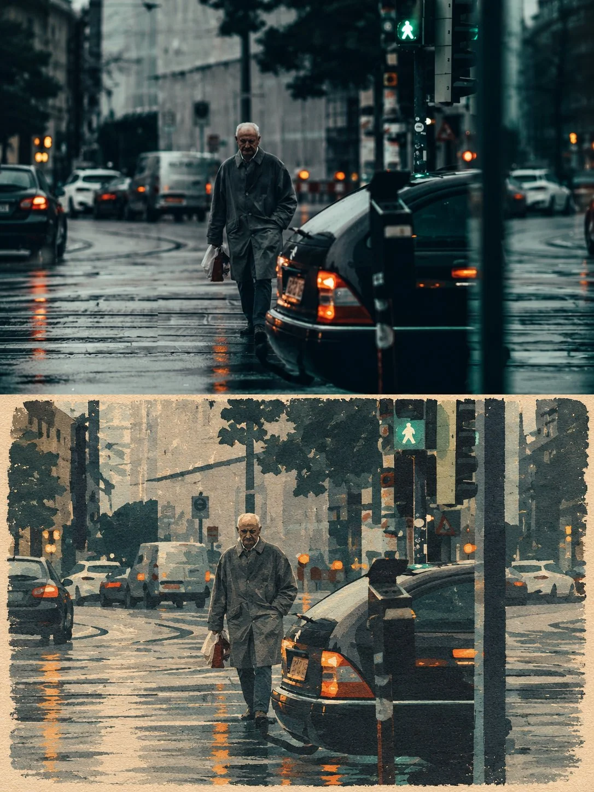

# Photo + Handmade-Paper Illustration Art-Book Poster

**中文标题：** 照片+手工纸插画艺术书海报  
**ID:** `gi25-x-920` · **Mode:** `edit`  
**Categories:** `edit-change-preserve`, `poster-typography`  
**Tags:** `x-twitter`, `community`, `gpt-image-2.5`, `x-direct`, `en`



### Photo + Handmade-Paper Illustration Art-Book Poster

```text
Create a premium cinematic art-book editorial poster using the uploaded image as the EXACT visual reference.
CANVAS & LAYOUT
- Vertical 3:4 aspect ratio
- One poster divided horizontally into two equal 50/50 sections
- Top half: original photorealistic image
- Bottom half: minimalist handmade-paper illustration of the exact same scene
- Warm ivory paper texture with subtle vintage print imperfections
- Premium independent art-book editorial aesthetic

TOP HALF — ORIGINAL PHOTOGRAPH
Reproduce the uploaded image as faithfully as possible. Preserve its original subject, identity, appearance, pose, clothing, objects, environment, background, lighting, camera angle, perspective and composition.

Do not replace the original subject with a different subject. Do not introduce unrelated objects or change the scene. If the uploaded image is already an illustration, faithfully preserve its visual appearance in the top panel rather than inventing a photograph.

BOTTOM HALF — MATCHING PAPER ILLUSTRATION
Transform the EXACT same subject and scene into a minimalist handmade-paper illustration.

Automatically adapt the illustration to the uploaded image:

- Portraits: preserve facial features, hairstyle, clothing and pose
- Animals: preserve species, markings, proportions and pose
- Cars and objects: preserve shape, color, distinctive features and orientation
- Nature and landscapes: preserve the scenery, natural elements and composition
- Buildings and city scenes: preserve architecture, perspective and surroundings
- Any other subject: retain its defining visual characteristics

Use simplified geometric shapes, layered paper-cut forms, muted natural colors, subtle distressed ink, rough printed edges and authentic handmade-paper texture. Simplify details artistically without losing the original subject's recognizability.

COMPOSITION MATCH
Keep the same subject placement, orientation, pose, major objects and visual direction in both panels. The bottom illustration must clearly represent the top image, not a different interpretation or unrelated scene.

COLOR & MOOD
Sample the dominant colors from the uploaded image and reinterpret them using a coordinated palette of muted earthy tones. Use warm ivory paper, restrained vintage print colors, delicate texture and sophisticated editorial balance. Adapt the mood to the original image.

TYPOGRAPHY
Do not invent captions, labels, signatures or random text. Leave the lower portion of the poster clean unless the user provides specific text to include.

STRICT REQUIREMENTS
Exactly two horizontal panels, each occupying 50% of the poster height. Vertical 3:4 composition. Top half preserves the uploaded image. Bottom half illustrates the same image in handmade-paper style. Maintain subject consistency and recognizable details. No extra panels, no unrelated objects, no unnecessary decorative frames, no random text, no logos, no watermark, no duplicated subjects, no distorted anatomy or geometry.
```

- **Recommended model:** `gpt-image-2.5-sunburst`
- **Settings:** _(defaults)_
- **Source:** [community](https://x.com/Ziha_ai/status/2112196499069358371) — @Ziha_ai
- **License note:** Original public X post; quoted with attribution — remix with attribution
- **Notes:** Collected directly from X; original post https://x.com/Ziha_ai/status/2112196499069358371; post text names GPT Image 2.5; discovered via X search, prompt re-verified against the original X post via api.fxtwitter.com; verified=True
- **Preview:** `previews/gi25-x-920.webp`
