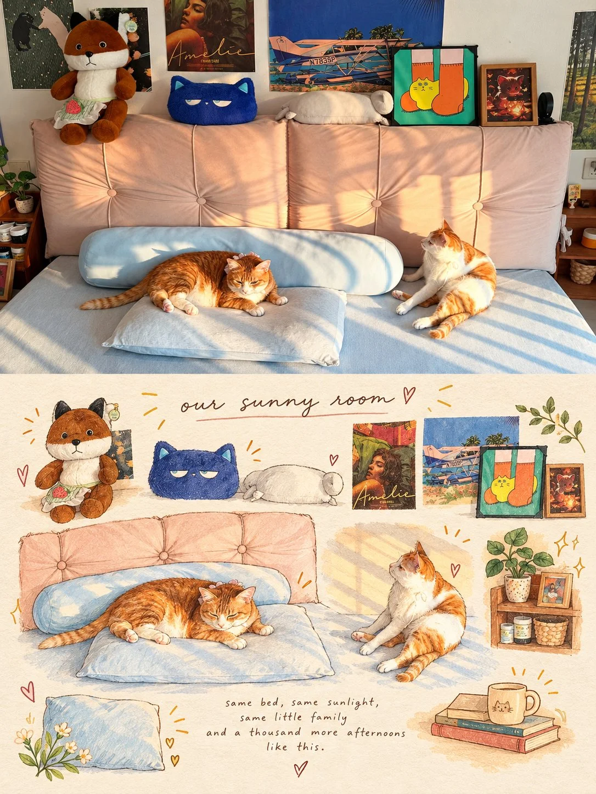

# Photo + Hand-Drawn Scrapbook Memory Poster

**中文标题：** 照片+手绘剪贴簿回忆海报  
**ID:** `gi25-x-924` · **Mode:** `edit`  
**Categories:** `edit-change-preserve`, `poster-typography`  
**Tags:** `x-twitter`, `community`, `gpt-image-2.5`, `x-direct`, `en`



### Photo + Hand-Drawn Scrapbook Memory Poster

```text
Create a vertical 3:4 editorial memory poster inspired by the uploaded photograph. Divide the composition into two horizontal sections: the top 50% preserves the original photograph with its recognizable subject, identity, pose, clothing, background, natural lighting, and realistic details. Do not redraw or stylize the top section.

The bottom 50% becomes a warm, hand-drawn illustrated scrapbook inspired by the photograph. Fill it with 7–9 small illustrations representing memorable details from the original scene, including the subject’s clothing, hairstyle, accessories, surrounding plants, flowers, trees, architecture, weather, activities, and other relevant objects. Arrange the illustrations in a balanced, playful collage with varied sizes and natural spacing.

ILLUSTRATION STYLE: Hand-drawn colored-pencil and watercolor sketches, delicate ink outlines, visible pencil strokes, imperfect artistic textures, soft coloring, charming doodles, tiny hearts, stars, arrows, and hand-drawn decorative accents. Use a warm cream-colored textured paper background with a nostalgic journal aesthetic.

COLOR PALETTE: Derive colors from the original photograph. Use soft, natural tones with subtle vintage warmth, earthy colors, and gentle highlights.

TYPOGRAPHY: Add a small handwritten title at the top of the illustrated section and a short, sentimental handwritten caption near the bottom. Keep the lettering elegant, lowercase, and naturally integrated into the artwork. Generate wording inspired by the photograph rather than using fixed text.

COMPOSITION RULES:
•Strict vertical 3:4 aspect ratio.
•Top and bottom sections occupy exactly 50% each.
•A perfectly straight horizontal division between sections.
•Original photograph remains photorealistic and unchanged.
•Bottom section contains illustrations related specifically to the uploaded image.
•Maintain a cohesive, handmade travel-journal or lifestyle-scrapbook aesthetic.
•High-quality textures, intricate sketch details, harmonious spacing, and professional editorial design.

IMPORTANT: Adapt every illustration, color, and handwritten caption to the uploaded photograph. Do not reuse objects or themes from reference examples unless they are relevant to the actual image. No extra photographs, no 3D elements, no glossy digital art, and no cluttered layout.

Result: A heartwarming, personalized photo-and-illustration poster that feels like a page from a beautifully illustrated personal diary.
```

- **Recommended model:** `gpt-image-2.5-sunburst`
- **Settings:** _(defaults)_
- **Source:** [community](https://x.com/NoravaleAI/status/2112169167701021134) — @NoravaleAI
- **License note:** Original public X post; quoted with attribution — remix with attribution
- **Notes:** Collected directly from X; prompt posted as the author's reply https://x.com/NoravaleAI/status/2112169167701021134 to https://x.com/NoravaleAI/status/2112169038667563305, which carries the images and names GPT Image 2.5; discovered via X search, prompt re-verified against the original X post via api.fxtwitter.com; verified=True; the post lists GPT Image 2.5 / Nano Banana / Grok as usable models
- **Preview:** `previews/gi25-x-924.webp`
