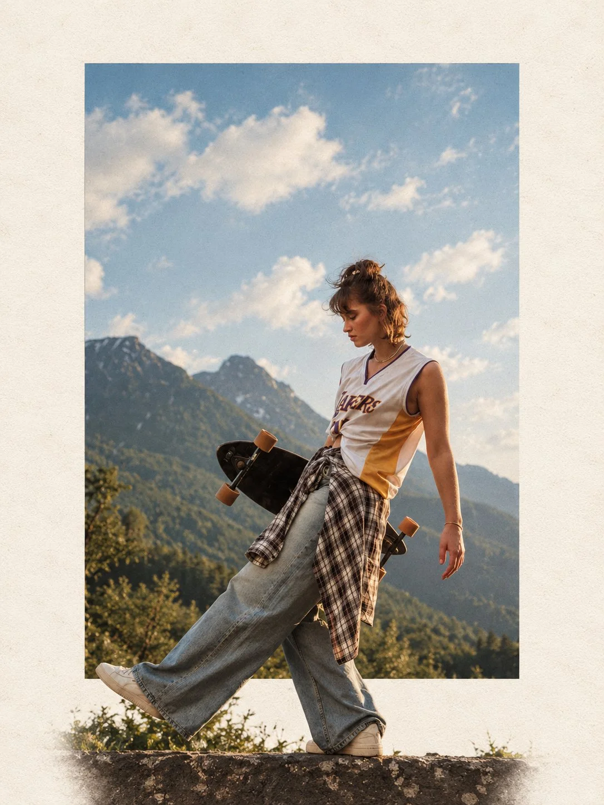

# Photo-to-Minimalist Travel Editorial Collage

**中文标题：** 照片→极简旅行杂志拼贴  
**ID:** `gi25-x-961` · **Mode:** `edit`  
**Categories:** `edit-change-preserve`, `poster-typography`  
**Tags:** `x-twitter`, `community`, `gpt-image-2.5`, `x-direct`, `en`



### Photo-to-Minimalist Travel Editorial Collage

```text
Use for portraits, people, flowers, trekking photos, and other vertical images. Canvas: strict 3:4 portrait.
Transform the uploaded photograph into a premium minimalist editorial collage inspired by luxury travel magazines, contemporary fashion editorials, and artistic outdoor photography.
FORMAT & COMPOSITION:
Create a strict 3:4 vertical canvas. Use a warm ivory/off-white background with subtle paper texture and generous negative space.
Place a large, clean-edged vertical rectangular crop of the original photograph in the center, slightly above the middle. Keep the original scenery recognizable inside the rectangle. Let the main subject naturally overlap and extend beyond the bottom edge of the rectangle into the ivory space. Where it looks natural, allow foreground flowers, grass, foliage, or rocks to extend beyond the frame as realistic photographic cutouts. Keep the layout asymmetrical but balanced, with the subject as the focal point.
PRESERVE THE ORIGINAL:
Use the uploaded photo as the source. Keep the subject as faithful to the original as possible: preserve identity, face, expression, hair, clothing, pose, proportions, colors, and distinctive details. Do not beautify, redesign, or stylize the subject. Preserve the original landscape, lighting, textures, and atmosphere. Do not crop off important parts of the subject.
STYLE:
Photorealistic premium travel editorial, minimalist Swiss-inspired art direction, warm ivory paper, muted earthy colors, dusty blues, natural greens, subtle film grain, realistic edges, and soft believable shadows.
RESTRICTIONS:
No text, typography, logos, watermarks, extra subjects, unrelated objects, illustration, cartoon effects, HDR, oversaturation, artificial glow, plastic textures, or exaggerated shadows. Do not distort proportions. If preserving the original subject conflicts with the layout, prioritize the subject.
FINAL RESULT:
A refined photorealistic editorial collage with a vertical rectangular photo and the original subject or natural foreground breaking out of the frame into the surrounding ivory negative space.
```

- **Recommended model:** `gpt-image-2.5-sunburst`
- **Settings:** _(defaults)_
- **Source:** [community](https://x.com/Ziha_ai/status/2112515912993820802) — @Ziha_ai
- **License note:** Original public X post; quoted with attribution — remix with attribution
- **Notes:** Collected directly from X; original post https://x.com/Ziha_ai/status/2112515912993820802; post text names GPT Image 2.5; discovered via X search, prompt re-verified against the original X post via api.fxtwitter.com; verified=True
- **Preview:** `previews/gi25-x-961.webp`
