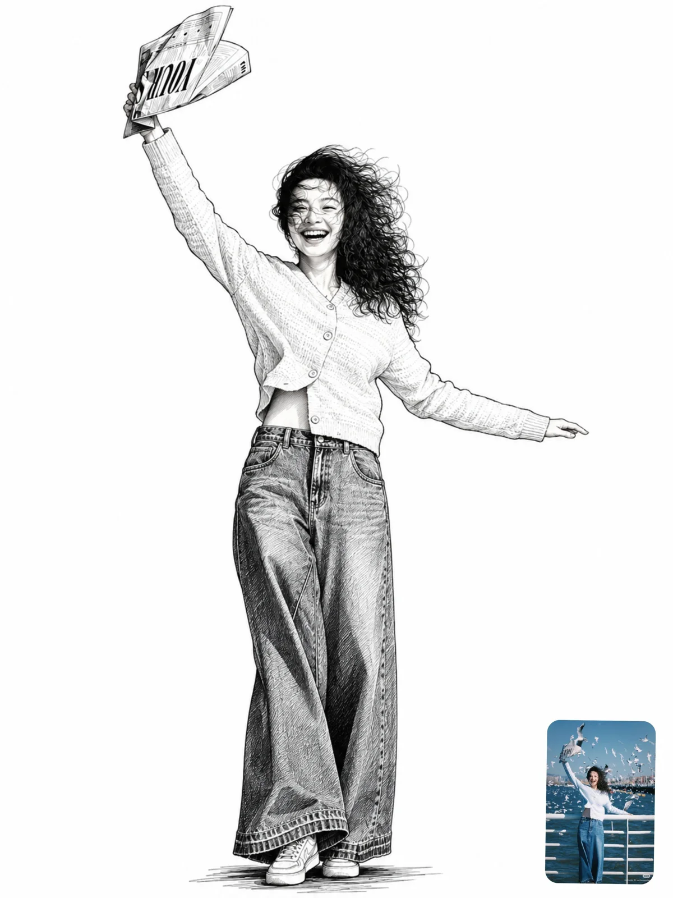

# Photo-to-Black-and-White Ink Line Illustration

**中文标题：** 照片→黑白钢笔线描插画  
**ID:** `gi25-x-962` · **Mode:** `edit`  
**Categories:** `edit-change-preserve`, `character-consistency`  
**Tags:** `x-twitter`, `community`, `gpt-image-2.5`, `x-direct`, `en`



### Photo-to-Black-and-White Ink Line Illustration

```text
Convert this photo into a detailed black-and-white ink illustration of the subject on a plain white background, 3:4 vertical.

Redraw the person or people as a hand-inked line drawing — clean confident pen lines, varying line weight, no color anywhere. Keep them full-body and centered, at the same pose, body angle and expression as the photo, with generous white space around them.

Keep the likeness. Faces must stay clearly recognizable as the same individuals: same face shape, eyes, nose, mouth, eyebrows, facial hair, hairstyle and glasses. Draw faces with lighter, finer, more restrained linework than the rest of the drawing — just enough line to describe the features, no heavy shading on the skin, no harsh outlines across the face.

Describe form with line, not gray tone. Use clean contour lines for edges, and fine parallel hatching only where a fold, shadow or texture needs it. Render dark clothing and dark objects as bold solid black fills, and light clothing as white with only its seams, folds, pleats and stitching drawn in. The contrast between solid black garments and open white ones is what gives the drawing its punch.

Keep every detail of the outfit and anything held or carried: patterns and prints on fabric, batik or lace texture, stripes, bag straps, watches, jewelry, earphone cables, shoes with their laces and soles. If the clothing has a printed graphic or logo, redraw that artwork as line illustration inside the garment rather than leaving it blank. If the subject is seated on or using an object — a chair, a bicycle, a pedicab — draw that object in full detail too, including spokes, frames and mechanical parts.

Delete the entire background. Pure white, empty, with nothing drawn behind the subject. The only grounding is a loose scribble of short horizontal pen strokes forming a soft shadow directly beneath the feet or wheels, fading out at the edges.

The finish should look like a skilled artist's ink portrait — crisp, graphic and confident, with clean edges and no smudging.

Avoid: color, gray airbrushed shading, soft gradients, pencil smudging, a photographic or partly photographic subject, a changed face or identity, a generic or idealized face, a cartoon or anime style, chibi proportions, heavy outlines across facial features, a background of any kind, scenery, buildings, a frame or border, cropped limbs, altered pose, altered clothing, missing printed graphics, text, signature, watermark.
```

- **Recommended model:** `gpt-image-2.5-sunburst`
- **Settings:** _(defaults)_
- **Source:** [community](https://x.com/harboriis/status/2112502344218988954) — @harboriis
- **License note:** Original public X post; quoted with attribution — remix with attribution
- **Notes:** Collected directly from X; original post https://x.com/harboriis/status/2112502344218988954; post text names GPT Image 2.5; discovered via X search, prompt re-verified against the original X post via api.fxtwitter.com; verified=True
- **Preview:** `previews/gi25-x-962.webp`
