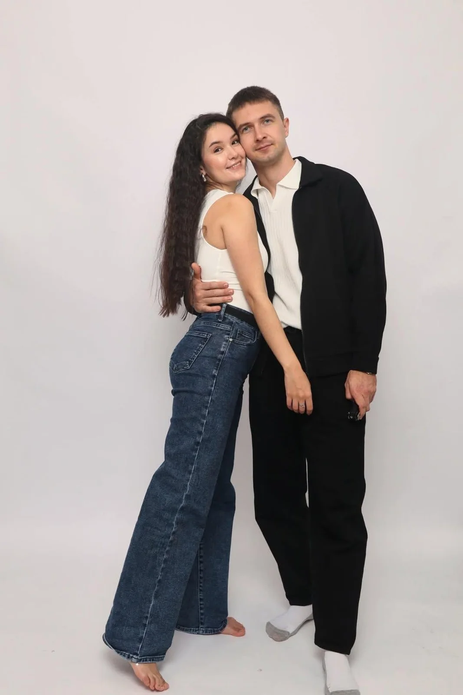

# Photo-to-Modern Naïve Illustration Poster

**中文标题：** 照片→现代稚拙风手绘海报  
**ID:** `gi25-x-981` · **Mode:** `edit`  
**Categories:** `edit-change-preserve`  
**Tags:** `x-twitter`, `community`, `gpt-image-2.5`, `x-direct`, `en`



### Photo-to-Modern Naïve Illustration Poster

```text
Draw this photo in the style of a modern, artistic naïve illustration: minimalist, hand-drawn, with playful proportions, imperfect outlines, soft yet contrasting flat colors, and decorative pencil strokes. No shadows, no gradients, no 3D effects. The overall look should resemble a premium designer poster, with a charming, whimsical, and authentic hand-drawn pencil aesthetic.
```

- **Recommended model:** `gpt-image-2.5-sunburst`
- **Settings:** _(defaults)_
- **Source:** [community](https://x.com/oggii_0/status/2113499885181747239) — @oggii_0
- **License note:** Original public X post; quoted with attribution — remix with attribution
- **Notes:** Collected directly from X; original post https://x.com/oggii_0/status/2113499885181747239; post text names GPT Image 2.5; discovered via Bin0754/gpt-image-gallery index, prompt re-verified against the original X post via api.fxtwitter.com; verified=True
- **Preview:** `previews/gi25-x-981.webp`
