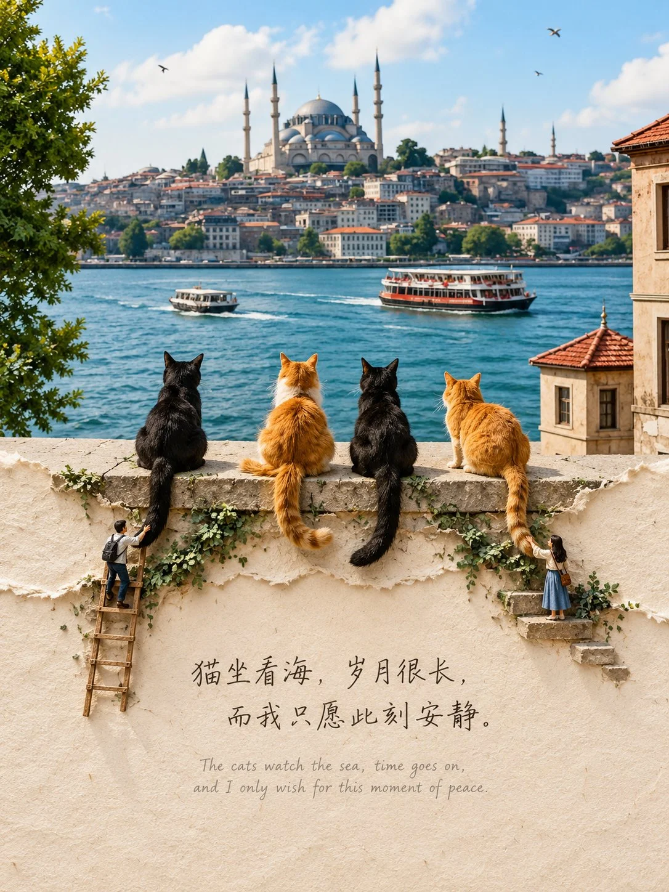

# Photo Top Half + Torn Paper Sculpture Bottom Half

**中文标题：** 上半照片+下半撕纸纸雕  
**ID:** `gi25-x-985` · **Mode:** `edit`  
**Categories:** `edit-change-preserve`, `poster-typography`  
**Tags:** `x-twitter`, `community`, `gpt-image-2.5`, `x-direct`, `en`



### Photo Top Half + Torn Paper Sculpture Bottom Half

```text
Keep the uploaded photograph photorealistic and intact in the upper half of the composition. Below the midpoint, transition into a sheet of warm cream handmade paper with an irregular, naturally torn edge. The entire lower half should remain mostly blank, with a subtle fibrous texture.

Allow one recognizable element from the original photograph to extend across the torn edge, transforming seamlessly into a three-dimensional paper-craft relief with delicate layered details and tiny projecting paper ledges. Include 2–3 miniature human figures interacting naturally with this element, creating the feeling of a meticulously crafted miniature diorama.

In the open space on the lower paper, write a short, elegant two-line Chinese poem in delicate handwritten calligraphy. Directly beneath it, add a small, understated English translation in soft grey handwritten lettering. Keep both texts beautifully spaced, legible, and harmoniously integrated into the composition.

Style & Atmosphere: Surreal photo-to-paper collage, refined paper engineering, handcrafted textures, subtle three-dimensional depth, miniature diorama artistry, soft natural daylight, delicate shadows, macro-level detail, understated elegance, and a calm, contemplative, poetic mood.

Composition: Vertical 3:4 aspect ratio. Preserve the original photograph in the upper half, create a clearly defined yet organic torn-paper transition around the midpoint, and leave generous negative space across the lower half. Maintain a sophisticated editorial aesthetic with realistic materials and seamless visual continuity between photography and paper sculpture.
```

- **Recommended model:** `gpt-image-2.5-sunburst`
- **Settings:** _(defaults)_
- **Source:** [community](https://x.com/Goodmanprotocol/status/2113903000834162787) — @Goodmanprotocol
- **License note:** Original public X post; quoted with attribution — remix with attribution
- **Notes:** Collected directly from X; original post https://x.com/Goodmanprotocol/status/2113903000834162787; post text names GPT Image 2.5; discovered via Bin0754/gpt-image-gallery index, prompt re-verified against the original X post via api.fxtwitter.com; verified=True
- **Preview:** `previews/gi25-x-985.webp`
