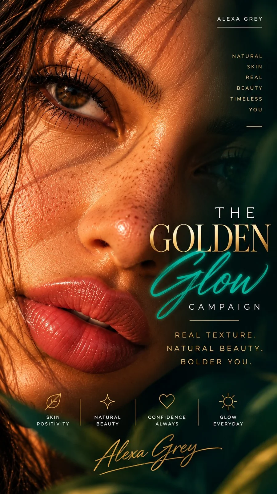

# Golden Glow Luxury Beauty Portrait from a Photo

**中文标题：** 照片→“金色光晕”奢华美妆人像  
**ID:** `gi25-x-987` · **Mode:** `edit`  
**Categories:** `edit-change-preserve`, `character-consistency`  
**Tags:** `x-twitter`, `community`, `gpt-image-2.5`, `x-direct`, `en`



### Golden Glow Luxury Beauty Portrait from a Photo

```text
Create an ultra-realistic luxury beauty portrait of the uploaded subject, preserving their exact facial identity, natural skin tone, facial proportions, hairstyle, and unique features. Use warm golden-hour sunlight, soft cinematic shadows, realistic skin pores, fine peach fuzz, natural freckles, delicate baby hairs, individual hair strands, and hydrated glossy lips with authentic texture. Capture crisp eye details using professional 85mm portrait or 100mm macro photography, shallow depth of field, and elegant champagne-gold and honey-amber tones. Keep the skin natural and unretouched—no plastic skin, excessive smoothing, artificial beauty filters, or exaggerated features. The final image should look like a premium skincare campaign photographed by a professional beauty photographer.
```

- **Recommended model:** `gpt-image-2.5-sunburst`
- **Settings:** _(defaults)_
- **Source:** [community](https://x.com/MonetizationDon/status/2112876398108901747) — @MonetizationDon
- **License note:** Original public X post; quoted with attribution — remix with attribution
- **Notes:** Collected directly from X; prompt posted as the author's reply https://x.com/MonetizationDon/status/2112876398108901747 to https://x.com/MonetizationDon/status/2112876392866033992, which carries the images and names GPT Image 2.5; discovered via Bin0754/gpt-image-gallery index, prompt re-verified against the original X post via api.fxtwitter.com; verified=True; posted as the author's reply; the intro line and closing call-to-action around the prompt are omitted; author says it was made with GPT Image 2.5 on Higgsfield
- **Preview:** `previews/gi25-x-987.webp`
