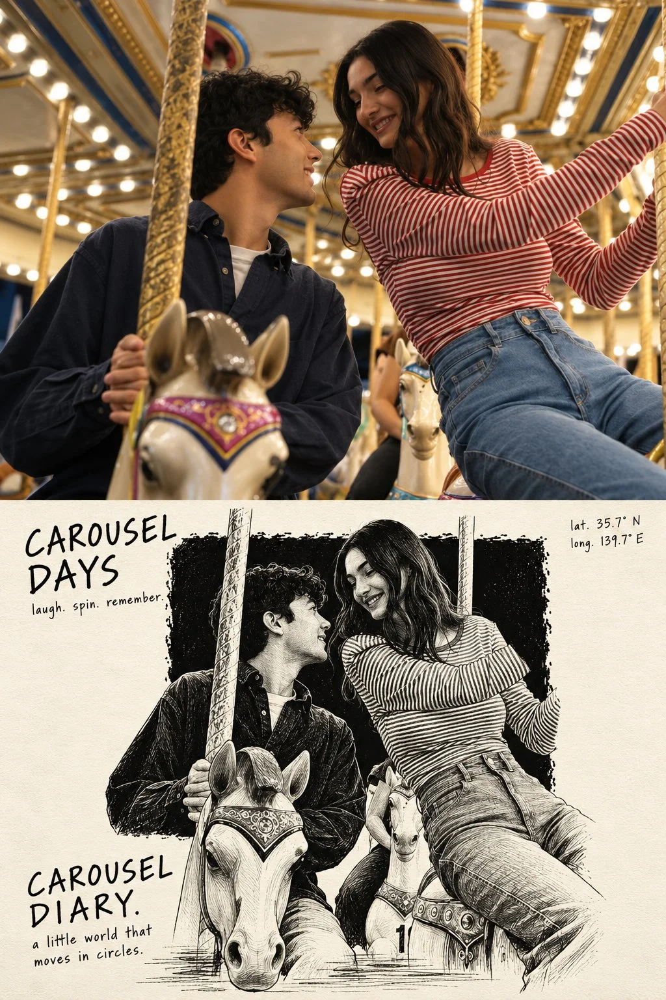

# Photo + Hand-Printed Illustration Editorial Art Poster

**中文标题：** 照片+手工版画编辑艺术海报  
**ID:** `gi25-x-988` · **Mode:** `edit`  
**Categories:** `edit-change-preserve`, `poster-typography`  
**Tags:** `x-twitter`, `community`, `gpt-image-2.5`, `x-direct`, `en`



### Photo + Hand-Printed Illustration Editorial Art Poster

```text
Create a high-resolution, vertical 2:3 editorial art poster using the uploaded reference photo.

TOP HALF: Use the original photograph full bleed, preserving the subject's identity, appearance, natural lighting, and photographic quality. Crop carefully if needed. No borders or margins.

BOTTOM HALF: On textured ivory paper, create a monochrome scratchboard illustration of only the main subject and essential accessories. Place a large, rough-edged black ink block in the center. The figure must be larger than the block, with roughly two-thirds inside it and the lower third breaking out onto the ivory paper. Add loose horizontal ink strokes beneath the feet for grounding.

Inside the black block, use fine white and light-grey etched linework. Outside it, continue the same figure in expressive black pen strokes on ivory. Ensure a seamless transition between both tonal styles. Avoid excessive hatching and unnecessary background details.

COLORS: The bottom half must use only black, white, and ivory, with subtle paper grain.

TYPOGRAPHY: Use rough, upright handwritten lettering.

- Top left: a 2 to 4 word title across two lines, followed by three short lowercase verbs separated by periods.
- Top right: latitude and longitude on two lines only.
- Bottom left: the location or theme followed by “DIARY.”, with a short descriptive sentence beneath.
- Keep all typography black on ivory, natural and imperfect, never cursive.

FINAL COMPOSITION: Exactly one standalone poster with two equal horizontal halves and one perfectly straight dividing line. Preserve the original subject's identity and proportions. Maintain generous negative space and a restrained, collectible editorial aesthetic, combining documentary photography with expressive hand-printed illustration. Print quality, 2:3 vertical aspect ratio.
```

- **Recommended model:** `gpt-image-2.5-sunburst`
- **Settings:** _(defaults)_
- **Source:** [community](https://x.com/harboriis/status/2113153634833993796) — @harboriis
- **License note:** Original public X post; quoted with attribution — remix with attribution
- **Notes:** Collected directly from X; original post https://x.com/harboriis/status/2113153634833993796; post text names GPT Image 2.5; discovered via Bin0754/gpt-image-gallery index, prompt re-verified against the original X post via api.fxtwitter.com; verified=True
- **Preview:** `previews/gi25-x-988.webp`
