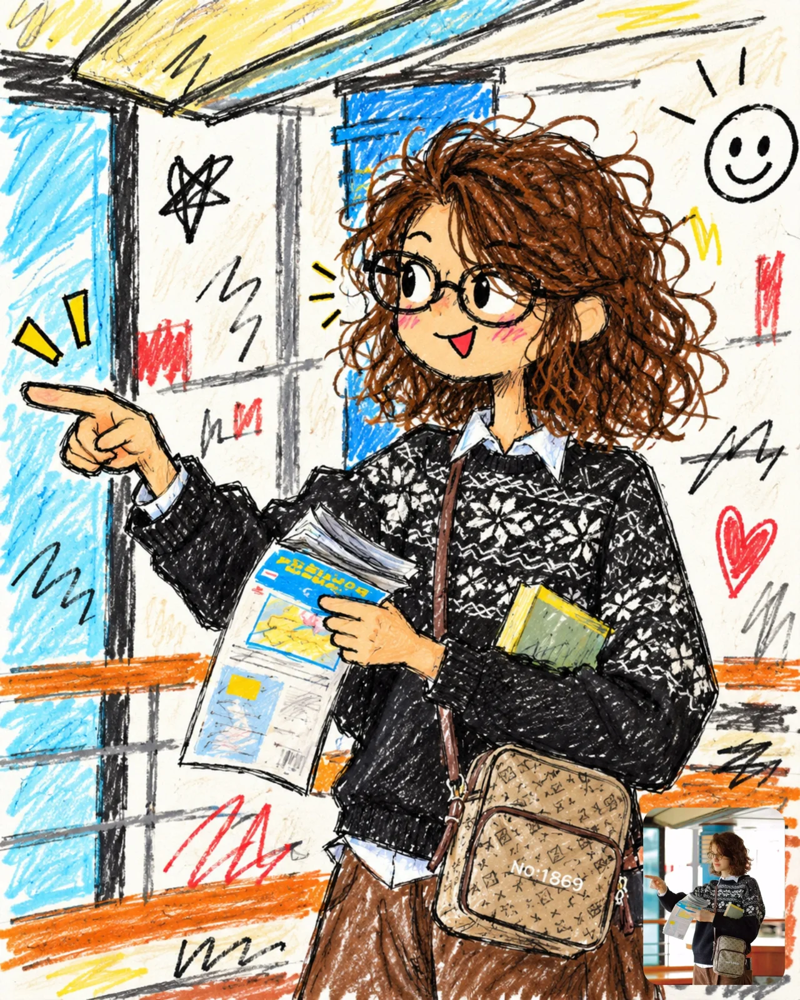

# Photo-to-Badly-Drawn Funny Doodle

**中文标题：** 照片→灵魂画手搞笑涂鸦  
**ID:** `gi25-x-989` · **Mode:** `edit`  
**Categories:** `edit-change-preserve`  
**Tags:** `x-twitter`, `community`, `gpt-image-2.5`, `x-direct`, `en`



### Photo-to-Badly-Drawn Funny Doodle

```text
Transform this photo into a badly drawn, funny doodle-style illustration. Features:
- A messy sketch that looks hastily drawn with cheap markers or crayons.
- Chaotic, rough, childish drawing style.
- Broken perspective and unnatural proportions.
- Slightly exaggerated, comical facial features.
Additional elements:
- A simple comic-style background inspired by the attached photo.
- Meaningless scribble lines and small, messy details.
- Clearly visible uneven coloring, color spilling outside the lines, and drawing strokes.
Style:
- Sloppiness that suggests it was drawn without much effort.
- Do not make it too polished.
- Silly, laughable meme style.
- A casual internet vibe.
Do not:
- Make it realistic.
- Render it too beautifully or intricately.
- Give it a professionally polished finish.
IMPORTANT: Do NOT generate the image yet. This prompt needs my photo. First reply only by asking me to upload this image.
```

- **Recommended model:** `gpt-image-2.5-sunburst`
- **Settings:** _(defaults)_
- **Source:** [community](https://x.com/Ziha_ai/status/2113465947784953958) — @Ziha_ai
- **License note:** Original public X post; quoted with attribution — remix with attribution
- **Notes:** Collected directly from X; original post https://x.com/Ziha_ai/status/2113465947784953958; post text names GPT Image 2.5; discovered via Bin0754/gpt-image-gallery index, prompt re-verified against the original X post via api.fxtwitter.com; verified=True
- **Preview:** `previews/gi25-x-989.webp`
