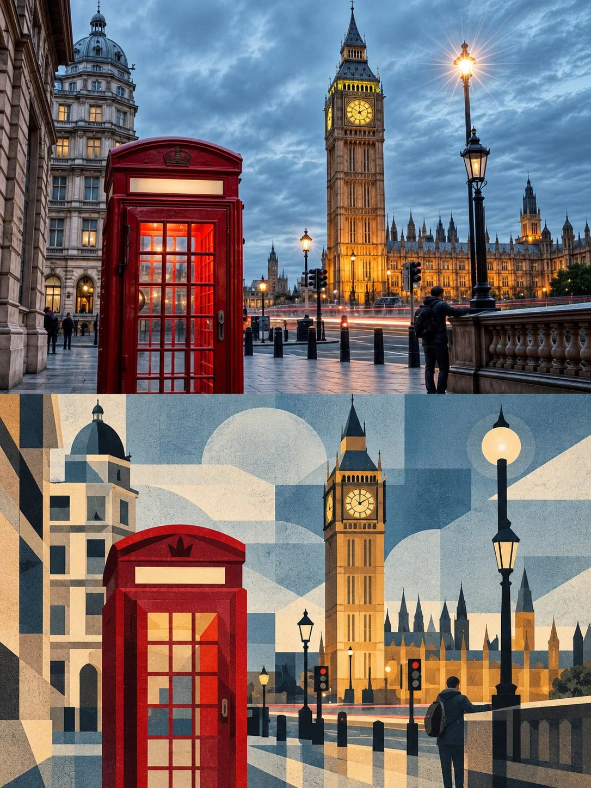

# Landmark Photo-to-Editorial Split Poster

**中文标题：** 地标照片→上下分割编辑海报  
**ID:** `gi25-x-992` · **Mode:** `edit`  
**Categories:** `edit-change-preserve`, `poster-typography`  
**Tags:** `x-twitter`, `community`, `gpt-image-2.5`, `x-direct`, `en`



### Landmark Photo-to-Editorial Split Poster

```text
Create a premium contemporary editorial poster for [LANDMARK NAME], [CITY], [COUNTRY], using the uploaded photograph of the landmark as the primary visual reference.
FORMAT AND COMPOSITION
Vertical 3:4 portrait poster, divided into two perfectly equal horizontal sections. The upper half occupies exactly 50% of the total height, and the lower half occupies the remaining 50%. Both sections must have equal heights, with a precise horizontal division at the center.
UPPER HALF — ORIGINAL PHOTOGRAPH
Preserve the original landmark photograph as faithfully as possible. Maintain the landmark’s authentic architectural identity, silhouette, proportions, distinctive structures, windows, arches, columns, rooflines, materials, and characteristic colors. Retain the original lighting, natural shadows, surface textures, perspective, and surrounding environment.
Apply subtle art-magazine color grading with refined tonal contrast, sophisticated color balance, and a contemporary fine-art photography aesthetic. If necessary, extend the background naturally to achieve the portrait composition without stretching, distorting, replacing, or altering the landmark. The photograph should feel authentic, timeless, and editorial rather than artificially enhanced.
LOWER HALF — GEOMETRIC ARCHITECTURAL ABSTRACTION
Reinterpret the same landmark as a sophisticated modular geometric illustration. Translate its most recognizable architectural features into bold, simplified geometric structures while maintaining an unmistakable visual connection to the photograph above.
Construct the illustration using large rectangles, squares, rounded squares, circles, triangles, arches, and carefully composed irregular geometric forms. Recreate the landmark’s distinctive silhouette, structural rhythm, architectural proportions, and recognizable details through overlapping blocks, layered planes, simplified facades, and carefully balanced shapes.
Avoid excessive fragmentation, tiny geometric pieces, photorealistic rendering, and generic architectural symbols. Favor fewer, larger, cohesive forms with deliberate spacing and strong compositional structure. Preserve the landmark’s unique identity rather than turning it into an interchangeable building.
COLOR AND MATERIAL LANGUAGE
Develop the illustration’s palette from the original photograph and the visual character of [COUNTRY]. Use a restrained, harmonious combination of architectural neutrals, muted heritage tones, earthy pigments, and carefully selected accent colors.
Introduce subtle paper grain, matte printed surfaces, delicate screen-print textures, and refined color overlays. Maintain a sophisticated balance between flat geometric shapes and tactile printed materials.
EDITORIAL ART DIRECTION
Create the visual quality of a collectible architecture-art exhibition poster designed for a prestigious independent art magazine. Emphasize architectural rhythm, negative space, geometric balance, precise alignment, and visual continuity between the photographic and illustrated halves.
The upper photograph and lower illustration must depict the same landmark from a consistent visual perspective wherever possible. Align major contours, dominant verticals, recognizable towers, rooflines, or other signature features across the central division to strengthen the relationship between the two halves.
The result should feel artistic, architectural, culturally distinctive, contemporary, and suitable for a high-quality art print.
STRICT RESTRICTIONS
No text, typography, letters, words, numbers, captions, slogans, logos, watermarks, signatures, labels, borders, or graphic lettering anywhere in the image. Do not add flags, decorative national symbols, or unrelated landmarks unless they are present in the original photograph. Do not modify the landmark’s authentic identity. Do not merge multiple photographs. Produce one complete, independent poster from the supplied photograph.
```

- **Recommended model:** `gpt-image-2.5-sunburst`
- **Settings:** _(defaults)_
- **Source:** [community](https://x.com/Ziha_ai/status/2113150559595438511) — @Ziha_ai
- **License note:** Original public X post; quoted with attribution — remix with attribution
- **Notes:** Collected directly from X; original post https://x.com/Ziha_ai/status/2113150559595438511; post text names GPT Image 2.5; discovered via Bin0754/gpt-image-gallery index, prompt re-verified against the original X post via api.fxtwitter.com; verified=True
- **Preview:** `previews/gi25-x-992.webp`
