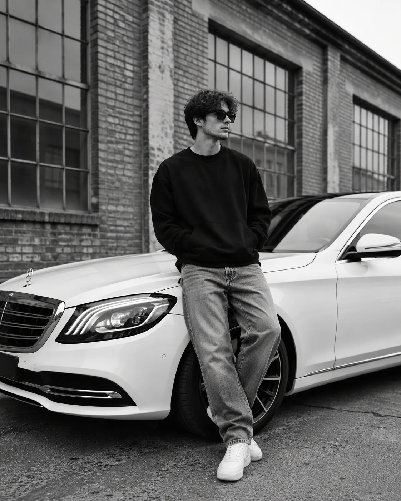

# Black-and-White Street Fashion Editorial with a Sedan

**中文标题：** 黑白街头时尚大片（倚靠轿车）  
**ID:** `gi25-x-1000` · **Mode:** `generate`  
**Categories:** `general`  
**Tags:** `x-twitter`, `community`, `gpt-image-2.5`, `x-direct`, `en`



### Black-and-White Street Fashion Editorial with a Sedan

```text
Create an ultra-realistic black-and-white fashion editorial photograph of a stylish young man casually leaning against the front of a luxury white Mercedes-Benz sedan parked on an urban street. He has medium-length, naturally wavy dark hair, wears slim black sunglasses, an oversized black crewneck sweatshirt, relaxed-fit light gray washed jeans, white crew socks, and clean white sneakers. His hands are tucked into his sweatshirt pockets, his legs are casually crossed at the ankles, and his head is turned slightly to the side with a calm, confident expression.

The car features a sleek front grille, elegant LED headlights, a sculpted white body, and polished alloy wheels. The background shows an old industrial brick building with large, multi-pane factory windows, creating a timeless urban streetwear aesthetic.

Shot from a slightly low, full-body angle, with natural overcast daylight, soft shadows, realistic fabric textures, detailed skin and hair, subtle film grain, rich monochrome tones, balanced contrast, and professional luxury fashion photography. Candid pose, minimalist styling, cinematic composition, sharp focus, authentic photographic details, vertical 4:5 aspect ratio, high resolution. No text, no watermark.
```

- **Recommended model:** `gpt-image-2.5-sunburst`
- **Settings:** _(defaults)_
- **Source:** [community](https://x.com/harboriis/status/2113498982009974823) — @harboriis
- **License note:** Original public X post; quoted with attribution — remix with attribution
- **Notes:** Collected directly from X; original post https://x.com/harboriis/status/2113498982009974823; post text names GPT Image 2.5; discovered via Bin0754/gpt-image-gallery index, prompt re-verified against the original X post via api.fxtwitter.com; verified=True
- **Preview:** `previews/gi25-x-1000.webp`
