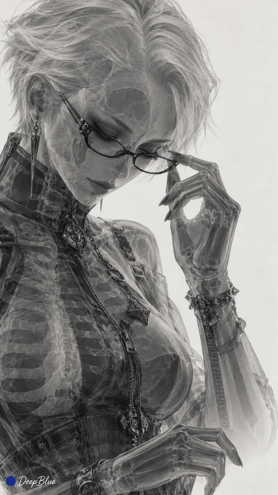

# Anime Heroines as X-Ray Radiographs Series

**中文标题：** 动漫女角色 X 光透射影像系列  
**ID:** `gi25-x-1001` · **Mode:** `generate`  
**Categories:** `general`  
**Tags:** `x-twitter`, `community`, `gpt-image-2.5`, `x-direct`, `zh`



### Anime Heroines as X-Ray Radiographs Series

```text
動漫遊戲女性角色 × X光透射攝影 × 二維透射投影 × 淺底深像 × 極簡留白

暖灰白底，角色呈細膩灰黑影像，保留標誌性髮型、原服裝輪廓與關鍵配飾。均勻透射成像，以吸收灰階取代表面明暗，灰階隨材質吸收與沿射線方向的重疊累積變化：髮絲與薄衣料淺淡，身體組織層次柔和，骨骼較深，金屬配件形成局部深色。前後結構穿透相交，細部顯隱不一，部分輕薄邊緣融入背景，整體呈平面的放射攝影印相質感。

六張各選一位廣為人知的不同女性角色，全身、半身與局部自由變化，姿態、朝向及構圖不重複。

9:16，n=6，六張獨立單圖，不拼圖。左下簽名：深藍色實心圓點在前，白色手寫體「DeepBlue」在後。
```

- **Recommended model:** `gpt-image-2.5-sunburst`
- **Settings:** _(defaults)_
- **Source:** [community](https://x.com/DeepBlueX0/status/2113116871843258767) — @DeepBlueX0
- **License note:** Original public X post; quoted with attribution — remix with attribution
- **Notes:** Collected directly from X; original post https://x.com/DeepBlueX0/status/2113116871843258767; post text names GPT Image 2.5; discovered via Bin0754/gpt-image-gallery index, prompt re-verified against the original X post via api.fxtwitter.com; verified=True
- **Preview:** `previews/gi25-x-1001.webp`
