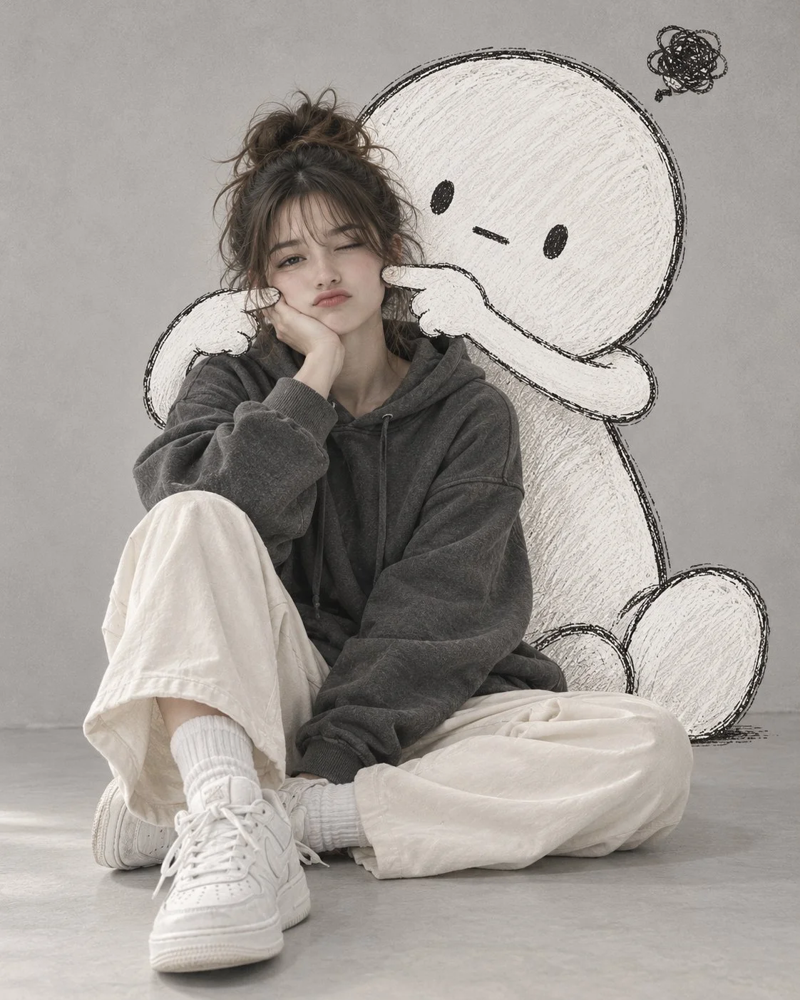

# Studio Portrait with a Giant Hand-Drawn Cartoon Character

**中文标题：** 影棚人像与巨型手绘卡通角色  
**ID:** `gi25-x-1004` · **Mode:** `generate`  
**Categories:** `general`  
**Tags:** `x-twitter`, `community`, `gpt-image-2.5`, `x-direct`, `en`



### Studio Portrait with a Giant Hand-Drawn Cartoon Character

```text
Create an ultra-realistic, cute editorial portrait of a stylish young woman sitting on a smooth light gray studio floor, playfully posing with a large hand-drawn cartoon character behind her.

Subject: A beautiful young woman with dark brown hair tied in a messy high bun, soft wispy bangs, natural makeup, and a cute pouty expression. She is wearing an oversized charcoal gray hoodie, loose cream-colored pants, white crew socks, and chunky white sneakers. She sits casually with one knee raised and the other leg folded to the side, resting one cheek on her hand while looking directly at the camera with one eye slightly squinted.

Cartoon Character: Behind her is a large, adorable white doodle character with a round head, tiny black oval eyes, a small straight mouth, and a simple rounded body. The character is drawn with rough, sketchy black outlines and lightly shaded white pencil texture. Its long cartoon arms extend around the woman, with both hands gently poking her cheeks to create a playful, squished-cheek expression. A small messy black scribble floats above its head, suggesting confusion or frustration.

Art Style: A seamless blend of photorealistic human photography and hand-drawn 2D cartoon illustration. The cartoon should look like it was sketched directly onto the photograph using a black marker and white colored pencil, with visible imperfect outlines and subtle pencil strokes.

Lighting and Background: Minimalist light gray seamless studio background, soft diffused lighting, gentle natural shadows, neutral colors, and a cozy, slightly whimsical mood.

Composition: Full-body vertical portrait, 4:5 aspect ratio, centered subject, eye-level camera angle, natural seated pose, crisp facial details, realistic fabric textures, and carefully integrated cartoon elements.

Quality: High-resolution photography, realistic skin texture, soft cinematic lighting, clean composition, charming Korean social media aesthetic.

Important: Keep the woman photorealistic. The cartoon character must remain visibly hand-drawn, with rough black outlines and a white sketch texture. Do not turn the entire image into an illustration. Avoid extra fingers, distorted hands, text, logos, watermarks, or unnecessary background objects.
```

- **Recommended model:** `gpt-image-2.5-sunburst`
- **Settings:** _(defaults)_
- **Source:** [community](https://x.com/Ziha_ai/status/2114360743131041959) — @Ziha_ai
- **License note:** Original public X post; quoted with attribution — remix with attribution
- **Notes:** Collected directly from X; original post https://x.com/Ziha_ai/status/2114360743131041959; post text names GPT Image 2.5; discovered via Bin0754/gpt-image-gallery index, prompt re-verified against the original X post via api.fxtwitter.com; verified=True
- **Preview:** `previews/gi25-x-1004.webp`
