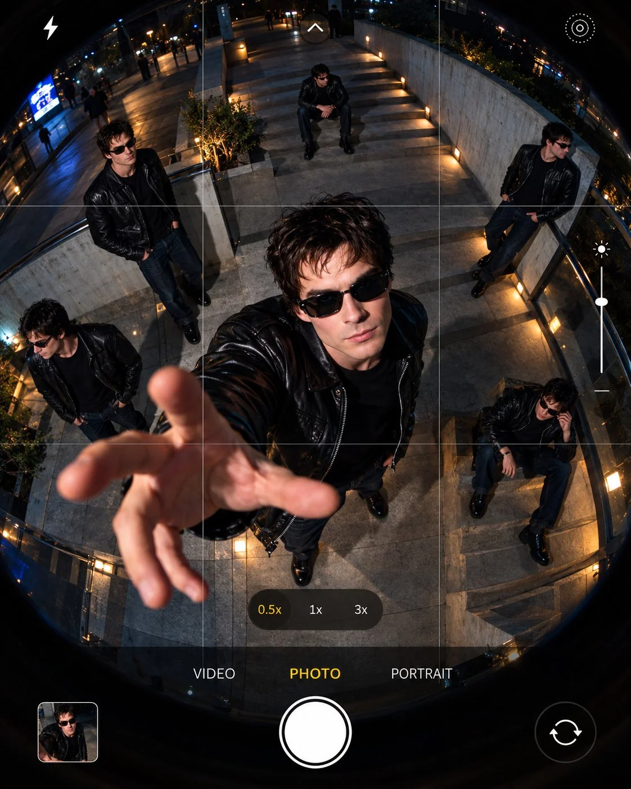

# 0.5× Fisheye POV Phone Viewfinder Shot

**中文标题：** 0.5× 鱼眼手机取景器 POV  
**ID:** `gi25-x-1008` · **Mode:** `generate`  
**Categories:** `general`  
**Tags:** `x-twitter`, `community`, `gpt-image-2.5`, `x-direct`, `en`



### 0.5× Fisheye POV Phone Viewfinder Shot

```text
Create a cinematic, hyper-realistic POV photograph captured through an extreme 0.5x ultra-wide fisheye lens, framed within a modern smartphone camera viewfinder interface. Include realistic gridlines, a flash icon, an exposure slider, zoom controls labeled “0.5x,” “1x,” and “3x,” and camera modes labeled “PHOTO,” “VIDEO,” and “PORTRAIT” at the bottom.

SCENE AND COMPOSITION:

A dramatic top-down, bird’s-eye view of [ENVIRONMENT OR LOCATION] at [TIME OF DAY]. Emphasize distinctive architectural or environmental features, sweeping shapes, multiple levels, and a strong sense of depth. Use the fisheye perspective to exaggerate spatial geometry and create an immersive composition.

SUBJECT AND STYLING:

Feature multiple identical versions of [SUBJECT] distributed naturally throughout the environment. Maintain consistent defining features, appearance, proportions, and styling across every version.

Give the subject a cool, confident appearance with stylish dark rectangular sunglasses, featuring realistic reflective lenses and a sleek, modern design that complements their overall look. Adapt the sunglasses naturally to the subject's face or features. Include [CLOTHING, ACCESSORIES, OR DISTINCTIVE STYLING] for a fashionable, effortlessly cool aesthetic.

Position the main subject prominently in the foreground center, facing toward the camera with one hand, limb, or appropriate feature reaching toward the lens. Create dramatic foreshortening and exaggerated perspective. Place additional identical versions throughout the surrounding space in varied poses, such as standing, sitting, leaning, or interacting with the environment.

LIGHTING AND ATMOSPHERE:

Combine [PRIMARY LIGHTING STYLE OR COLOR] with [SECONDARY LIGHTING TONE] to create cinematic contrast, realistic shadows, and visual depth. Add subtle reflections on the sunglasses, natural highlights, and atmospheric background details that complement the chosen location.

CAMERA AND QUALITY:

Extreme 0.5x ultra-wide fisheye perspective, overhead composition, realistic lens distortion, subtle circular-corner vignetting, sharp subject details, natural textures, high dynamic range, cinematic color grading, physically realistic lighting, premium streetwear editorial aesthetic, and 8K-level detail.

Aspect ratio: 4:5 vertical portrait.

Adapt the subject, clothing, poses, environment, and lighting to the chosen concept while preserving the stylish dark sunglasses, smartphone camera interface, dramatic fisheye perspective, and multiple-identical-subject composition.
```

- **Recommended model:** `gpt-image-2.5-sunburst`
- **Settings:** _(defaults)_
- **Source:** [community](https://x.com/Goodmanprotocol/status/2114222131362062665) — @Goodmanprotocol
- **License note:** Original public X post; quoted with attribution — remix with attribution
- **Notes:** Collected directly from X; original post https://x.com/Goodmanprotocol/status/2114222131362062665; post text names GPT Image 2.5; discovered via Bin0754/gpt-image-gallery index, prompt re-verified against the original X post via api.fxtwitter.com; verified=True
- **Preview:** `previews/gi25-x-1008.webp`
